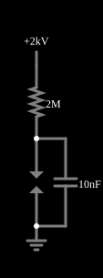

# Gerador de dente de serra com centelhador

<!-- navegacao:inicio -->
[Índice](README.md) · [Próximo: Tesla Coil](tesla.md)
<!-- navegacao:fim -->

## Objetivo

Mostrar um **oscilador de relaxação** de alta tensão: um capacitor carrega lentamente por um resistor de megaohms e descarrega de repente através de um centelhador quando a tensão atinge a ruptura, o que gera uma onda dente de serra.

## O circuito

<!-- esquema:inicio -->

<!-- esquema:fim -->

Uma fonte de $2\ \text{kV}$ carrega um capacitor de $10\ \text{nF}$ por um resistor de $2\ \text{M}\Omega$. Em paralelo com o capacitor há um centelhador de tensão de ruptura $1\ \text{kV}$, resistência de condução $10\ \text{k}\Omega$ e corrente de manutenção $1\ \text{mA}$. Um osciloscópio mostra a tensão no capacitor.

<!-- componentes:inicio -->
| N.º | Tipo | Elemento | Valores |
|----:|------|----------|---------|
| 0 | `RailElm` | voltage source | Voltage = 2k; Waveform = D/C; DC Offset (V) = 0; Internal Resistance (ohms) = 0 |
| 1 | `ResistorElm` | resistor | Resistance (ohms) = 2M |
| 2 | `SparkGapElm` | spark gap | On resistance (ohms) = 10k; Off resistance (ohms) = 1G; Breakdown voltage = 1k; Holding current (A) = 1m |
| 3 | `GroundElm` | ground | Symbol = Earth |
| 4 | `CapacitorElm` | capacitor | Capacitance (F) = 10n; Trapezoidal Approximation = sim; Initial Voltage (on Reset) = 1m; Series Resistance = 0 |
<!-- componentes:fim -->

## Teoria

O centelhador (*spark gap*) do simulador é uma chave controlada pela tensão: com resistência de **abertura** muito alta ($1\ \text{G}\Omega$) até que a tensão entre os terminais atinja a **tensão de ruptura**; a partir daí ele passa a ter a resistência de **condução**, e só volta a abrir quando a corrente cai abaixo da **corrente de manutenção**.

**Carga.** Entre $V_V$ (a tensão em que o centelhador se apaga) e a ruptura $V_B$, o capacitor carrega pela fonte através de $R = 2\ \text{M}\Omega$ com a constante $RC = 20\ \text{ms}$:

$$t_c = RC\thinspace\ln\frac{V_s - V_V}{V_s - V_B} = 20\ \text{ms}\cdot\ln\frac{2000 - 10}{2000 - 1000} = 13{,}7\ \text{ms}.$$

**Descarga.** O centelhador conduz pela resistência de $10\ \text{k}\Omega$ com a constante $R_{on}C = 0{,}1\ \text{ms}$ e se apaga quando a corrente cai a $1\ \text{mA}$, isto é, quando $V = I_{hold}R_{on} = 10\ \text{V}$ ($V_V$). O valor assintótico da descarga, $V_s R_{on}/(R + R_{on}) = 9{,}95\ \text{V}$, fica um pouco abaixo de $10\ \text{V}$, então o tempo de descarga é

$$t_d = R_{on}C\thinspace\ln\frac{V_B - 9{,}95}{V_V - 9{,}95} \approx 0{,}99\ \text{ms}.$$

O período é $T = t_c + t_d = 14{,}7\ \text{ms}$, ou $f = 67{,}9\ \text{Hz}$.

## Resultados esperados

O simulador dá, em regime permanente:

- **Frequência:** $67{,}74\ \text{Hz}$ (teoria: $67{,}9\ \text{Hz}$).
- **Tensão no capacitor:** de $10{,}0\ \text{V}$ a $1000{,}0\ \text{V}$, uma dente de serra de subida lenta ($13{,}7\ \text{ms}$) e descida rápida ($1\ \text{ms}$).
- **Corrente de pico no centelhador:** $0{,}0995\ \text{A}$ ($1000\ \text{V}/10\ \text{k}\Omega$).

## O que observar

A forma de onda do osciloscópio é uma dente de serra exponencial: a subida é uma curva de carga de $RC$ e não uma reta, porque a fonte de $2\ \text{kV}$ está muito acima da ruptura e só o trecho inicial da exponencial é percorrido. Aumente o resistor e a frequência cai na proporção.

## Limites do modelo

- O centelhador é um modelo de chave com histerese; um centelhador real tem tempo de formação do arco, tensão de arco e desionização, que o simulador não modela.
- A tensão de ruptura é fixa; na realidade ela varia com a distância, a pressão e a umidade.

## Referências

Kuffel, Zaengl e Kuffel, *High Voltage Engineering: Fundamentals*, capítulos sobre ruptura de gases e geradores de impulso; Marx, *Eine neue Methode zur Erzeugung hoher Spannungen*, Elektrotechnische Zeitschrift (1924).

O circuito deste exemplo faz parte da coleção do simulador original de Paul Falstad e Iain Sharp (CircuitJS1); a explicação é deste projeto.
