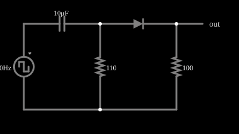

# Gerador de pulsos agudos

<!-- navegacao:inicio -->
[Índice](README.md) · [Anterior: Blocking Inductive Kickback](inductkick-block.md) · [Próximo: AM Detector](amdetect.md)
<!-- navegacao:fim -->

## Objetivo

Mostrar como um circuito diferenciador seguido de um diodo gera, a partir de uma onda quadrada, uma sequência de pulsos agudos de uma só polaridade, um por ciclo.

## O circuito

<!-- esquema:inicio -->

<!-- esquema:fim -->

Uma onda quadrada de $\pm 5\ \text{V}$ e $40\ \text{Hz}$ alimenta um capacitor de $10\ \mu\text{F}$ em série com um resistor de $110\ \Omega$ para a terra (um diferenciador); do nó entre eles, um diodo leva à saída, com uma carga de $100\ \Omega$.

<!-- componentes:inicio -->
| N.º | Tipo | Elemento | Valores |
|----:|------|----------|---------|
| 0 | `VoltageElm` | square wave gen | Max Voltage = 5; Waveform = Square Wave; DC Offset (V) = 0; Internal Resistance (ohms) = 0; Show Voltage = não; Specify As = Frequency/Duty Cycle; Frequency (Hz) = 40; Phase Offset (degrees) = 0; Duty Cycle = 50; Rise/Fall Time (s) = 0 |
| 1 | `ResistorElm` | resistor | Resistance (ohms) = 110 |
| 2 | `DiodeElm` | diode | Model = default |
| 4 | `CapacitorElm` | capacitor | Capacitance (F) = 10μ; Trapezoidal Approximation = sim; Initial Voltage (on Reset) = 1m; Series Resistance = 0 |
| 5 | `OutputElm` | output | Show Voltage = não |
| 6 | `ResistorElm` | resistor | Resistance (ohms) = 100 |
<!-- componentes:fim -->

## Teoria

O diodo do simulador (modelo "default") segue a equação de Shockley,

$$i = I_s\left(e^{v/(nV_T)} - 1\right),\qquad I_s = 1{,}714\cdot 10^{-7}\ \text{A},\quad n = 2,\quad V_T = 25{,}865\ \text{mV},$$

sem resistência série. Para uma corrente $i \gg I_s$ a tensão é $v = nV_T\ln(i/I_s + 1)$, que dá $0{,}806\ \text{V}$ em $1\ \text{A}$, $0{,}568\ \text{V}$ em $10\ \text{mA}$ e $0{,}449\ \text{V}$ em $1\ \text{mA}$: a tensão cresce $nV_T\ln 10 = 119\ \text{mV}$ a cada década de corrente. Para $v < 0$ a corrente tende a $-I_s = -0{,}17\ \mu\text{A}$.

## Resultados esperados

Na borda da onda quadrada, o capacitor mantém sua tensão e o salto $\Delta V = 10\ \text{V}$ aparece sobre o resistor, que depois decai com $\tau = RC \approx 1{,}1\ \text{ms}$ (veja o diferenciador). O diodo só deixa passar para a carga a parte positiva, isto é, os pulsos das bordas de **subida**; os pulsos negativos (bordas de descida) são bloqueados. O pulso na carga tem pico $\Delta V - v_D(i)$, em que $v_D$ é a queda do diodo na corrente do pulso, e largura da ordem de $\tau$, bem menor que o semiperíodo ($12{,}5\ \text{ms}$).

## O que observar

A integração numérica independente (passo de $2\ \mu\text{s}$) dá, em regime:

| grandeza | valor |
|:---------|------:|
| pico do pulso na carga | $9{,}30\ \text{V}$ |
| tensão na carga entre os pulsos | $\approx 0$ |
| pico positivo no resistor de $110\ \Omega$ | $9{,}98\ \text{V}$ |
| pico negativo no resistor de $110\ \Omega$ | $-9{,}99\ \text{V}$ |
| queda máxima do diodo | $0{,}683\ \text{V}$ |

(o simulador, com passo de $5\ \mu\text{s}$, lê o pico do pulso $0{,}3\%$ abaixo, pois a borda cai entre dois passos). O pico na carga, $9{,}30\ \text{V}$, é o salto de $10\ \text{V}$ menos a queda do diodo ($0{,}68\ \text{V}$). As verificações conferem os valores da tabela, com tolerância de 2%.

## Limites do modelo

- Em cada borda de subida aparece um pulso de cerca de $9\ \text{V}$ na carga, com cerca de $1\ \text{ms}$ de duração; nas descidas, a saída permanece em zero.
- No resistor de $110\ \Omega$ os pulsos são positivos e negativos; só os positivos passam pelo diodo.
- Aumente a constante de tempo (capacitor maior) e os pulsos se alargam.

## Referências

Fonte ideal e bordas instantâneas; numa onda quadrada real, o tempo de subida determina a amplitude do pulso. O pulso é lido com um passo de simulação de $5\ \mu\text{s}$, que o subestima ligeiramente.

O circuito deste exemplo faz parte da coleção do simulador original de Paul Falstad e Iain Sharp (CircuitJS1); a explicação é deste projeto.
