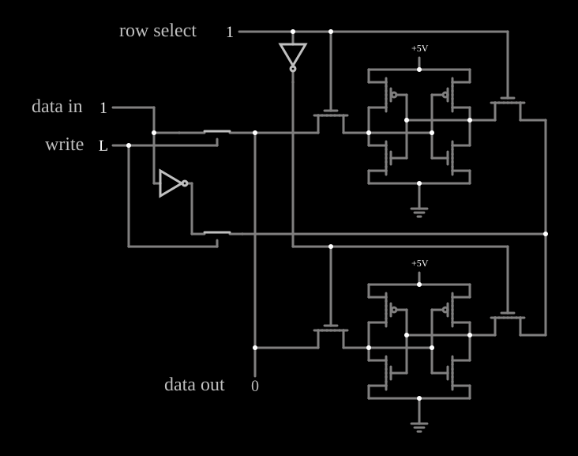

# Memória RAM estática

<!-- navegacao:inicio -->
[Índice](README.md) · [Anterior: Traffic Light](traffic.md) · [Próximo: Dynamic RAM](dram.md)
<!-- navegacao:fim -->

## Objetivo

Mostrar a célula de **RAM estática** (SRAM): dois inversores CMOS em realimentação cruzada guardam um bit enquanto houver alimentação, e dois transistores de acesso a ligam às linhas de bit quando a sua linha é selecionada.

## O circuito

<!-- esquema:inicio -->

<!-- esquema:fim -->

Há duas células, uma por linha. Cada uma tem dois inversores CMOS (PMOS e NMOS com $V_t = 1{,}5\ \text{V}$ e $\beta = 0{,}001\ \text{A/V}^2$, transistores fracos) em anel, alimentados por $5\ \text{V}$, e dois NMOS de acesso, muito mais fortes ($\beta = 0{,}04\ \text{A/V}^2$), que ligam os dois nós da célula às duas **linhas de bit** (*bit lines*), comuns às duas células.

- *row select* (elemento 66, uma entrada numérica) aciona a linha de palavra da célula de cima (com $1$) ou, por um inversor, a da célula de baixo (com $0$).
- *write* (elemento 78, botão momentâneo) fecha duas chaves analógicas que impõem *data in* (elemento 80) numa linha de bit e o seu complemento (um inversor) na outra.
- *data out* (elemento 81) lê uma das linhas de bit.

O exemplo abre com *row select* $= 1$, *data in* $= 1$ e as duas células sem dado (os nós em $2{,}5\ \text{V}$, o ponto de equilíbrio instável dos inversores).

<!-- componentes:inicio -->
| N.º | Tipo | Elemento | Valores |
|----:|------|----------|---------|
| 0 | `NMosfetElm` | MOSFET | Model = old-mosfet-6; Swap D/S = não |
| 2 | `PMosfetElm` | MOSFET | Model = old-mosfet-6; Swap D/S = não |
| 4 | `PMosfetElm` | MOSFET | Model = old-mosfet-6; Swap D/S = não |
| 5 | `NMosfetElm` | MOSFET | Model = old-mosfet-6; Swap D/S = não |
| 19 | `GroundElm` | ground | Symbol = Earth |
| 21 | `RailElm` | voltage source | Voltage = 5; Waveform = D/C; DC Offset (V) = 0; Internal Resistance (ohms) = 0 |
| 24 | `NMosfetElm` | MOSFET | Model = old-mosfet-7; Swap D/S = não |
| 25 | `NMosfetElm` | MOSFET | Model = old-mosfet-7; Swap D/S = não |
| 30 | `NMosfetElm` | MOSFET | Model = old-mosfet-7; Swap D/S = não |
| 31 | `NMosfetElm` | MOSFET | Model = old-mosfet-7; Swap D/S = não |
| 34 | `RailElm` | voltage source | Voltage = 5; Waveform = D/C; DC Offset (V) = 0; Internal Resistance (ohms) = 0 |
| 36 | `GroundElm` | ground | Symbol = Earth |
| 50 | `NMosfetElm` | MOSFET | Model = old-mosfet-6; Swap D/S = não |
| 51 | `PMosfetElm` | MOSFET | Model = old-mosfet-6; Swap D/S = não |
| 53 | `PMosfetElm` | MOSFET | Model = old-mosfet-6; Swap D/S = não |
| 55 | `NMosfetElm` | MOSFET | Model = old-mosfet-6; Swap D/S = não |
| 66 | `LogicInputElm` | logic input | Momentary Switch = não; High Logic Voltage = 5; Low Voltage = 0; Numeric = sim; Ternary = não; Keyboard Shortcut =  |
| 69 | `AnalogSwitchElm` | analog switch | Normally closed = não; On Resistance (ohms) = 20; Off Resistance (ohms) = 10G; Pulldown Resistor = não; Threshold = 2.5 |
| 70 | `AnalogSwitchElm` | analog switch | Normally closed = não; On Resistance (ohms) = 20; Off Resistance (ohms) = 10G; Pulldown Resistor = não; Threshold = 2.5 |
| 73 | `InverterElm` | inverter | Slew Rate (V/ns) = 500m; High Logic Voltage = 5; DeMorgan's Symbol = não |
| 78 | `LogicInputElm` | logic input | Momentary Switch = sim; High Logic Voltage = 5; Low Voltage = 0; Numeric = não; Ternary = não; Keyboard Shortcut =  |
| 80 | `LogicInputElm` | logic input | Momentary Switch = não; High Logic Voltage = 5; Low Voltage = 0; Numeric = sim; Ternary = não; Keyboard Shortcut =  |
| 81 | `LogicOutputElm` | logic output | Threshold = 2.5; Current Required = não; Numeric = sim; Ternary = não |
| 82 | `InverterElm` | inverter | Slew Rate (V/ns) = 500m; High Logic Voltage = 5; DeMorgan's Symbol = não |
| 84 | `TextElm` | text | Text = write; Size = 24; Draw Bar On Top = não; Color = #c0c0c0 |
| 85 | `TextElm` | text | Text = data in; Size = 24; Draw Bar On Top = não; Color = #c0c0c0 |
| 86 | `TextElm` | text | Text = data out; Size = 24; Draw Bar On Top = não; Color = #c0c0c0 |
| 87 | `TextElm` | text | Text = row select; Size = 24; Draw Bar On Top = não; Color = #c0c0c0 |
<!-- componentes:fim -->

## Teoria

**Guardar:** dois inversores em anel têm dois estados estáveis, como no [CMOS Flip-Flop](cmosff.md); sem acesso, a célula não consome corrente além das fugas.

**Escrever:** com a linha de palavra ativa, os transistores de acesso ligam a célula às linhas de bit, e as chaves de escrita forçam nelas $D$ e $\overline{D}$. Como os transistores de acesso são muito mais fortes que os inversores da célula, as linhas de bit vencem e a célula vira para o novo estado. É o dimensionamento relativo dos transistores que permite a escrita.

**Ler:** sem escrita, a célula selecionada aciona as linhas de bit pelos transistores de acesso. Uma SRAM real pré-carrega as linhas e usa amplificadores sensores; aqui a saída lê a linha de bit diretamente, e o nível alto lido fica abaixo de $5\ \text{V}$, porque o NMOS de acesso só passa até cerca de $V_{DD} - V_t$ e divide a tensão com o PMOS fraco da célula.

A célula clássica tem **seis transistores** (6T) e não precisa de *refresh*, ao contrário da [Dynamic RAM](dram.md), mas ocupa bem mais área por bit.

## Resultados esperados

O simulador dá, numa sequência de operações:

| Tempo | Operação | *data out* |
|------|------|------:|
| $0{,}5\ \text{ms}$ | linha 1, célula ainda sem dado | $2{,}50\ \text{V}$ |
| $1{,}2\ \text{ms}$ | escrevendo $1$ na linha 1 | $5{,}00\ \text{V}$ |
| $2\ \text{ms}$ | lendo a linha 1 | $3{,}76\ \text{V}$ (um lógico) |
| $2{,}8\ \text{ms}$ | linha 0 selecionada, sem dado | $2{,}50\ \text{V}$ |
| $4\ \text{ms}$ | depois de escrever $0$ na linha 0 | $0$ |
| $5\ \text{ms}$ | de volta à linha 1 | $3{,}50\ \text{V}$ (um lógico) |

A linha 1 conserva o $1$ enquanto a linha 0 é escrita: cada célula guarda o seu bit.

## O que observar

Escreva valores diferentes nas duas linhas e alterne *row select*: a saída mostra o bit de cada célula, sem perdê-lo com o tempo.

## Limites do modelo

- Não há pré-carga nem amplificador sensor; o nível lido depende da divisão entre o transistor de acesso e o da célula, e varia um pouco conforme a história das linhas de bit ($3{,}76$ e $3{,}50\ \text{V}$ na tabela).
- Sem capacitâncias nas linhas de bit, a leitura não perturba a célula; numa SRAM real, a estabilidade na leitura é uma restrição de projeto importante.

## Referências

Weste e Harris, *CMOS VLSI Design*, capítulo sobre SRAM; Rabaey, Chandrakasan e Nikolić, *Digital Integrated Circuits*, capítulo sobre memórias.

O circuito deste exemplo faz parte da coleção do simulador original de Paul Falstad e Iain Sharp (CircuitJS1); a explicação é deste projeto.
