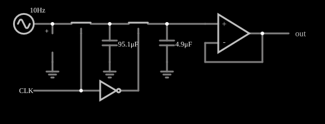

# Filtro de capacitor chaveado

<!-- navegacao:inicio -->
[Índice](README.md) · [Anterior: VCVS High-Pass Filter](filt-vcvs-hipass.md) · [Próximo: Allpass](allpass1.md)
<!-- navegacao:fim -->

## Objetivo

Mostrar um filtro de capacitor chaveado: chaves analógicas, comandadas por um relógio de duas fases, transferem carga entre capacitores, e o conjunto se comporta como um filtro passa-baixas.

## O circuito

<!-- esquema:inicio -->

<!-- esquema:fim -->

A fonte é um gerador de varredura logarítmica (*sweep*) de $5\ \text{V}$ de pico, que percorre as frequências de $10$ a $400\ \text{Hz}$ em $0{,}2\ \text{s}$ (ida e volta), de modo que a resposta em frequência do filtro aparece como a variação da amplitude da saída ao longo do tempo. A entrada passa por uma chave analógica ($20\ \Omega$ quando fechada) a um capacitor de $95{,}1\ \mu\text{F}$ para a terra; uma segunda chave leva esse nó a um capacitor de $4{,}877\ \mu\text{F}$ para a terra, que é lido por um amplificador operacional seguidor de tensão. O relógio é uma onda quadrada de $2\ \text{kHz}$ (entre $0$ e $5\ \text{V}$); a primeira chave fecha com o relógio alto e a segunda, com ele baixo (um inversor gera a fase oposta). Dois osciloscópios mostram a entrada e a saída.

<!-- componentes:inicio -->
| N.º | Tipo | Elemento | Valores |
|----:|------|----------|---------|
| 0 | `AnalogSwitchElm` | analog switch | Normally closed = não; On Resistance (ohms) = 20; Off Resistance (ohms) = 10G; Pulldown Resistor = não; Threshold = 2.5 |
| 1 | `AnalogSwitchElm` | analog switch | Normally closed = não; On Resistance (ohms) = 20; Off Resistance (ohms) = 10G; Pulldown Resistor = não; Threshold = 2.5 |
| 2 | `CapacitorElm` | capacitor | Capacitance (F) = 4.9μ; Trapezoidal Approximation = sim; Initial Voltage (on Reset) = 1m; Series Resistance = 0 |
| 4 | `OpAmpElm` | op-amp | Max Output (V) = 15; Min Output (V) = -15; Gain = 100k |
| 8 | `OutputElm` | output | Show Voltage = não |
| 9 | `GroundElm` | ground | Symbol = Earth |
| 10 | `GroundElm` | ground | Symbol = Earth |
| 12 | `InverterElm` | inverter | Slew Rate (V/ns) = 500m; High Logic Voltage = 5; DeMorgan's Symbol = não |
| 14 | `RailElm` | square wave gen | Max Voltage = 2.5; Waveform = Square Wave; DC Offset (V) = 2.5; Internal Resistance (ohms) = 0; Show Voltage = não; Specify As = Frequency/Duty Cycle; Frequency (Hz) = 2k; Phase Offset (degrees) = 0; Duty Cycle = 50; Rise/Fall Time (s) = 0 |
| 15 | `CapacitorElm` | capacitor | Capacitance (F) = 95.1μ; Trapezoidal Approximation = sim; Initial Voltage (on Reset) = 1m; Series Resistance = 0 |
| 16 | `ProbeElm` | voltmeter | Show Voltage = não; Value = Voltage; Scale = Auto; Use Circle Symbol = não; Series Resistance (0 = infinite) = 0 |
| 17 | `GroundElm` | ground | Symbol = Earth |
| 18 | `SweepElm` | sweep (log) | Min Frequency (Hz) = 10; Max Frequency (Hz) = 400; Sweep Time (s) = 200m; Logarithmic = sim; Max Voltage = 5; Bidirectional = sim |
<!-- componentes:fim -->

## Teoria

Um capacitor $C$ que liga alternadamente dois nós, a uma frequência de relógio $f_\text{clk}$, transporta uma carga média por segundo $Q f_\text{clk} = C\,\Delta V\,f_\text{clk}$, ou seja, comporta-se como um resistor de valor

$$R_\text{eq} = \frac{1}{f_\text{clk}\,C}.$$

É a ideia do capacitor chaveado: um resistor "sintonizável" pela frequência do relógio, o que permite construir filtros integrados com constantes de tempo fixadas por razões de capacitâncias, mais precisas que valores absolutos.

Neste exemplo as duas fases se alternam a $2\ \text{kHz}$ (cada fase dura $0{,}25\ \text{ms}$). O capacitor grande ($95{,}1\ \mu\text{F}$) se carrega na primeira fase pela resistência de $20\ \Omega$ da chave, cuja constante de tempo é $20\ \Omega\cdot 95{,}1\ \mu\text{F} \approx 1{,}9\ \text{ms}$, muito maior que uma fase, de modo que o capacitor só se aproxima da tensão de entrada aos poucos, e na segunda fase compartilha carga com o capacitor menor. O efeito resultante é o de um filtro passa-baixas de ordem 1 com constante de tempo de alguns milissegundos.

## Resultados esperados

Como a entrada é uma senoide de $5\ \text{V}$ de frequência crescente, a amplitude da saída mostra a resposta em frequência (medida como o máximo da saída em cada janela):

| Janela | Frequência da varredura | Máximo da saída | Ganho |
|--------|------------------------:|----------------:|------:|
| $0$ a $40\ \text{ms}$ | $10$ a $42\ \text{Hz}$ | $4{,}726\ \text{V}$ | $0{,}945$ |
| $60$ a $100\ \text{ms}$ | $39$ a $63\ \text{Hz}$ | $3{,}885\ \text{V}$ | $0{,}777$ |
| $190$ a $200\ \text{ms}$ | $616$ a $800\ \text{Hz}$ | $0{,}572\ \text{V}$ | $0{,}114$ |

Um polo simples tem módulo $1/\sqrt{1 + (f/f_c)^2}$; o valor de $0{,}777$ perto de $45\ \text{Hz}$ indica $f_c$ da ordem de $50\ \text{Hz}$. As verificações conferem as três janelas (tolerância de 3%).

## O que observar

- A saída é a entrada suavizada: a amplitude cai à medida que a frequência da varredura sobe, e há uma pequena ondulação do relógio de $2\ \text{kHz}$ sobre a saída.
- Aumente a frequência do relógio (ou o capacitor) e a frequência de corte muda: essa é a graça do filtro chaveado.
- A chave com a resistência de $20\ \Omega$ é parte importante da constante de tempo do exemplo; a de um filtro ideal chaveado vem só das capacitâncias.

## Limites do modelo

O modelo de chave analógica tem resistência de $20\ \Omega$ constante, sem injeção de carga nem capacitâncias parasitas, que são a maior fonte de erro num filtro chaveado real. A frequência de corte estimada é aproximada, porque o sistema não é exatamente de primeira ordem e a amostragem em $2\ \text{kHz}$ produz *aliasing* para frequências perto do relógio.

## Referências

- A. S. Sedra e K. C. Smith, *Microeletrônica*, Pearson.
- R. Gregorian e G. C. Temes, *Analog MOS Integrated Circuits for Signal Processing*, Wiley.
- S. Franco, *Design with Operational Amplifiers and Analog Integrated Circuits*, McGraw-Hill.

O circuito deste exemplo faz parte da coleção do simulador original de Paul Falstad e Iain Sharp (CircuitJS1); a explicação é deste projeto.
