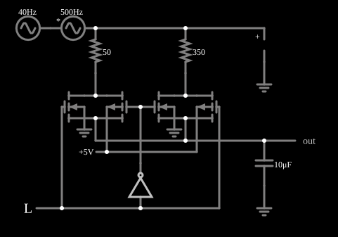

# Filtro passa-baixas de frequência de corte selecionável

<!-- navegacao:inicio -->
[Índice](README.md) · [Anterior: Leading-Edge Detector](leadingedge.md) · [Próximo: Voltage Inverter](voltinvert.md)
<!-- navegacao:fim -->

## Objetivo

Mostrar um **filtro passa-baixas RC cuja frequência de corte é escolhida por uma chave CMOS**: o sinal de controle liga um de dois resistores em série com um capacitor, mudando a constante de tempo e, com ela, a parcela de alta frequência que passa.

## O circuito

<!-- esquema:inicio -->

<!-- esquema:fim -->

A entrada soma dois sinais senoidais de $1\ \text{V}$ de pico: um de $40\ \text{Hz}$ e outro de $500\ \text{Hz}$, ambos em torno de $2{,}5\ \text{V}$. Dois resistores, de $50\ \Omega$ e de $350\ \Omega$, são ligados ao capacitor de $10\ \mu\text{F}$ (a saída) por duas [portas de transmissão CMOS](cmostransgate.md) (modelo padrão com diodo de corpo), uma para cada resistor, controladas por uma entrada lógica e pelo seu complemento, de modo que **só um resistor conduz de cada vez**. Dois osciloscópios mostram a entrada e a saída.

<!-- componentes:inicio -->
| N.º | Tipo | Elemento | Valores |
|----:|------|----------|---------|
| 0 | `PMosfetElm` | MOSFET | Model = default-body; Swap D/S = não |
| 1 | `NMosfetElm` | MOSFET | Model = default-body; Swap D/S = não |
| 2 | `ResistorElm` | resistor | Resistance (ohms) = 50 |
| 3 | `ResistorElm` | resistor | Resistance (ohms) = 350 |
| 9 | `CapacitorElm` | capacitor | Capacitance (F) = 10μ; Trapezoidal Approximation = sim; Initial Voltage (on Reset) = 1m; Series Resistance = 0 |
| 10 | `GroundElm` | ground | Symbol = Earth |
| 11 | `OutputElm` | output | Show Voltage = não |
| 13 | `InverterElm` | inverter | Slew Rate (V/ns) = 500m; High Logic Voltage = 5; DeMorgan's Symbol = não |
| 17 | `LogicInputElm` | logic input | Momentary Switch = não; High Logic Voltage = 5; Low Voltage = 0; Numeric = não; Ternary = não; Keyboard Shortcut =  |
| 18 | `VoltageElm` | A/C source | Max Voltage = 1; Waveform = A/C; DC Offset (V) = 0; Internal Resistance (ohms) = 0; Show Voltage = não; Frequency (Hz) = 500; Phase Offset (degrees) = 0 |
| 20 | `ProbeElm` | voltmeter | Show Voltage = não; Value = Voltage; Scale = Auto; Use Circle Symbol = não; Series Resistance (0 = infinite) = 0 |
| 21 | `GroundElm` | ground | Symbol = Earth |
| 22 | `RailElm` | A/C source | Max Voltage = 1; Waveform = A/C; DC Offset (V) = 2.5; Internal Resistance (ohms) = 0; Show Voltage = não; Frequency (Hz) = 40; Phase Offset (degrees) = 0 |
| 23 | `NMosfetElm` | MOSFET | Model = default-body; Swap D/S = não |
| 24 | `PMosfetElm` | MOSFET | Model = default-body; Swap D/S = não |
| 34 | `GroundElm` | ground | Symbol = Earth |
| 35 | `GroundElm` | ground | Symbol = Earth |
| 41 | `RailElm` | voltage source | Voltage = 5; Waveform = D/C; DC Offset (V) = 0; Internal Resistance (ohms) = 0 |
<!-- componentes:fim -->

## Teoria

A resistência em série com o capacitor é $R = R_{res} + R_{on}$, com $R_{on} \approx 25\ \Omega$ da porta de transmissão (com a entrada perto de $2{,}5\ \text{V}$, os dois transistores conduzem; veja a fórmula em [Porta de transmissão CMOS](cmostransgate.md)). O circuito é um passa-baixas de primeira ordem:

$$f_c = \frac{1}{2\pi R C}, \qquad |H(f)| = \frac{1}{\sqrt{1 + (f/f_c)^2}}.$$

- Estado inicial: $R = 350 + 25 = 375\ \Omega$, $f_c = 1/(2\pi \cdot 375 \cdot 10\ \mu\text{F}) = 42{,}4\ \text{Hz}$.
- Estado alternado: $R = 50 + 25 = 75\ \Omega$, $f_c = 212{,}2\ \text{Hz}$.

## Resultados esperados

Os ganhos previstos pela fórmula e os medidos no simulador (por Fourier da saída, em $0{,}1\ \text{s}$) são:

| Estado | Frequência | $\lvert H \rvert$ previsto | $\lvert H \rvert$ medido |
|--------|-----------:|-------------------------:|-----------------------:|
| $f_c = 42{,}4\ \text{Hz}$ | $40\ \text{Hz}$ | $0{,}728$ | $0{,}728$ |
| $f_c = 42{,}4\ \text{Hz}$ | $500\ \text{Hz}$ | $0{,}0846$ | $0{,}0846$ |
| $f_c = 212{,}2\ \text{Hz}$ | $40\ \text{Hz}$ | $0{,}983$ | $0{,}986$ |
| $f_c = 212{,}2\ \text{Hz}$ | $500\ \text{Hz}$ | $0{,}391$ | $0{,}392$ |

A entrada vai de $0{,}502$ a $4{,}498\ \text{V}$; a saída, de $1{,}689$ a $3{,}311\ \text{V}$ no estado inicial e de $1{,}118$ a $3{,}886\ \text{V}$ no alternado. As verificações conferem os extremos de entrada e saída nos dois estados (tolerância de $0{,}2\%$ a $0{,}5\%$).

## O que observar

No estado inicial, a saída é quase só a senoide de $40\ \text{Hz}$ (com $73\%$ da amplitude), com uma ondulação muito pequena de $500\ \text{Hz}$ ($8\%$ do original); clique na entrada lógica e a ondulação de $500\ \text{Hz}$ aparece ($39\%$), com a de $40\ \text{Hz}$ quase intacta ($99\%$). Para testar: troque o capacitor por $1\ \mu\text{F}$ e veja as duas frequências de corte multiplicadas por $10$; troque o resistor de $350\ \Omega$ por $3{,}5\ \text{k}\Omega$ e veja o corte do estado inicial cair a cerca de $4{,}5\ \text{Hz}$ ($1/(2\pi \cdot 3525\ \Omega \cdot 10\ \mu\text{F})$).

## Limites do modelo

- A resistência de ligado das portas ($25\ \Omega$ para a entrada perto de $2{,}5\ \text{V}$, de $14$ a $25\ \Omega$ no ciclo) varia com a tensão de entrada e introduz uma pequena distorção, que a fórmula de primeira ordem ignora.
- Sem capacitâncias, a chave não injeta carga na troca de estado; num circuito real a troca causa um transitório na saída.
- Os ganhos medidos por Fourier vêm do simulador e não fazem parte das verificações automáticas.

## Referências

Sedra e Smith, *Microelectronic Circuits*, capítulos sobre o MOSFET, a lógica CMOS e os circuitos de capacitor chaveado; Weste e Harris, *CMOS VLSI Design*.

O circuito deste exemplo faz parte da coleção do simulador original de Paul Falstad e Iain Sharp (CircuitJS1); a explicação é deste projeto.
