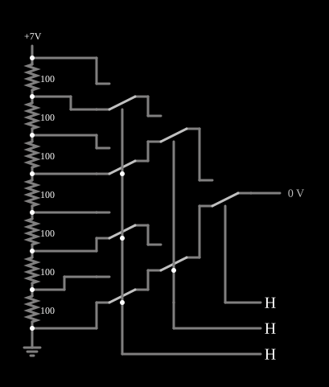

# Conversor D/A em árvore de chaves

<!-- navegacao:inicio -->
[Índice](README.md) · [Anterior: R-2R Ladder DAC](r2rladder.md) · [Próximo: Digital Sine Wave](digsine.md)
<!-- navegacao:fim -->

## Objetivo

Mostrar o conversor digital-analógico por **seleção de tensão**: um divisor resistivo gera todos os níveis possíveis, e uma árvore de chaves, comandada pelos bits, escolhe um deles.

## O circuito

<!-- esquema:inicio -->

<!-- esquema:fim -->

Sete resistores iguais de $100\ \Omega$ em série, de $7\ \text{V}$ à terra, geram oito tensões: $0, 1, 2, \dots, 7\ \text{V}$. Uma árvore de sete chaves analógicas de duas posições escolhe uma: quatro chaves no primeiro nível (cada uma entre dois níveis vizinhos), duas no segundo e uma no último, que aciona a saída (elemento 13). O bit 0 (elemento 49) comanda as quatro chaves do primeiro nível, o bit 1 (elemento 47) as duas do segundo, e o bit 2 (elemento 45) a última. O exemplo abre com os três bits em $1$.

<!-- componentes:inicio -->
| N.º | Tipo | Elemento | Valores |
|----:|------|----------|---------|
| 0 | `AnalogSwitch2Elm` | analog switch (SPDT) | Swap NO/NC = sim; On Resistance (ohms) = 20; Off Resistance (ohms) = 10G; Pulldown Resistor = não; Threshold = 2.5 |
| 1 | `AnalogSwitch2Elm` | analog switch (SPDT) | Swap NO/NC = sim; On Resistance (ohms) = 20; Off Resistance (ohms) = 10G; Pulldown Resistor = não; Threshold = 2.5 |
| 2 | `AnalogSwitch2Elm` | analog switch (SPDT) | Swap NO/NC = sim; On Resistance (ohms) = 20; Off Resistance (ohms) = 10G; Pulldown Resistor = não; Threshold = 2.5 |
| 3 | `AnalogSwitch2Elm` | analog switch (SPDT) | Swap NO/NC = sim; On Resistance (ohms) = 20; Off Resistance (ohms) = 10G; Pulldown Resistor = não; Threshold = 2.5 |
| 4 | `AnalogSwitch2Elm` | analog switch (SPDT) | Swap NO/NC = sim; On Resistance (ohms) = 20; Off Resistance (ohms) = 10G; Pulldown Resistor = não; Threshold = 2.5 |
| 5 | `AnalogSwitch2Elm` | analog switch (SPDT) | Swap NO/NC = sim; On Resistance (ohms) = 20; Off Resistance (ohms) = 10G; Pulldown Resistor = não; Threshold = 2.5 |
| 6 | `AnalogSwitch2Elm` | analog switch (SPDT) | Swap NO/NC = sim; On Resistance (ohms) = 20; Off Resistance (ohms) = 10G; Pulldown Resistor = não; Threshold = 2.5 |
| 13 | `OutputElm` | output | Show Voltage = sim; Scale = V; Fixed Precision = não |
| 14 | `ResistorElm` | resistor | Resistance (ohms) = 100 |
| 15 | `ResistorElm` | resistor | Resistance (ohms) = 100 |
| 16 | `ResistorElm` | resistor | Resistance (ohms) = 100 |
| 17 | `ResistorElm` | resistor | Resistance (ohms) = 100 |
| 18 | `ResistorElm` | resistor | Resistance (ohms) = 100 |
| 19 | `ResistorElm` | resistor | Resistance (ohms) = 100 |
| 20 | `ResistorElm` | resistor | Resistance (ohms) = 100 |
| 37 | `RailElm` | voltage source | Voltage = 7; Waveform = D/C; DC Offset (V) = 0; Internal Resistance (ohms) = 0 |
| 38 | `GroundElm` | ground | Symbol = Earth |
| 45 | `LogicInputElm` | logic input | Momentary Switch = não; High Logic Voltage = 5; Low Voltage = 0; Numeric = não; Ternary = não; Keyboard Shortcut =  |
| 47 | `LogicInputElm` | logic input | Momentary Switch = não; High Logic Voltage = 5; Low Voltage = 0; Numeric = não; Ternary = não; Keyboard Shortcut =  |
| 49 | `LogicInputElm` | logic input | Momentary Switch = não; High Logic Voltage = 5; Low Voltage = 0; Numeric = não; Ternary = não; Keyboard Shortcut =  |
<!-- componentes:fim -->

## Teoria

Cada nível da árvore divide o conjunto de tensões ao meio, como uma busca binária: o bit mais significativo escolhe a metade de cima ou de baixo, o seguinte escolhe metade dessa metade, e o bit 0 escolhe entre os dois níveis vizinhos. A saída é

$$V_{out} = \frac{N}{8} \cdot 8\ \text{V} = N \cdot 1\ \text{V}, \qquad N = 4b_2 + 2b_1 + b_0.$$

O conversor é **monotônico por construção**: um código maior escolhe sempre um nó mais alto do divisor, por pior que seja o casamento dos resistores. O preço é o número de chaves, $2^n - 1$, e a resistência das chaves em série no caminho, que limita a velocidade; por isso a árvore é usada em conversores de poucos bits ou como o estágio fino de conversores segmentados.

## Resultados esperados

O simulador dá a saída em $N$ volts: $7{,}001\ \text{V}$ para $N = 7$, $6{,}001\ \text{V}$ para $6$, $3{,}000\ \text{V}$ para $3$, $1{,}000\ \text{V}$ para $1$ e $0$ para $0$.

## O que observar

Mude os bits e acompanhe o caminho que fica ligado através da árvore até a saída.

## Limites do modelo

- A saída não tem carga: só a resistência das chaves desligadas ($10\ \text{G}\Omega$) e da saída. Com uma carga, a resistência do divisor e das três chaves em série formaria um divisor e mudaria a tensão.
- Este exemplo depende da posição dos terminais de controle das chaves; nesta versão do projeto, o leitor de arquivos foi corrigido para aplicar a grade pequena do arquivo antes de posicionar os elementos, como faz o original, sem o que as linhas de controle ficavam desligadas e a saída ficava sempre em $0$.

## Referências

Johns e Martin, *Analog Integrated Circuit Design*, capítulo sobre conversores D/A (decodificadores de resistores); Kester (ed.), *Data Conversion Handbook*, Analog Devices.

O circuito deste exemplo faz parte da coleção do simulador original de Paul Falstad e Iain Sharp (CircuitJS1); a explicação é deste projeto.
