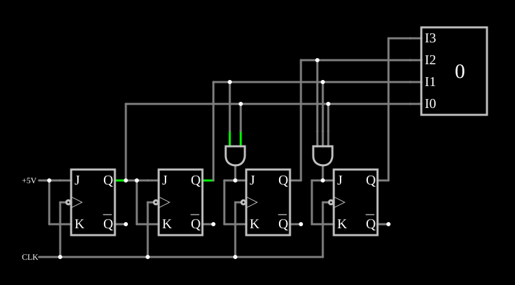

# Contador síncrono

<!-- navegacao:inicio -->
[Índice](README.md) · [Anterior: 8-Bit Ripple Counter](counter8.md) · [Próximo: Up/Down Counter](updownctr.md)
<!-- navegacao:fim -->

## Objetivo

Mostrar o contador **síncrono**: todos os flip-flops recebem o mesmo relógio, e portas AND decidem quais deles invertem, de modo que todos os bits mudam juntos.

## O circuito

<!-- esquema:inicio -->

<!-- esquema:fim -->

Quatro flip-flops JK disparados pela borda de descida recebem o mesmo relógio, uma onda quadrada de $200\ \text{Hz}$. O primeiro tem $J = K = 1$; o segundo tem $J = K = Q_0$; o terceiro, $J = K = Q_0 Q_1$ (uma AND de duas entradas); o quarto, $J = K = Q_0 Q_1 Q_2$ (uma AND de três entradas). Um mostrador decimal (elemento 42) exibe a contagem. O exemplo abre com os flip-flops no estado $3$.

<!-- componentes:inicio -->
| N.º | Tipo | Elemento | Valores |
|----:|------|----------|---------|
| 0 | `JKFlipFlopElm` | JK flip-flop | High Logic Voltage = 5; Reset Pin = não; Positive Edge Triggered = não; Invert Reset = não |
| 1 | `JKFlipFlopElm` | JK flip-flop | High Logic Voltage = 5; Reset Pin = não; Positive Edge Triggered = não; Invert Reset = não |
| 2 | `JKFlipFlopElm` | JK flip-flop | High Logic Voltage = 5; Reset Pin = não; Positive Edge Triggered = não; Invert Reset = não |
| 3 | `JKFlipFlopElm` | JK flip-flop | High Logic Voltage = 5; Reset Pin = não; Positive Edge Triggered = não; Invert Reset = não |
| 19 | `RailElm` | voltage source | Voltage = 5; Waveform = D/C; DC Offset (V) = 0; Internal Resistance (ohms) = 0 |
| 20 | `RailElm` | square wave gen | Max Voltage = 2.5; Waveform = Square Wave; DC Offset (V) = 2.5; Internal Resistance (ohms) = 0; Show Voltage = não; Specify As = Frequency/Duty Cycle; Frequency (Hz) = 200; Phase Offset (degrees) = 0; Duty Cycle = 50; Rise/Fall Time (s) = 0 |
| 29 | `AndGateElm` | AND gate | # of Inputs = 2; High Logic Voltage = 5; Schmitt Inputs = não; Invert Inputs = não; Propagation Delay (s) = 0; DeMorgan's Symbol = não |
| 35 | `AndGateElm` | AND gate | # of Inputs = 3; High Logic Voltage = 5; Schmitt Inputs = não; Invert Inputs = não; Propagation Delay (s) = 0; DeMorgan's Symbol = não |
| 42 | `DecimalDisplayElm` | decimal display | High Logic Voltage = 5; Bit Order = MSB First; # of Bits = 4; Display Mode = Decimal |
<!-- componentes:fim -->

## Teoria

Na contagem binária, o bit $k$ inverte exatamente quando todos os bits abaixo dele valem $1$. As ANDs calculam essa condição, e o [flip-flop JK](jkff.md) com $J = K = 1$ inverte, com $J = K = 0$ guarda:

$$T_0 = 1, \quad T_1 = Q_0, \quad T_2 = Q_0 Q_1, \quad T_3 = Q_0 Q_1 Q_2.$$

Como todos os flip-flops recebem a mesma borda, todos os bits mudam no mesmo instante: não há os estados intermediários do [contador em cascata](counter.md), e o atraso não cresce com o número de bits (só o das ANDs, que pode ser reduzido com lógica de antecipação).

## Resultados esperados

O simulador mostra $3$ em $1\ \text{ms}$, $4$ em $4\ \text{ms}$ (depois da borda de $2{,}5\ \text{ms}$), $15$ em $61{,}5\ \text{ms}$ e $0$ em $66{,}5\ \text{ms}$: uma unidade a cada $5\ \text{ms}$, com ciclo de $80\ \text{ms}$.

## O que observar

Compare com o [4-Bit Ripple Counter](counter.md): a sequência é a mesma, mas aqui todos os bits mudam na mesma borda.

## Limites do modelo

- Sem atrasos de porta, a vantagem de velocidade não aparece; ela existe num circuito real, onde a cascata acumula atrasos.

## Referências

Mano e Ciletti, *Digital Design*, capítulo sobre contadores síncronos; Texas Instruments, folha de dados do SN74161.

O circuito deste exemplo faz parte da coleção do simulador original de Paul Falstad e Iain Sharp (CircuitJS1); a explicação é deste projeto.
