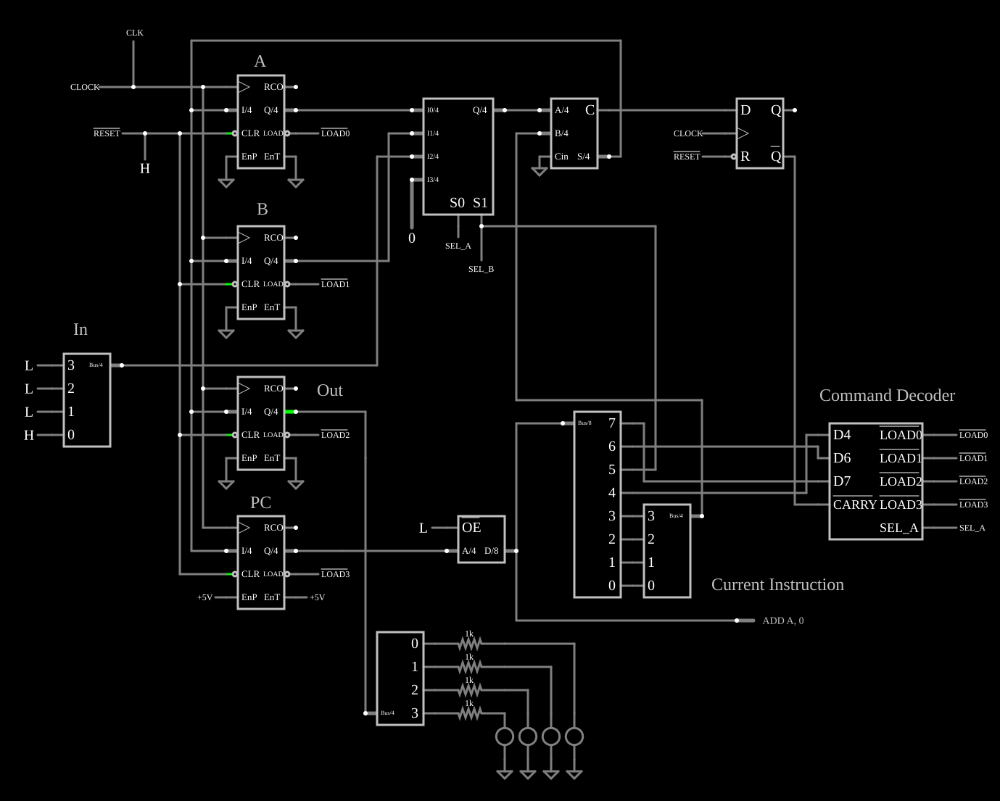

# CPU TD4: contador decrescente

<!-- navegacao:inicio -->
[Índice](README.md) · [Anterior: TD4 Counter](td4-ctr.md) · [Próximo: TD4 Up-Down Counter](td4-ctr-up-dn.md)
<!-- navegacao:fim -->

## Objetivo

Mostrar que a TD4, que só sabe somar, também conta para baixo: somar $15$ num registrador de 4 bits é o mesmo que subtrair $1$.

## O circuito

<!-- esquema:inicio -->

<!-- esquema:fim -->

A mesma CPU do [TD4 LED Strobe](td4.md); só o programa da ROM muda.

<!-- componentes:inicio -->
| N.º | Tipo | Elemento | Valores |
|----:|------|----------|---------|
| 0 | `Counter2Elm` | Counter | High Logic Voltage = 5; Bit Order = Bus; # of Bits = 4; Modulus = 0 |
| 1 | `LabeledNodeElm` | Labeled Node | Text = /LOAD0; Internal Node = não; Rotate Text When Vertical = não |
| 2 | `LabeledNodeElm` | Labeled Node | Text = /RESET; Internal Node = não; Rotate Text When Vertical = não |
| 4 | `LabeledNodeElm` | Labeled Node | Text = CLOCK; Internal Node = não; Rotate Text When Vertical = não |
| 8 | `LabeledNodeElm` | Labeled Node | Text = /LOAD1; Internal Node = não; Rotate Text When Vertical = não |
| 9 | `Counter2Elm` | Counter | High Logic Voltage = 5; Bit Order = Bus; # of Bits = 4; Modulus = 0 |
| 10 | `Counter2Elm` | Counter | High Logic Voltage = 5; Bit Order = Bus; # of Bits = 4; Modulus = 0 |
| 11 | `LabeledNodeElm` | Labeled Node | Text = /LOAD2; Internal Node = não; Rotate Text When Vertical = não |
| 14 | `Counter2Elm` | Counter | High Logic Voltage = 5; Bit Order = Bus; # of Bits = 4; Modulus = 0 |
| 15 | `LabeledNodeElm` | Labeled Node | Text = /LOAD3; Internal Node = não; Rotate Text When Vertical = não |
| 31 | `MultiplexerElm` | Multiplexer | High Logic Voltage = 5; # of Select Bits = 2; Inverted Output = não; Strobe Pin = não; Input Mode = Bus Input/Output; Bus Select = não; Data Bus Width = 4 |
| 33 | `RoutedWireElm` | wire | Show Current = não; Show Voltage = não; Show Bus Value = sim; Show Bus Value (Hex) = não |
| 34 | `LabeledNodeElm` | Labeled Node | Text = SEL_A; Internal Node = não; Rotate Text When Vertical = não |
| 35 | `LabeledNodeElm` | Labeled Node | Text = SEL_B; Internal Node = não; Rotate Text When Vertical = não |
| 36 | `FullAdderElm` | Adder | High Logic Voltage = 5; Bit Order = Bus; # of Bits = 4 |
| 38 | `RoutedWireElm` | wire | Show Current = não; Show Voltage = não; Show Bus Value = sim; Show Bus Value (Hex) = não |
| 39 | `BusLogicInputElm` | bus input (4) | Bus Width = 4; Value = 0; High Voltage = 5; Low Voltage = 0 |
| 40 | `BusSplitterElm` | Bus Splitter | High Logic Voltage = 5; # of Bits = 4 |
| 41 | `BusSplitterElm` | Bus Splitter | High Logic Voltage = 5; # of Bits = 4 |
| 42 | `ResistorElm` | resistor | Resistance (ohms) = 1k |
| 43 | `ResistorElm` | resistor | Resistance (ohms) = 1k |
| 44 | `ResistorElm` | resistor | Resistance (ohms) = 1k |
| 45 | `ResistorElm` | resistor | Resistance (ohms) = 1k |
| 46 | `LEDElm` | LED | Red Value (0-1) = 1; Green Value (0-1) = 0; Blue Value (0-1) = 0; Max Brightness Current (A) = 10m; Model = default-led |
| 47 | `GroundElm` | ground | Symbol = Signal |
| 48 | `GroundElm` | ground | Symbol = Signal |
| 49 | `GroundElm` | ground | Symbol = Signal |
| 50 | `GroundElm` | ground | Symbol = Signal |
| 51 | `GroundElm` | ground | Symbol = Signal |
| 52 | `GroundElm` | ground | Symbol = Signal |
| 53 | `GroundElm` | ground | Symbol = Signal |
| 54 | `GroundElm` | ground | Symbol = Signal |
| 55 | `GroundElm` | ground | Symbol = Signal |
| 56 | `LEDElm` | LED | Red Value (0-1) = 1; Green Value (0-1) = 0; Blue Value (0-1) = 0; Max Brightness Current (A) = 10m; Model = default-led |
| 57 | `GroundElm` | ground | Symbol = Signal |
| 58 | `LEDElm` | LED | Red Value (0-1) = 1; Green Value (0-1) = 0; Blue Value (0-1) = 0; Max Brightness Current (A) = 10m; Model = default-led |
| 59 | `GroundElm` | ground | Symbol = Signal |
| 60 | `LEDElm` | LED | Red Value (0-1) = 1; Green Value (0-1) = 0; Blue Value (0-1) = 0; Max Brightness Current (A) = 10m; Model = default-led |
| 61 | `RoutedWireElm` | wire | Show Current = não; Show Voltage = não; Show Bus Value = não; Show Bus Value (Hex) = não |
| 62 | `RoutedWireElm` | wire | Show Current = não; Show Voltage = não; Show Bus Value = não; Show Bus Value (Hex) = não |
| 63 | `RoutedWireElm` | wire | Show Current = não; Show Voltage = não; Show Bus Value = não; Show Bus Value (Hex) = não |
| 64 | `RoutedWireElm` | wire | Show Current = não; Show Voltage = não; Show Bus Value = não; Show Bus Value (Hex) = não |
| 65 | `BusSplitterElm` | Bus Splitter | High Logic Voltage = 5; # of Bits = 8 |
| 66 | `BusSplitterElm` | Bus Splitter | High Logic Voltage = 5; # of Bits = 4 |
| 67 | `RoutedWireElm` | wire | Show Current = não; Show Voltage = não; Show Bus Value = sim; Show Bus Value (Hex) = não |
| 68 | `CustomCompositeElm` | subcircuit (decoder) | Model Name = decoder; High Logic Voltage (0=default) = 0 |
| 69 | `RoutedWireElm` | wire | Show Current = não; Show Voltage = não; Show Bus Value = não; Show Bus Value (Hex) = não |
| 70 | `RoutedWireElm` | wire | Show Current = não; Show Voltage = não; Show Bus Value = não; Show Bus Value (Hex) = não |
| 71 | `RoutedWireElm` | wire | Show Current = não; Show Voltage = não; Show Bus Value = não; Show Bus Value (Hex) = não |
| 72 | `LabeledNodeElm` | Labeled Node | Text = /LOAD0; Internal Node = não; Rotate Text When Vertical = não |
| 73 | `LabeledNodeElm` | Labeled Node | Text = /LOAD1; Internal Node = não; Rotate Text When Vertical = não |
| 74 | `LabeledNodeElm` | Labeled Node | Text = /LOAD2; Internal Node = não; Rotate Text When Vertical = não |
| 75 | `LabeledNodeElm` | Labeled Node | Text = /LOAD3; Internal Node = não; Rotate Text When Vertical = não |
| 76 | `LabeledNodeElm` | Labeled Node | Text = SEL_A; Internal Node = não; Rotate Text When Vertical = não |
| 77 | `RoutedWireElm` | wire | Show Current = não; Show Voltage = não; Show Bus Value = não; Show Bus Value (Hex) = não |
| 78 | `LogicInputElm` | logic input | Momentary Switch = não; High Logic Voltage = 5; Low Voltage = 0; Numeric = não; Ternary = não; Keyboard Shortcut =  |
| 79 | `LogicInputElm` | logic input | Momentary Switch = não; High Logic Voltage = 5; Low Voltage = 0; Numeric = não; Ternary = não; Keyboard Shortcut =  |
| 80 | `LogicInputElm` | logic input | Momentary Switch = não; High Logic Voltage = 5; Low Voltage = 0; Numeric = não; Ternary = não; Keyboard Shortcut =  |
| 81 | `LogicInputElm` | logic input | Momentary Switch = não; High Logic Voltage = 5; Low Voltage = 0; Numeric = não; Ternary = não; Keyboard Shortcut =  |
| 82 | `RoutedWireElm` | wire | Show Current = não; Show Voltage = não; Show Bus Value = não; Show Bus Value (Hex) = não |
| 83 | `DFlipFlopElm` | D flip-flop | High Logic Voltage = 5; Reset Pin = sim; Set Pin = não; Invert Set/Reset = sim |
| 85 | `LabeledNodeElm` | Labeled Node | Text = CLOCK; Internal Node = não; Rotate Text When Vertical = não |
| 86 | `LabeledNodeElm` | Labeled Node | Text = /RESET; Internal Node = não; Rotate Text When Vertical = não |
| 87 | `LogicInputElm` | logic input | Momentary Switch = não; High Logic Voltage = 5; Low Voltage = 0; Numeric = não; Ternary = não; Keyboard Shortcut =  |
| 88 | `RailElm` | square wave gen | Max Voltage = 2.5; Waveform = Square Wave; DC Offset (V) = 2.5; Internal Resistance (ohms) = 0; Show Voltage = não; Specify As = Frequency/Duty Cycle; Frequency (Hz) = 1k; Phase Offset (degrees) = 0; Duty Cycle = 50; Rise/Fall Time (s) = 0 |
| 90 | `RoutedWireElm` | wire | Show Current = não; Show Voltage = não; Show Bus Value = não; Show Bus Value (Hex) = não |
| 93 | `RailElm` | voltage source | Voltage = 5; Waveform = D/C; DC Offset (V) = 0; Internal Resistance (ohms) = 0 |
| 94 | `RailElm` | voltage source | Voltage = 5; Waveform = D/C; DC Offset (V) = 0; Internal Resistance (ohms) = 0 |
| 97 | `TextElm` | text | Text = A; Size = 24; Draw Bar On Top = não; Color = #c0c0c0 |
| 98 | `TextElm` | text | Text = B; Size = 24; Draw Bar On Top = não; Color = #c0c0c0 |
| 99 | `TextElm` | text | Text = PC; Size = 24; Draw Bar On Top = não; Color = #c0c0c0 |
| 100 | `TextElm` | text | Text = Out; Size = 24; Draw Bar On Top = não; Color = #c0c0c0 |
| 101 | `TextElm` | text | Text = Command Decoder; Size = 24; Draw Bar On Top = não; Color = #c0c0c0 |
| 102 | `TextElm` | text | Text = In; Size = 24; Draw Bar On Top = não; Color = #c0c0c0 |
| 103 | `RoutedWireElm` | wire | Show Current = não; Show Voltage = não; Show Bus Value = não; Show Bus Value (Hex) = sim |
| 104 | `InstructionDisplayElm` | instruction display | Bus Width = 8; Threshold Voltage = 2.5; Lookup Table = 0-0xF=ADD A, {a} 0x10-0x1F=MOV A, B 0x20-0x2F=IN A 0x30-0x3F |
| 105 | `TextElm` | text | Text = Current Instruction; Size = 24; Draw Bar On Top = não; Color = #c0c0c0 |
| 107 | `ROMElm` | ROM | High Logic Voltage = 5; Bit Order = Bus; # of Address Bits = 4; # of Data Bits = 8; Contents = 0: 5F 91 F0 ; Hex Display = sim; Restore Contents on Reset = não |
| 108 | `LogicInputElm` | logic input | Momentary Switch = não; High Logic Voltage = 5; Low Voltage = 0; Numeric = não; Ternary = não; Keyboard Shortcut =  |
<!-- componentes:fim -->

## Teoria

| Endereço | Código | Instrução |
|------|------|------|
| 0 | `5F` | `ADD B, 15` |
| 1 | `91` | `OUT B` |
| 2 | `F0` | `JMP 0` |

Em aritmética de 4 bits (módulo $16$), $B + 15 \equiv B - 1$: $15$ é a representação em complemento de dois de $-1$. A soma gera um vai-um sempre que $B \ne 0$, que o programa ignora. A saída desce uma unidade a cada volta do laço, de três instruções.

## Resultados esperados

O simulador mostra $15$ desde o início ($0{,}7\ \text{ms}$), depois $14, 13, \dots, 1, 0, 15, 14, \dots$, um passo a cada $3\ \text{ms}$: $14$ em $2{,}7\ \text{ms}$, $0$ em $44{,}7\ \text{ms}$ e $15$ de novo em $47{,}7\ \text{ms}$.

## O que observar

Compare com o [TD4 Counter](td4-ctr.md): o único byte diferente na ROM é `5F` no lugar de `51`.

## Limites do modelo

- Os mesmos do [TD4 LED Strobe](td4.md).

## Referências

Iku Watanabe, *CPUの創りかた*, Mynavi, 2003; Harris e Harris, *Digital Design and Computer Architecture*, sobre complemento de dois.

O circuito deste exemplo faz parte da coleção do simulador original de Paul Falstad e Iain Sharp (CircuitJS1); a explicação é deste projeto.
