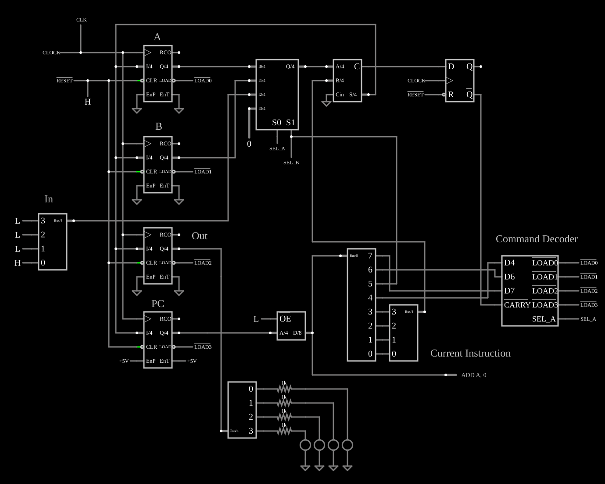

# CPU TD4: luzes sequenciais

<!-- navegacao:inicio -->
[Índice](README.md) · [Próximo: TD4 Counter](td4-ctr.md)
<!-- navegacao:fim -->

## Objetivo

Mostrar uma **CPU completa de 4 bits**, a TD4 do livro de Iku Watanabe, construída com contadores, um multiplexador, um somador e uma ROM de programa, executando um programa que faz uma luz ir e voltar por quatro LEDs.

## O circuito

<!-- esquema:inicio -->

<!-- esquema:fim -->

- **Registradores:** quatro contadores de 4 bits usados como registradores com carga paralela: $A$, $B$, a porta de saída *Out* e o contador de programa *PC*. Cada um é carregado na borda do relógio quando o seu sinal $\overline{LOAD}$ está ativo; o *PC* incrementa nos outros casos.
- **Caminho de dados:** um multiplexador de 4 para 1 escolhe a fonte ($A$, $B$, a porta de entrada *In* — quatro chaves, elementos 78 a 81 — ou zero), e um somador de 4 bits soma essa fonte ao dado imediato da instrução. O resultado vai a todos os registradores; o vai-um vai a um flip-flop D, o *carry flag*.
- **Programa:** uma ROM de 16 palavras de 8 bits (elemento 107), endereçada pelo *PC*. Um decodificador de comandos (subcircuito) transforma os 4 bits altos da instrução nos sinais de seleção e de carga; um mostrador (elemento 104) escreve a instrução atual.
- **Relógio e saída:** um relógio de $1\ \text{kHz}$, uma entrada de $\overline{RESET}$ (elemento 87) e quatro LEDs com resistores de $1\ \text{k}\Omega$ na porta de saída, da esquerda para a direita os bits 3 a 0 (elementos 46, 56, 58 e 60).

<!-- componentes:inicio -->
| N.º | Tipo | Elemento | Valores |
|----:|------|----------|---------|
| 0 | `Counter2Elm` | Counter | High Logic Voltage = 5; Bit Order = Bus; # of Bits = 4; Modulus = 0 |
| 1 | `LabeledNodeElm` | Labeled Node | Text = /LOAD0; Internal Node = não; Rotate Text When Vertical = não |
| 2 | `LabeledNodeElm` | Labeled Node | Text = /RESET; Internal Node = não; Rotate Text When Vertical = não |
| 4 | `LabeledNodeElm` | Labeled Node | Text = CLOCK; Internal Node = não; Rotate Text When Vertical = não |
| 8 | `LabeledNodeElm` | Labeled Node | Text = /LOAD1; Internal Node = não; Rotate Text When Vertical = não |
| 9 | `Counter2Elm` | Counter | High Logic Voltage = 5; Bit Order = Bus; # of Bits = 4; Modulus = 0 |
| 10 | `Counter2Elm` | Counter | High Logic Voltage = 5; Bit Order = Bus; # of Bits = 4; Modulus = 0 |
| 11 | `LabeledNodeElm` | Labeled Node | Text = /LOAD2; Internal Node = não; Rotate Text When Vertical = não |
| 14 | `Counter2Elm` | Counter | High Logic Voltage = 5; Bit Order = Bus; # of Bits = 4; Modulus = 0 |
| 15 | `LabeledNodeElm` | Labeled Node | Text = /LOAD3; Internal Node = não; Rotate Text When Vertical = não |
| 31 | `MultiplexerElm` | Multiplexer | High Logic Voltage = 5; # of Select Bits = 2; Inverted Output = não; Strobe Pin = não; Input Mode = Bus Input/Output; Bus Select = não; Data Bus Width = 4 |
| 33 | `RoutedWireElm` | wire | Show Current = não; Show Voltage = não; Show Bus Value = sim; Show Bus Value (Hex) = não |
| 34 | `LabeledNodeElm` | Labeled Node | Text = SEL_A; Internal Node = não; Rotate Text When Vertical = não |
| 35 | `LabeledNodeElm` | Labeled Node | Text = SEL_B; Internal Node = não; Rotate Text When Vertical = não |
| 36 | `FullAdderElm` | Adder | High Logic Voltage = 5; Bit Order = Bus; # of Bits = 4 |
| 38 | `RoutedWireElm` | wire | Show Current = não; Show Voltage = não; Show Bus Value = sim; Show Bus Value (Hex) = não |
| 39 | `BusLogicInputElm` | bus input (4) | Bus Width = 4; Value = 0; High Voltage = 5; Low Voltage = 0 |
| 40 | `BusSplitterElm` | Bus Splitter | High Logic Voltage = 5; # of Bits = 4 |
| 41 | `BusSplitterElm` | Bus Splitter | High Logic Voltage = 5; # of Bits = 4 |
| 42 | `ResistorElm` | resistor | Resistance (ohms) = 1k |
| 43 | `ResistorElm` | resistor | Resistance (ohms) = 1k |
| 44 | `ResistorElm` | resistor | Resistance (ohms) = 1k |
| 45 | `ResistorElm` | resistor | Resistance (ohms) = 1k |
| 46 | `LEDElm` | LED | Red Value (0-1) = 1; Green Value (0-1) = 0; Blue Value (0-1) = 0; Max Brightness Current (A) = 10m; Model = default-led |
| 47 | `GroundElm` | ground | Symbol = Signal |
| 48 | `GroundElm` | ground | Symbol = Signal |
| 49 | `GroundElm` | ground | Symbol = Signal |
| 50 | `GroundElm` | ground | Symbol = Signal |
| 51 | `GroundElm` | ground | Symbol = Signal |
| 52 | `GroundElm` | ground | Symbol = Signal |
| 53 | `GroundElm` | ground | Symbol = Signal |
| 54 | `GroundElm` | ground | Symbol = Signal |
| 55 | `GroundElm` | ground | Symbol = Signal |
| 56 | `LEDElm` | LED | Red Value (0-1) = 1; Green Value (0-1) = 0; Blue Value (0-1) = 0; Max Brightness Current (A) = 10m; Model = default-led |
| 57 | `GroundElm` | ground | Symbol = Signal |
| 58 | `LEDElm` | LED | Red Value (0-1) = 1; Green Value (0-1) = 0; Blue Value (0-1) = 0; Max Brightness Current (A) = 10m; Model = default-led |
| 59 | `GroundElm` | ground | Symbol = Signal |
| 60 | `LEDElm` | LED | Red Value (0-1) = 1; Green Value (0-1) = 0; Blue Value (0-1) = 0; Max Brightness Current (A) = 10m; Model = default-led |
| 61 | `RoutedWireElm` | wire | Show Current = não; Show Voltage = não; Show Bus Value = não; Show Bus Value (Hex) = não |
| 62 | `RoutedWireElm` | wire | Show Current = não; Show Voltage = não; Show Bus Value = não; Show Bus Value (Hex) = não |
| 63 | `RoutedWireElm` | wire | Show Current = não; Show Voltage = não; Show Bus Value = não; Show Bus Value (Hex) = não |
| 64 | `RoutedWireElm` | wire | Show Current = não; Show Voltage = não; Show Bus Value = não; Show Bus Value (Hex) = não |
| 65 | `BusSplitterElm` | Bus Splitter | High Logic Voltage = 5; # of Bits = 8 |
| 66 | `BusSplitterElm` | Bus Splitter | High Logic Voltage = 5; # of Bits = 4 |
| 67 | `RoutedWireElm` | wire | Show Current = não; Show Voltage = não; Show Bus Value = sim; Show Bus Value (Hex) = não |
| 68 | `CustomCompositeElm` | subcircuit (decoder) | Model Name = decoder; High Logic Voltage (0=default) = 0 |
| 69 | `RoutedWireElm` | wire | Show Current = não; Show Voltage = não; Show Bus Value = não; Show Bus Value (Hex) = não |
| 70 | `RoutedWireElm` | wire | Show Current = não; Show Voltage = não; Show Bus Value = não; Show Bus Value (Hex) = não |
| 71 | `RoutedWireElm` | wire | Show Current = não; Show Voltage = não; Show Bus Value = não; Show Bus Value (Hex) = não |
| 72 | `LabeledNodeElm` | Labeled Node | Text = /LOAD0; Internal Node = não; Rotate Text When Vertical = não |
| 73 | `LabeledNodeElm` | Labeled Node | Text = /LOAD1; Internal Node = não; Rotate Text When Vertical = não |
| 74 | `LabeledNodeElm` | Labeled Node | Text = /LOAD2; Internal Node = não; Rotate Text When Vertical = não |
| 75 | `LabeledNodeElm` | Labeled Node | Text = /LOAD3; Internal Node = não; Rotate Text When Vertical = não |
| 76 | `LabeledNodeElm` | Labeled Node | Text = SEL_A; Internal Node = não; Rotate Text When Vertical = não |
| 77 | `RoutedWireElm` | wire | Show Current = não; Show Voltage = não; Show Bus Value = não; Show Bus Value (Hex) = não |
| 78 | `LogicInputElm` | logic input | Momentary Switch = não; High Logic Voltage = 5; Low Voltage = 0; Numeric = não; Ternary = não; Keyboard Shortcut =  |
| 79 | `LogicInputElm` | logic input | Momentary Switch = não; High Logic Voltage = 5; Low Voltage = 0; Numeric = não; Ternary = não; Keyboard Shortcut =  |
| 80 | `LogicInputElm` | logic input | Momentary Switch = não; High Logic Voltage = 5; Low Voltage = 0; Numeric = não; Ternary = não; Keyboard Shortcut =  |
| 81 | `LogicInputElm` | logic input | Momentary Switch = não; High Logic Voltage = 5; Low Voltage = 0; Numeric = não; Ternary = não; Keyboard Shortcut =  |
| 82 | `RoutedWireElm` | wire | Show Current = não; Show Voltage = não; Show Bus Value = não; Show Bus Value (Hex) = não |
| 83 | `DFlipFlopElm` | D flip-flop | High Logic Voltage = 5; Reset Pin = sim; Set Pin = não; Invert Set/Reset = sim |
| 85 | `LabeledNodeElm` | Labeled Node | Text = CLOCK; Internal Node = não; Rotate Text When Vertical = não |
| 86 | `LabeledNodeElm` | Labeled Node | Text = /RESET; Internal Node = não; Rotate Text When Vertical = não |
| 87 | `LogicInputElm` | logic input | Momentary Switch = não; High Logic Voltage = 5; Low Voltage = 0; Numeric = não; Ternary = não; Keyboard Shortcut =  |
| 88 | `RailElm` | square wave gen | Max Voltage = 2.5; Waveform = Square Wave; DC Offset (V) = 2.5; Internal Resistance (ohms) = 0; Show Voltage = não; Specify As = Frequency/Duty Cycle; Frequency (Hz) = 1k; Phase Offset (degrees) = 0; Duty Cycle = 50; Rise/Fall Time (s) = 0 |
| 90 | `RoutedWireElm` | wire | Show Current = não; Show Voltage = não; Show Bus Value = não; Show Bus Value (Hex) = não |
| 93 | `RailElm` | voltage source | Voltage = 5; Waveform = D/C; DC Offset (V) = 0; Internal Resistance (ohms) = 0 |
| 94 | `RailElm` | voltage source | Voltage = 5; Waveform = D/C; DC Offset (V) = 0; Internal Resistance (ohms) = 0 |
| 97 | `TextElm` | text | Text = A; Size = 24; Draw Bar On Top = não; Color = #c0c0c0 |
| 98 | `TextElm` | text | Text = B; Size = 24; Draw Bar On Top = não; Color = #c0c0c0 |
| 99 | `TextElm` | text | Text = PC; Size = 24; Draw Bar On Top = não; Color = #c0c0c0 |
| 100 | `TextElm` | text | Text = Out; Size = 24; Draw Bar On Top = não; Color = #c0c0c0 |
| 101 | `TextElm` | text | Text = Command Decoder; Size = 24; Draw Bar On Top = não; Color = #c0c0c0 |
| 102 | `TextElm` | text | Text = In; Size = 24; Draw Bar On Top = não; Color = #c0c0c0 |
| 103 | `RoutedWireElm` | wire | Show Current = não; Show Voltage = não; Show Bus Value = não; Show Bus Value (Hex) = sim |
| 104 | `InstructionDisplayElm` | instruction display | Bus Width = 8; Threshold Voltage = 2.5; Lookup Table = 0-0xF=ADD A, {a} 0x10-0x1F=MOV A, B 0x20-0x2F=IN A 0x30-0x3F |
| 105 | `TextElm` | text | Text = Current Instruction; Size = 24; Draw Bar On Top = não; Color = #c0c0c0 |
| 107 | `ROMElm` | ROM | High Logic Voltage = 5; Bit Order = Bus; # of Address Bits = 4; # of Data Bits = 8; Contents = 0: B1 B2 B4 B8 B4 B2 B1 B2 8: B4 B8 B4 B2 F0 ; Hex Display = sim; Restore Contents on Reset = não |
| 108 | `LogicInputElm` | logic input | Momentary Switch = não; High Logic Voltage = 5; Low Voltage = 0; Numeric = não; Ternary = não; Keyboard Shortcut =  |
<!-- componentes:fim -->

## Teoria

Cada instrução tem 8 bits: 4 de código de operação e 4 de dado imediato $Im$. O conjunto de instruções da TD4 é:

| Código | Instrução | Efeito |
|------|------|------|
| `0x` | `ADD A, Im` | $A \leftarrow A + Im$ |
| `1x` | `MOV A, B` | $A \leftarrow B$ |
| `2x` | `IN A` | $A \leftarrow In$ |
| `3x` | `MOV A, Im` | $A \leftarrow Im$ |
| `4x` | `MOV B, A` | $B \leftarrow A$ |
| `5x` | `ADD B, Im` | $B \leftarrow B + Im$ |
| `6x` | `IN B` | $B \leftarrow In$ |
| `7x` | `MOV B, Im` | $B \leftarrow Im$ |
| `9x` | `OUT B` | $Out \leftarrow B$ |
| `Bx` | `OUT Im` | $Out \leftarrow Im$ |
| `Ex` | `JNC Im` | se não houve vai-um, $PC \leftarrow Im$ |
| `Fx` | `JMP Im` | $PC \leftarrow Im$ |

Todas as instruções usam o mesmo caminho: **fonte + imediato → destino**. `MOV A, B` é "$B + 0 \to A$", `OUT Im` é "$0 + Im \to Out$", e `JMP` é uma carga do *PC*. O decodificador só precisa escolher a fonte e qual registrador carrega. Cada instrução leva um período do relógio.

O programa deste exemplo é `B1 B2 B4 B8 B4 B2 B1 B2 B4 B8 B4 B2 F0`: doze instruções `OUT` com os valores $1, 2, 4, 8, 4, 2, \dots$ (um só bit aceso, que vai e volta) e um `JMP 0`.

## Resultados esperados

O simulador executa uma instrução por milissegundo. A saída vale $0$ antes da primeira instrução (em $0{,}7\ \text{ms}$) e mostra em seguida $1, 2, 4, 8, 4, 2, 1, 2, 4, 8, 4, 2$, repetindo o último valor durante o `JMP`; o ciclo tem $13\ \text{ms}$. Por exemplo, em $1{,}7\ \text{ms}$ acende o bit 0 (elemento 60), em $2{,}7\ \text{ms}$ o bit 1 (elemento 58), em $4{,}7\ \text{ms}$ o bit 3 (elemento 46), em $7{,}7\ \text{ms}$ de novo o bit 0; em $13{,}7\ \text{ms}$ (o `JMP`) o bit 1 continua aceso e em $14{,}7\ \text{ms}$ o programa recomeça pelo bit 0. Cada LED aceso conduz $3{,}32\ \text{mA}$.

## O que observar

Acompanhe o mostrador de instrução, o *PC* e a saída. Os exemplos [TD4 Counter](td4-ctr.md), [TD4 Down Counter](td4-ctr-dn.md), [TD4 Up-Down Counter](td4-ctr-up-dn.md) e [TD4 Add 2](td4-add2.md) usam a mesma CPU com outros programas na ROM.

## Limites do modelo

- A ROM é um elemento de memória ideal, e o decodificador de comandos é um subcircuito; o original usa uma matriz de diodos e chaves DIP para o programa.
- O relógio de $1\ \text{kHz}$ é muito mais rápido que o da TD4 real (1 ou 10 Hz, para ver os LEDs), mas não há atrasos que limitem a frequência na simulação.

## Referências

Iku Watanabe, *CPUの創りかた* (*Como fazer uma CPU*), Mynavi, 2003; Harris e Harris, *Digital Design and Computer Architecture*, capítulo sobre o processador de ciclo único.

O circuito deste exemplo faz parte da coleção do simulador original de Paul Falstad e Iain Sharp (CircuitJS1); a explicação é deste projeto.
