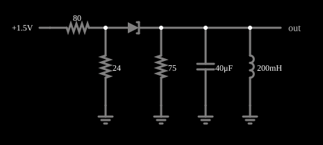

# Oscilador LC com diodo túnel

<!-- navegacao:inicio -->
[Índice](README.md) · [Anterior: I/V Curve](tdiode.md) · [Próximo: Relaxation Oscillator](tdrelax.md)
<!-- navegacao:fim -->

## Objetivo

Mostrar um **oscilador senoidal** feito com um diodo túnel: a resistência negativa do diodo compensa as perdas de um circuito ressonante LC e sustenta a oscilação.

## O circuito

<!-- esquema:inicio -->

<!-- esquema:fim -->

Uma fonte de $1{,}5\ \text{V}$ alimenta um divisor de $80\ \Omega$ e $24\ \Omega$ (equivalente de Thévenin de $0{,}346\ \text{V}$ em série com $18{,}5\ \Omega$), que polariza o diodo túnel. Do outro lado do diodo há um resistor de $75\ \Omega$ para a terra e, em paralelo com ele, um indutor de $200\ \text{mH}$ e um capacitor de $40\ \mu\text{F}$. Três osciloscópios mostram a saída, o indutor e o diodo.

<!-- componentes:inicio -->
| N.º | Tipo | Elemento | Valores |
|----:|------|----------|---------|
| 0 | `RailElm` | voltage source | Voltage = 1.5; Waveform = D/C; DC Offset (V) = 0; Internal Resistance (ohms) = 0 |
| 1 | `ResistorElm` | resistor | Resistance (ohms) = 80 |
| 2 | `ResistorElm` | resistor | Resistance (ohms) = 24 |
| 3 | `TunnelDiodeElm` | tunnel diode |  |
| 4 | `ResistorElm` | resistor | Resistance (ohms) = 75 |
| 5 | `InductorElm` | inductor | Inductance (H) = 200m; Trapezoidal Approximation = sim; Initial Current (on Reset) (A) = 0; Saturation Current (A) (0=none) = 0 |
| 6 | `OutputElm` | output | Show Voltage = não |
| 7 | `GroundElm` | ground | Symbol = Earth |
| 8 | `GroundElm` | ground | Symbol = Earth |
| 9 | `GroundElm` | ground | Symbol = Earth |
| 11 | `CapacitorElm` | capacitor | Capacitance (F) = 40μ; Trapezoidal Approximation = sim; Initial Voltage (on Reset) = 1m; Series Resistance = 0 |
| 13 | `GroundElm` | ground | Symbol = Earth |
<!-- componentes:fim -->

## Teoria

O diodo túnel do simulador tem a corrente

$$I(V) = I_P\,\frac{V}{V_P}\,e^{1 - V/V_P} + I_P\,e^{-V_{PP}/V_T}\left(e^{V/V_T} - 1\right) + I_V\left(e^{V - V_V} - e^{-V_V}\right),$$

com $V_P = 0{,}1\ \text{V}$, $I_P = 4{,}7\ \text{mA}$, $V_V = 0{,}37\ \text{V}$, $I_V = 370\ \mu\text{A}$, $V_T = 26\ \text{mV}$ e $V_{PP} = 0{,}525\ \text{V}$. O primeiro termo é o de tunelamento (pico), o segundo, a corrente de difusão usual (Shockley) e o terceiro, uma corrente excedente que cresce de novo depois do vale. A curva tem um **pico** de $4{,}73\ \text{mA}$ em $0{,}10\ \text{V}$ e um **vale** de $1{,}00\ \text{mA}$ em $0{,}43\ \text{V}$; entre os dois, a inclinação é negativa: é a região de resistência diferencial negativa.

Polarizado com $0{,}35\ \text{V}$ pelo divisor, o diodo opera na região de resistência negativa. O circuito LC tem frequência de ressonância $f_0 = 1/(2\pi\sqrt{LC}) = 1/(2\pi\sqrt{0{,}2\ \text{H}\cdot 40\ \mu\text{F}}) = 56{,}3\ \text{Hz}$. Se a condutância negativa do diodo supera a condutância de perdas, o ponto de equilíbrio é instável e a oscilação cresce até se limitar pelas não linearidades da curva.

## Resultados esperados

O simulador dá, em regime permanente:

- **Frequência:** $53{,}5\ \text{Hz}$, $5\ \%$ abaixo da frequência de ressonância $f_0$ do tanque (o diodo e as resistências a deslocam).
- **Capacitor:** oscila entre $-0{,}145\ \text{V}$ e $+0{,}150\ \text{V}$, amplitude estável, a mesma em janelas diferentes.
- **Diodo:** a tensão varia de $0{,}109\ \text{V}$ a $0{,}468\ \text{V}$, isto é, passa quase toda a região de resistência negativa em cada ciclo.
- **Indutor:** a corrente vai de $0{,}48\ \text{mA}$ a $4{,}79\ \text{mA}$.

## O que observar

A oscilação se estabelece depois de um transitório inicial e a amplitude fica estável. Mude o capacitor e a frequência muda como $1/\sqrt{C}$.

## Limites do modelo

- A amplitude é grande a ponto de a oscilação deixar a região linear e ficar levemente distorcida.
- Resistores, indutor e capacitor são ideais; num circuito real as perdas do indutor determinam se há oscilação.
- A diferença de $5\ \%$ para $f_0$ não foi analisada em detalhe.

## Referências

Sze e Ng, *Physics of Semiconductor Devices*, capítulo sobre o diodo túnel; Esaki, *New phenomenon in narrow germanium p-n junctions*, Physical Review 109 (1958).

O circuito deste exemplo faz parte da coleção do simulador original de Paul Falstad e Iain Sharp (CircuitJS1); a explicação é deste projeto.
