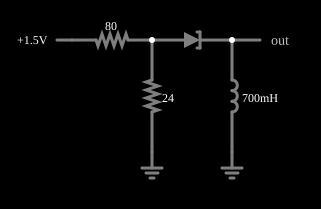

# Oscilador de relaxação com diodo túnel

<!-- navegacao:inicio -->
[Índice](README.md) · [Anterior: LC Oscillator](tdosc.md)
<!-- navegacao:fim -->

## Objetivo

Mostrar um **oscilador de relaxação**: sem capacitor, só com um indutor, a resistência negativa do diodo túnel faz a corrente subir e descer entre dois valores fixos, saltando da curva de baixa tensão para a de alta tensão e de volta.

## O circuito

<!-- esquema:inicio -->

<!-- esquema:fim -->

A mesma polarização do exemplo anterior (fonte de $1{,}5\ \text{V}$ com divisor de $80\ \Omega$ e $24\ \Omega$, isto é, $0{,}346\ \text{V}$ em série com $18{,}46\ \Omega$) alimenta o diodo túnel em série com um indutor de $700\ \text{mH}$ para a terra. Não há capacitor.

<!-- componentes:inicio -->
| N.º | Tipo | Elemento | Valores |
|----:|------|----------|---------|
| 0 | `RailElm` | voltage source | Voltage = 1.5; Waveform = D/C; DC Offset (V) = 0; Internal Resistance (ohms) = 0 |
| 1 | `ResistorElm` | resistor | Resistance (ohms) = 80 |
| 2 | `ResistorElm` | resistor | Resistance (ohms) = 24 |
| 3 | `TunnelDiodeElm` | tunnel diode |  |
| 4 | `InductorElm` | inductor | Inductance (H) = 700m; Trapezoidal Approximation = sim; Initial Current (on Reset) (A) = 0; Saturation Current (A) (0=none) = 0 |
| 5 | `OutputElm` | output | Show Voltage = não |
| 6 | `GroundElm` | ground | Symbol = Earth |
| 7 | `GroundElm` | ground | Symbol = Earth |
<!-- componentes:fim -->

## Símbolos e parâmetros

Os símbolos usados neste documento (definições completas no [glossário](../glossario-simbolos.md)):

| Símbolo | Nome | Significado | Unidade |
|---------|------|-------------|---------|
| $t$ | tempo | instante, contado a partir do início da simulação | s |
| $T$ | período | duração de um ciclo completo de um sinal periódico | s |
| $I$ | corrente | intensidade da corrente elétrica que passa por um ramo | A |
| $L$ | indutância | quanto fluxo magnético uma bobina cria por ampère | H |
| $V$ | tensão | diferença de potencial elétrico entre dois pontos do circuito | V |
| $I_P$ | corrente de pico | corrente no pico da curva do dispositivo | A |
| $V_P$ | tensão de pico do dispositivo | tensão em que o dispositivo passa a conduzir (pico da curva) | V |
| $V_{PP}$ | tensão de pico do diodo | tensão do pico da curva do diodo túnel | V |
| $V_T$ | tensão térmica | $kT/q$: cerca de $25{,}85\ \text{mV}$ a $300\ \text{K}$ | V |
| $I_V$ | corrente de vale | corrente no vale da curva do dispositivo | A |
| $V_V$ | tensão de vale | tensão do vale da curva do dispositivo | V |
| $V_{\text{th}}$ | tensão de limiar | $V_{GS}$ a partir da qual o canal do MOSFET começa a conduzir | V |
| $R_{\text{th}}$ | resistência de Thévenin | resistência vista dos terminais com as fontes desligadas | Ω |
| $V_D$ | tensão no diodo | tensão entre o ânodo e o cátodo do diodo | V |
| $V_{\text{baixa}}$ | tensão do ramo baixo | tensão do ramo de tensão baixa da curva | V |
| $V_{\text{alta}}$ | tensão do ramo alto | tensão do ramo de tensão alta da curva | V |

## Teoria

O diodo túnel do simulador tem a corrente

$$I(V) = I_P\thinspace\frac{V}{V_P}\thinspace e^{1 - V/V_P} + I_P\thinspace e^{-V_{PP}/V_T}\left(e^{V/V_T} - 1\right) + I_V\left(e^{V - V_V} - e^{-V_V}\right),$$

com $V_P = 0{,}1\ \text{V}$, $I_P = 4{,}7\ \text{mA}$, $V_V = 0{,}37\ \text{V}$, $I_V = 370\ \mu\text{A}$, $V_T = 26\ \text{mV}$ e $V_{PP} = 0{,}525\ \text{V}$. O primeiro termo é o de tunelamento (pico), o segundo, a corrente de difusão usual (Shockley) e o terceiro, uma corrente excedente que cresce de novo depois do vale. A curva tem um **pico** de $4{,}73\ \text{mA}$ em $0{,}10\ \text{V}$ e um **vale** de $1{,}00\ \text{mA}$ em $0{,}43\ \text{V}$; entre os dois, a inclinação é negativa: é a região de resistência diferencial negativa.

A corrente no indutor é contínua; a tensão no diodo, não. Com $I$ entre $I_V$ e $I_P$ há dois valores possíveis de $V$ (um na rampa de baixa tensão, outro na de alta). A dinâmica é $L\thinspace dI/dt = V_{th} - R_{th}I - V_D(I)$:

- No ramo de baixa tensão ($V_D \approx 0$ a $0{,}1\ \text{V}$) a corrente **sobe**; quando atinge o pico $I_P = 4{,}73\ \text{mA}$ o ramo desaparece e a tensão do diodo **salta** para o ramo de alta tensão ($0{,}52\ \text{V}$ com a mesma corrente).
- No ramo de alta tensão, $V_D > V_{th} - R_{th}I$ e a corrente **desce**, até o vale, $I_V = 1{,}00\ \text{mA}$, onde o ramo desaparece e a tensão salta de volta para $0{,}009\ \text{V}$.

O período é a soma dos tempos nos dois ramos,

$$T = L\int_{I_V}^{I_P}\frac{dI}{V_{th} - R_{th}I - V_{baixa}(I)} + L\int_{I_V}^{I_P}\frac{dI}{V_{alta}(I) + R_{th}I - V_{th}},$$

que, integrado numericamente com a curva do diodo, dá $10{,}4\ \text{ms} + 13{,}0\ \text{ms} = 23{,}3\ \text{ms}$, ou $42{,}9\ \text{Hz}$.

## Resultados esperados

O simulador dá, em regime permanente:

- **Frequência:** $42{,}3\ \text{Hz}$ (a integral dá $42{,}9\ \text{Hz}$, diferença de $1{,}3\ \%$).
- **Corrente no indutor:** oscila entre $0{,}99\ \text{mA}$ (vale) e $4{,}75\ \text{mA}$ (pico).
- **Tensão no diodo:** salta entre $0{,}008\ \text{V}$ e $0{,}524\ \text{V}$ (os valores que a curva dá para essas correntes são $0{,}009\ \text{V}$ e $0{,}522\ \text{V}$): uma onda quase retangular.

## O que observar

No osciloscópio, a corrente no indutor é uma onda triangular assimétrica (sobe em cerca de $10{,}4\ \text{ms}$ e desce em cerca de $13{,}0\ \text{ms}$) e a tensão do diodo é uma onda quase quadrada. Não há capacitor: o período é proporcional a $L$, e dobrar a indutância dobra o período.

## Limites do modelo

- O diodo é modelado só pela curva estática; num diodo real as capacitâncias parasitas limitam a velocidade dos saltos, que no modelo são instantâneos.
- A integral acima desprezou o tempo dos saltos e usou os valores do pico e do vale da curva do modelo.

## Referências

Sze e Ng, *Physics of Semiconductor Devices*, capítulo sobre o diodo túnel; Esaki, *New phenomenon in narrow germanium p-n junctions*, Physical Review 109 (1958).

O circuito deste exemplo faz parte da coleção do simulador original de Paul Falstad e Iain Sharp (CircuitJS1); a explicação é deste projeto.
