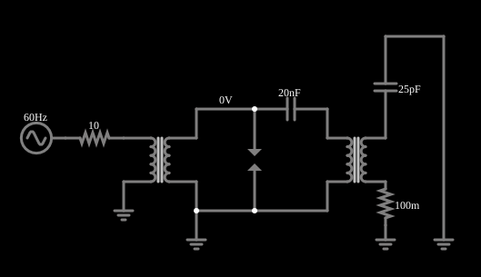

# Bobina de Tesla

<!-- navegacao:inicio -->
[Índice](README.md) · [Anterior: Sawtooth Generator](spark-sawtooth.md) · [Próximo: Marx Generator](spark-marx.md)
<!-- navegacao:fim -->

## Objetivo

Mostrar uma **bobina de Tesla**: dois circuitos ressonantes sintonizados na mesma frequência, acoplados por um transformador de núcleo de ar, trocam energia e elevam a tensão da faixa de dezenas de quilovolts a centenas de quilovolts.

## O circuito

<!-- esquema:inicio -->

<!-- esquema:fim -->

A rede ($169{,}7\ \text{V}$ de pico, $60\ \text{Hz}$, em série com um resistor de $10\ \Omega$) alimenta o primário de um transformador elevador de relação $1:100$ ($10\ \text{H}$ no primário). O secundário (cerca de $17\ \text{kV}$) carrega um capacitor de $20\ \text{nF}$ em paralelo com um centelhador de ruptura $10\ \text{kV}$. Quando o centelhador dispara, o capacitor descarrega no primário de uma bobina de Tesla de $31{,}7\ \mu\text{H}$, acoplada com $k = 0{,}1$ a um secundário de relação $28{,}3$ ($\approx 25{,}4\ \text{mH}$) com uma capacitância de topo de $25\ \text{pF}$ e resistência de $0{,}1\ \Omega$. Dois osciloscópios mostram o centelhador e o topo da bobina.

<!-- componentes:inicio -->
| N.º | Tipo | Elemento | Valores |
|----:|------|----------|---------|
| 0 | `GroundElm` | ground | Symbol = Earth |
| 1 | `ResistorElm` | resistor | Resistance (ohms) = 10 |
| 2 | `RailElm` | A/C source | Max Voltage = 169.7; Waveform = A/C; DC Offset (V) = 0; Internal Resistance (ohms) = 0; Show Voltage = não; Frequency (Hz) = 60; Phase Offset (degrees) = 0 |
| 3 | `TransformerElm` | transformer | Primary Inductance (H) = 10; Ratio (N1/N2) = 10m; Coupling Coefficient = 999m; Trapezoidal Approximation = não; Swap Secondary Polarity = não; Saturation Current (A) (0=none) = 0 |
| 4 | `CapacitorElm` | capacitor | Capacitance (F) = 20n; Trapezoidal Approximation = sim; Initial Voltage (on Reset) = 1m; Series Resistance = 0 |
| 8 | `GroundElm` | ground | Symbol = Earth |
| 13 | `CapacitorElm` | capacitor | Capacitance (F) = 25p; Trapezoidal Approximation = sim; Initial Voltage (on Reset) = 1m; Series Resistance = 0 |
| 14 | `ResistorElm` | resistor | Resistance (ohms) = 100m |
| 15 | `GroundElm` | ground | Symbol = Earth |
| 16 | `TransformerElm` | transformer | Primary Inductance (H) = 31.7μ; Ratio (N1/N2) = 35.4m; Coupling Coefficient = 100m; Trapezoidal Approximation = não; Swap Secondary Polarity = não; Saturation Current (A) (0=none) = 0 |
| 17 | `SparkGapElm` | spark gap | On resistance (ohms) = 1; Off resistance (ohms) = 1G; Breakdown voltage = 10k; Holding current (A) = 1m |
| 19 | `GroundElm` | ground | Symbol = Earth |
<!-- componentes:fim -->

## Símbolos e parâmetros

Os símbolos usados neste documento (definições completas no [glossário](../glossario-simbolos.md)):

| Símbolo | Nome | Significado | Unidade |
|---------|------|-------------|---------|
| $k$ | coeficiente de acoplamento | fração do fluxo de uma bobina que atravessa a outra (de $0$ a $1$) | — |
| $f_1$ | frequência 1 | frequência chamada $f_1$ no circuito | Hz |
| $L_1$ | indutância do indutor 1 | indutância do indutor chamado $L_1$ no circuito | H |
| $C_1$ | capacitância do capacitor 1 | capacitância do capacitor chamado $C_1$ no circuito | F |
| $f_2$ | frequência 2 | frequência chamada $f_2$ no circuito | Hz |
| $L_2$ | indutância do indutor 2 | indutância do indutor chamado $L_2$ no circuito | H |
| $C_2$ | capacitância do capacitor 2 | capacitância do capacitor chamado $C_2$ no circuito | F |
| $V_1$ | tensão 1 | tensão chamada $V_1$ no circuito | V |
| $V_2$ | tensão 2 | tensão chamada $V_2$ no circuito | V |

## Teoria

O centelhador (*spark gap*) do simulador é uma chave controlada pela tensão: com resistência de **abertura** muito alta ($1\ \text{G}\Omega$) até que a tensão entre os terminais atinja a **tensão de ruptura**; a partir daí ele passa a ter a resistência de **condução**, e só volta a abrir quando a corrente cai abaixo da **corrente de manutenção**.

Os dois circuitos ressonantes têm a mesma frequência:

$$f_1 = \frac{1}{2\pi\sqrt{L_1 C_1}} = \frac{1}{2\pi\sqrt{31{,}7\ \mu\text{H}\cdot 20\ \text{nF}}} = 200\ \text{kHz},\qquad f_2 = \frac{1}{2\pi\sqrt{L_2 C_2}} = \frac{1}{2\pi\sqrt{25{,}4\ \text{mH}\cdot 25\ \text{pF}}} = 200\ \text{kHz},$$

e, com acoplamento $k = 0{,}1$, a energia passa do primário ao secundário em cerca de $1/(2k) = 5$ ciclos. A energia $\tfrac12 C_1V_1^2 = 1\ \text{J}$ (com $V_1 = 10\ \text{kV}$), toda transferida para $C_2$, daria

$$V_2 = V_1\sqrt{\frac{C_1}{C_2}} = 10\ \text{kV}\cdot\sqrt{\frac{20\ \text{nF}}{25\ \text{pF}}} = 283\ \text{kV}$$

como limite superior, a tensão de topo se não houvesse perdas e a transferência fosse completa.

## Resultados esperados

O simulador dá, em regime permanente:

- **Capacitor do primário:** carrega a $\pm 10{,}00\ \text{kV}$, o limite de ruptura do centelhador.
- **Topo do secundário:** chega a $\pm 215\ \text{kV}$, $21{,}5$ vezes a tensão do primário e $76\ \%$ do limite de $283\ \text{kV}$ calculado acima.
- **Corrente no centelhador:** pico de $245\ \text{A}$ na descarga.
- **Corrente na rede:** pico de $11{,}6\ \text{A}$.

## O que observar

Veja o osciloscópio do topo: a tensão cresce em pacotes de oscilações de $200\ \text{kHz}$ a cada disparo do centelhador, com envelope que sobe enquanto a energia passa do primário ao secundário e depois decai. Esse é o *ring-up* típico de uma bobina de Tesla.

## Limites do modelo

- O transformador do estágio de carga é de núcleo ideal com $k = 0{,}999$; a rede real teria indutância de dispersão mais alta, que limita a corrente de carga.
- O centelhador é ideal ($1\ \Omega$ de condução, ruptura em $10\ \text{kV}$); uma bobina real perde energia no arco e em radiação, e o ganho de tensão fica bem abaixo do limite teórico.
- A simulação é pesada (passo de $10\ \text{ns}$): leva cerca de dez segundos de processamento por ciclo da rede.

## Referências

Kuffel, Zaengl e Kuffel, *High Voltage Engineering: Fundamentals*, capítulos sobre ruptura de gases e geradores de impulso; Marx, *Eine neue Methode zur Erzeugung hoher Spannungen*, Elektrotechnische Zeitschrift (1924). Tesla, patente US 568.176 (1896).

O circuito deste exemplo faz parte da coleção do simulador original de Paul Falstad e Iain Sharp (CircuitJS1); a explicação é deste projeto.
