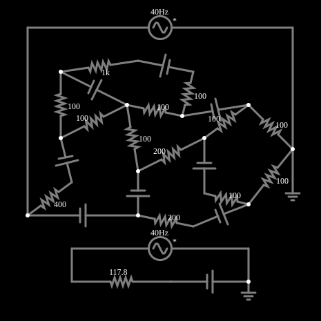

# Teorema de Thévenin

<!-- navegacao:inicio -->
[Índice](README.md) · [Anterior: Potentiometer Divider](potdivide.md) · [Próximo: Norton's Theorem](norton.md)
<!-- navegacao:fim -->

## Objetivo

Mostrar que qualquer rede linear de resistores e fontes, vista de dois terminais, se comporta como uma única fonte $V_{th}$ em série com uma resistência $R_{th}$ (equivalente de Thévenin).

## O circuito

<!-- esquema:inicio -->

<!-- esquema:fim -->

À esquerda há uma rede de 13 resistores e 8 fontes de tensão contínua. À direita, o equivalente de Thévenin dessa rede visto de dois terminais: uma fonte de $2{,}8076\ \text{V}$ em série com um resistor de $117{,}78\ \Omega$. Para provar a equivalência, uma fonte alternada de teste (5 V, 40 Hz) é ligada aos terminais da rede original e outra, idêntica, aos terminais do equivalente. Os dois osciloscópios mostram as correntes das duas fontes.

<!-- componentes:inicio -->
| N.º | Tipo | Elemento | Valores |
|----:|------|----------|---------|
| 0 | `ResistorElm` | resistor | Resistance (ohms) = 100 |
| 1 | `ResistorElm` | resistor | Resistance (ohms) = 100 |
| 2 | `ResistorElm` | resistor | Resistance (ohms) = 200 |
| 3 | `ResistorElm` | resistor | Resistance (ohms) = 100 |
| 4 | `ResistorElm` | resistor | Resistance (ohms) = 100 |
| 5 | `VoltageElm` | voltage source | Voltage = 5; Waveform = D/C; DC Offset (V) = 0; Internal Resistance (ohms) = 0; Show Voltage = não; Circle Symbol = não |
| 6 | `VoltageElm` | voltage source | Voltage = 5; Waveform = D/C; DC Offset (V) = 0; Internal Resistance (ohms) = 0; Show Voltage = não; Circle Symbol = não |
| 7 | `VoltageElm` | voltage source | Voltage = 5; Waveform = D/C; DC Offset (V) = 0; Internal Resistance (ohms) = 0; Show Voltage = não; Circle Symbol = não |
| 8 | `VoltageElm` | voltage source | Voltage = 5; Waveform = D/C; DC Offset (V) = 0; Internal Resistance (ohms) = 0; Show Voltage = não; Circle Symbol = não |
| 9 | `VoltageElm` | voltage source | Voltage = 5; Waveform = D/C; DC Offset (V) = 0; Internal Resistance (ohms) = 0; Show Voltage = não; Circle Symbol = não |
| 10 | `ResistorElm` | resistor | Resistance (ohms) = 200 |
| 11 | `ResistorElm` | resistor | Resistance (ohms) = 400 |
| 12 | `ResistorElm` | resistor | Resistance (ohms) = 100 |
| 13 | `ResistorElm` | resistor | Resistance (ohms) = 100 |
| 14 | `ResistorElm` | resistor | Resistance (ohms) = 1k |
| 15 | `VoltageElm` | voltage source | Voltage = 5; Waveform = D/C; DC Offset (V) = 0; Internal Resistance (ohms) = 0; Show Voltage = não; Circle Symbol = não |
| 16 | `VoltageElm` | voltage source | Voltage = 2; Waveform = D/C; DC Offset (V) = 0; Internal Resistance (ohms) = 0; Show Voltage = não; Circle Symbol = não |
| 17 | `VoltageElm` | voltage source | Voltage = 5; Waveform = D/C; DC Offset (V) = 0; Internal Resistance (ohms) = 0; Show Voltage = não; Circle Symbol = não |
| 18 | `ResistorElm` | resistor | Resistance (ohms) = 100 |
| 19 | `ResistorElm` | resistor | Resistance (ohms) = 100 |
| 20 | `ResistorElm` | resistor | Resistance (ohms) = 100 |
| 23 | `ResistorElm` | resistor | Resistance (ohms) = 117.8 |
| 26 | `VoltageElm` | voltage source | Voltage = 2.8; Waveform = D/C; DC Offset (V) = 0; Internal Resistance (ohms) = 0; Show Voltage = não; Circle Symbol = não |
| 27 | `VoltageElm` | A/C source | Max Voltage = 5; Waveform = A/C; DC Offset (V) = 0; Internal Resistance (ohms) = 0; Show Voltage = não; Frequency (Hz) = 40; Phase Offset (degrees) = 0 |
| 28 | `VoltageElm` | A/C source | Max Voltage = 5; Waveform = A/C; DC Offset (V) = 0; Internal Resistance (ohms) = 0; Show Voltage = não; Frequency (Hz) = 40; Phase Offset (degrees) = 0 |
| 29 | `GroundElm` | ground | Symbol = Earth |
| 30 | `GroundElm` | ground | Symbol = Earth |
<!-- componentes:fim -->

## Teoria

**Teorema de Thévenin.** Uma rede linear de dois terminais é equivalente a uma fonte de tensão $V_{th}$ em série com uma resistência $R_{th}$, onde:

- $V_{th}$ é a tensão em aberto entre os terminais;
- $R_{th}$ é a resistência vista dos terminais com todas as fontes independentes zeradas (fontes de tensão em curto, de corrente abertas); ou $R_{th}=V_{th}/I_{cc}$, com $I_{cc}$ a corrente de curto-circuito.

Ligando a mesma carga aos dois, a tensão e a corrente na carga são idênticas. Para uma carga $R_L$:

$$I_L = \frac{V_{th}}{R_{th}+R_L},\qquad V_L = V_{th}\,\frac{R_L}{R_{th}+R_L}.$$

Por superposição, a rede responde linearmente a qualquer fonte de teste, de modo que a igualdade para um sinal senoidal de 40 Hz prova a equivalência.

## Resultados esperados

A corrente das duas fontes de teste é a mesma a cada instante: em $t=12{,}5\ \text{ms}$ (a fonte de teste passa por zero) cada uma fornece $23{,}78\ \text{mA}$ em módulo, o que é a corrente de curto-circuito $V_{th}/R_{th} = 2{,}8076/117{,}78 = 23{,}84\ \text{mA}$ menos o pequeno efeito dos $6\ \text{mV}$ restantes da fonte de teste. Em $t=10\ \text{ms}$ cada uma fornece $1{,}158\ \text{mA}$. As verificações conferem as duas correntes nos dois instantes.

## O que observar

- Compare os dois osciloscópios: as curvas coincidem.
- Altere um resistor da rede original: a equivalência deixa de valer (o equivalente precisaria ser recalculado).
- Troque a fonte de teste por outra frequência: as correntes continuam coincidindo, pois a rede é linear.

## Limites do modelo

Rede linear de elementos ideais; o equivalente só vale para os dois terminais escolhidos e para sinais em que a rede é linear (resistores, fontes independentes).

## Referências

- J. W. Nilsson e S. A. Riedel, *Circuitos Elétricos*, Pearson.
- C. K. Alexander e M. N. O. Sadiku, *Fundamentos de Circuitos Elétricos*, AMGH.

O circuito deste exemplo faz parte da coleção do simulador original de Paul Falstad e Iain Sharp (CircuitJS1); a explicação é deste projeto.
