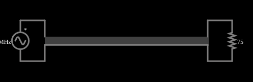

# Linha de transmissão casada

<!-- navegacao:inicio -->
[Índice](README.md) · [Próximo: Standing Wave](tlstand.md)
<!-- navegacao:fim -->

## Objetivo

Mostrar o efeito mais simples de uma **linha de transmissão**: o sinal que entra numa ponta aparece na outra com um *atraso* fixo e sem distorção, porque a carga é igual à impedância característica da linha.

## O circuito

<!-- esquema:inicio -->

<!-- esquema:fim -->

Uma fonte senoidal de $5\ \text{V}$ de pico e $40\ \text{MHz}$ alimenta diretamente uma linha sem perdas de impedância característica $Z_0 = 75\ \Omega$ e atraso $\tau = 30\ \text{ns}$. A outra ponta termina num resistor de $75\ \Omega$, igual a $Z_0$. Não há osciloscópio: as tensões se leem nos terminais dos elementos.

<!-- componentes:inicio -->
| N.º | Tipo | Elemento | Valores |
|----:|------|----------|---------|
| 0 | `TransLineElm` | transmission line | Delay (s) = 30n; Impedance (ohms) = 75 |
| 5 | `ResistorElm` | resistor | Resistance (ohms) = 75 |
| 6 | `VoltageElm` | A/C source | Max Voltage = 5; Waveform = A/C; DC Offset (V) = 0; Internal Resistance (ohms) = 0; Show Voltage = não; Frequency (Hz) = 40M; Phase Offset (degrees) = 0 |
<!-- componentes:fim -->

## Teoria

Numa linha sem perdas, uma onda de tensão viaja com velocidade $v = \ell/\tau$ e leva consigo uma corrente $I = V/Z_0$. Ao chegar a uma carga $R_L$, parte da onda é refletida com o coeficiente

$$\Gamma = \frac{R_L - Z_0}{R_L + Z_0}.$$

Com $R_L = Z_0$ temos $\Gamma = 0$: toda a potência é absorvida e não há onda refletida. A tensão na carga é então a da fonte atrasada de $\tau$:

$$v_L(t) = V_p \sin\bigl(2\pi f\,(t - \tau)\bigr),\qquad \varphi = 360^\circ f\tau = 360^\circ \cdot 40\ \text{MHz}\cdot 30\ \text{ns} = 432^\circ \equiv 72^\circ.$$

A linha parece, para a fonte, um resistor de $Z_0$: a corrente de pico é $V_p/Z_0 = 5/75 = 66{,}7\ \text{mA}$.

## Resultados esperados

O simulador dá:

- **Amplitude na carga:** $+5\ \text{V}$ e $-5\ \text{V}$ nos extremos, valor eficaz $3{,}536\ \text{V}$ ($5/\sqrt 2$), sem nenhuma atenuação.
- **Atraso:** antes de $30\ \text{ns}$ a carga fica em $0\ \text{V}$. Em $t = 100\ \text{ns}$ a tensão no resistor é $-4{,}757\ \text{V}$ (com a polaridade do elemento), o valor de $5\sin(2\pi\cdot 40\ \text{MHz}\cdot 70\ \text{ns}) = -4{,}755\ \text{V}$.
- **Corrente da fonte:** pico de $66{,}7\ \text{mA}$, isto é, $5\ \text{V}/75\ \Omega$.

## O que observar

Compare o instante em que a fonte passa por zero com o instante em que a carga passa por zero: a diferença é de $30\ \text{ns}$, um ciclo e um quinto do período de $25\ \text{ns}$. Altere a impedância ou a carga e veja a onda refletida aparecer (os exemplos seguintes fazem isso).

## Limites do modelo

- A linha é ideal: sem perdas e sem dispersão. Uma linha real atenua o sinal e distorce pulsos largos.
- O atraso de $30\ \text{ns}$ equivale a cerca de $6\ \text{m}$ de cabo com $v \approx 2\cdot 10^8\ \text{m/s}$; o simulador não modela comprimento, só o atraso.

## Referências

Pozar, *Microwave Engineering*, capítulo 2 (teoria de linhas de transmissão); Ramo, Whinnery e Van Duzer, *Fields and Waves in Communication Electronics*, capítulo sobre linhas de transmissão.

O circuito deste exemplo faz parte da coleção do simulador original de Paul Falstad e Iain Sharp (CircuitJS1); a explicação é deste projeto.
