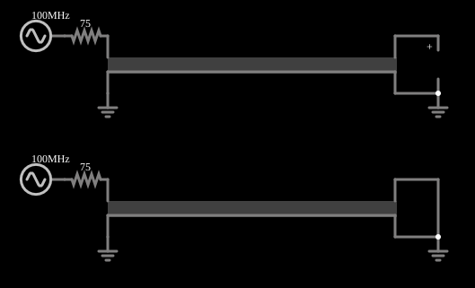

# Resposta em frequência de uma linha em aberto e em curto

<!-- navegacao:inicio -->
[Índice](README.md) · [Anterior: Impedance Matching (Shunt Stub)](tlmatch2.md) · [Próximo: Low-Pass Filter](tllopass.md)
<!-- navegacao:fim -->

## Objetivo

Mostrar como a **impedância de entrada** de um trecho de linha de transmissão varia com a frequência, alternando entre quase zero e quase infinito, quando a ponta está aberta ou em curto.

## O circuito

<!-- esquema:inicio -->

<!-- esquema:fim -->

Duas linhas de $75\ \Omega$ e $5\ \text{ns}$ são alimentadas, cada uma por um resistor de $75\ \Omega$, por uma fonte de varredura linear de $100\ \text{MHz}$ a $500\ \text{MHz}$ em $400\ \text{ns}$ (ida e volta). A ponta da linha de cima está **aberta** (com um voltímetro) e a da linha de baixo está **em curto**. Um osciloscópio acompanha o resistor de cada circuito.

<!-- componentes:inicio -->
| N.º | Tipo | Elemento | Valores |
|----:|------|----------|---------|
| 2 | `SweepElm` | sweep (linear) | Min Frequency (Hz) = 100M; Max Frequency (Hz) = 500M; Sweep Time (s) = 400n; Logarithmic = não; Max Voltage = 5; Bidirectional = sim |
| 3 | `GroundElm` | ground | Symbol = Earth |
| 4 | `ResistorElm` | resistor | Resistance (ohms) = 75 |
| 5 | `GroundElm` | ground | Symbol = Earth |
| 6 | `ProbeElm` | voltmeter | Show Voltage = não; Value = Voltage; Scale = Auto; Use Circle Symbol = não; Series Resistance (0 = infinite) = 0; Label =  |
| 7 | `SweepElm` | sweep (linear) | Min Frequency (Hz) = 100M; Max Frequency (Hz) = 500M; Sweep Time (s) = 400n; Logarithmic = não; Max Voltage = 5; Bidirectional = sim |
| 8 | `ResistorElm` | resistor | Resistance (ohms) = 75 |
| 12 | `TransLineElm` | transmission line | Delay (s) = 5n; Impedance (ohms) = 75 |
| 13 | `TransLineElm` | transmission line | Delay (s) = 5n; Impedance (ohms) = 75 |
| 14 | `GroundElm` | ground | Symbol = Earth |
| 15 | `GroundElm` | ground | Symbol = Earth |
<!-- componentes:fim -->

## Símbolos e parâmetros

Os símbolos usados neste documento (definições completas no [glossário](../glossario-simbolos.md)):

| Símbolo | Nome | Significado | Unidade |
|---------|------|-------------|---------|
| $t$ | tempo | instante, contado a partir do início da simulação | s |
| $f$ | frequência | número de ciclos por segundo de um sinal periódico | Hz |
| $I$ | corrente | intensidade da corrente elétrica que passa por um ramo | A |
| $\theta$ | ângulo | ângulo de fase ou de condução | rad |
| $\tau$ | constante de tempo | tempo característico de carga ou descarga de um circuito (por exemplo, $RC$ ou $L/R$) | s |
| $Z_{\text{aberta}}$ | impedância em aberto | impedância de entrada da linha terminada em aberto | Ω |
| $Z_0$ | impedância característica | razão entre tensão e corrente de uma onda que percorre a linha | Ω |
| $Z_{\text{curto}}$ | impedância em curto | impedância de entrada da linha terminada em curto-circuito | Ω |
| $Z_{\text{in}}$ | impedância de entrada | impedância vista pela fonte olhando para a entrada do circuito | Ω |
| $V_p$ | tensão de pico | valor máximo atingido por uma senoide | V |
| $R_s$ | resistência em série | resistor em série com a fonte ou com o dispositivo | Ω |

## Teoria

Uma linha sem perdas de comprimento elétrico $\theta = 2\pi f\tau$ tem impedância de entrada

$$Z_{\text{aberta}} = -jZ_0\cot\theta,\qquad Z_{\text{curto}} = jZ_0\tan\theta.$$

Com $\tau = 5\ \text{ns}$, $\theta = \pi f/100\ \text{MHz}$. Então a linha **aberta** tem $Z_{\text{in}} = 0$ em $50$, $150$, $250\ \text{MHz}$... (um quarto de onda, mais múltiplos de meia onda) e $Z_{\text{in}} \to \infty$ em $100$, $200$, $300\ \text{MHz}$... A linha **em curto** é o complemento. A corrente no resistor da fonte,

$$I = \frac{V_p}{R_s + Z_{\text{in}}},$$

vai portanto ao máximo $V_p/R_s = 66{,}7\ \text{mA}$ quando $Z_{\text{in}} = 0$ e a quase zero quando $|Z_{\text{in}}| \to \infty$.

## Resultados esperados

A frequência da varredura é $f(t) = 100\ \text{MHz} + 1\ \text{MHz/ns}\cdot t$ (na subida), e o simulador dá, para a amplitude da corrente no resistor de cada circuito em torno de cada instante:

| $t$ | $f$ | Linha aberta | Linha em curto |
|---:|---:|---:|---:|
| $50\ \text{ns}$ | $150\ \text{MHz}$ | $65{,}8\ \text{mA}$ (máximo) | $7{,}6\ \text{mA}$ |
| $100\ \text{ns}$ | $200\ \text{MHz}$ | $16{,}1\ \text{mA}$ | $66{,}2\ \text{mA}$ (máximo) |
| $150\ \text{ns}$ | $250\ \text{MHz}$ | $66{,}6\ \text{mA}$ (máximo) | $17{,}0\ \text{mA}$ |
| $200\ \text{ns}$ | $300\ \text{MHz}$ | $14{,}1\ \text{mA}$ | $66{,}1\ \text{mA}$ (máximo) |

Os máximos ficam muito perto de $66{,}7\ \text{mA}$; os mínimos não são zero porque cada valor é o máximo de uma janela de $8\ \text{ns}$ ($\pm 4\ \text{MHz}$) em torno da frequência, e a impedância muda depressa perto desses pontos.

## O que observar

Veja os osciloscópios: as duas correntes alternam de máximo para mínimo a cada $50\ \text{MHz}$, e quando uma está no máximo a outra está no mínimo. É o princípio dos **tocos** como filtros e dos transformadores de quarto de onda.

## Limites do modelo

- A linha é ideal, sem perdas; numa linha real os picos e vales ficam atenuados.
- Cada valor é um máximo medido numa janela de tempo, porque a frequência varia durante a medida; com uma fonte de frequência fixa os mínimos seriam ainda menores.
- A varredura volta de $500\ \text{MHz}$ a $100\ \text{MHz}$ na segunda metade do período e repete a curva ao contrário.

## Referências

Pozar, *Microwave Engineering*, capítulo 2 (linhas de transmissão) e capítulo 5 (casamento de impedâncias); Ramo, Whinnery e Van Duzer, *Fields and Waves in Communication Electronics*, capítulo sobre linhas de transmissão.

O circuito deste exemplo faz parte da coleção do simulador original de Paul Falstad e Iain Sharp (CircuitJS1); a explicação é deste projeto.
