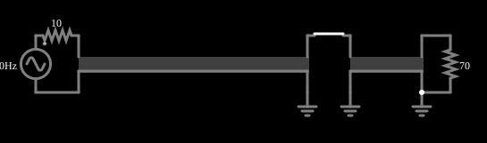

# Interruptor de luz numa linha longa

<!-- navegacao:inicio -->
[Índice](README.md) · [Anterior: Low-Pass Filter](tllopass.md)
<!-- navegacao:fim -->

## Objetivo

Mostrar que, numa linha longa, **ligar um interruptor não acende a carga na hora**: a mudança viaja como uma onda, chega à carga com atraso e com amplitude diferente da final, e só depois de várias reflexões a tensão se aproxima do valor de regime.

## O circuito

<!-- esquema:inicio -->

<!-- esquema:fim -->

Uma fonte de $169{,}7\ \text{V}$ de pico e $60\ \text{Hz}$ (a tensão da rede de $120\ \text{V}$ eficazes, com fase de $90^\circ$, no pico no instante inicial) tem resistência interna de $10\ \Omega$ e alimenta, por uma linha de $300\ \Omega$ e $60\ \text{ns}$, um interruptor, depois um segundo trecho de $300\ \Omega$ e $10\ \text{ns}$ e uma lâmpada de $70\ \Omega$. Dois osciloscópios mostram a tensão da fonte e a da lâmpada.

<!-- componentes:inicio -->
| N.º | Tipo | Elemento | Valores |
|----:|------|----------|---------|
| 0 | `TransLineElm` | transmission line | Delay (s) = 60n; Impedance (ohms) = 300 |
| 1 | `ResistorElm` | resistor | Resistance (ohms) = 10 |
| 5 | `ResistorElm` | resistor | Resistance (ohms) = 70 |
| 6 | `VoltageElm` | A/C source | Max Voltage = 169.7; Waveform = A/C; DC Offset (V) = 0; Internal Resistance (ohms) = 0; Show Voltage = não; Frequency (Hz) = 60; Phase Offset (degrees) = 90 |
| 7 | `GroundElm` | ground | Symbol = Earth |
| 8 | `GroundElm` | ground | Symbol = Earth |
| 9 | `GroundElm` | ground | Symbol = Earth |
| 10 | `TransLineElm` | transmission line | Delay (s) = 10n; Impedance (ohms) = 300 |
| 11 | `SwitchElm` | switch (SPST) | Momentary Switch = não; IEC Symbol = não; Label (for linking) = ; Keyboard Shortcut = ; On Resistance (ohms) = 0 |
<!-- componentes:fim -->

## Teoria

Para uma variação rápida (a chegada do pico da rede com o interruptor fechado) o sistema se comporta como uma linha de transmissão. A onda lançada na linha é

$$V_{\text{lanç}} = V_p\thinspace\frac{Z_0}{R_s + Z_0} = 169{,}7\cdot\frac{300}{310} = 164{,}2\ \text{V}.$$

Quando ela chega à lâmpada ($70\ \text{ns}$ depois, a soma dos atrasos), o coeficiente de reflexão é $\Gamma_L = (70 - 300)/(70 + 300) = -0{,}622$, e a tensão na lâmpada é

$$V_L = V_{\text{lanç}}(1 + \Gamma_L) = 164{,}2\cdot 0{,}378 = 62{,}1\ \text{V}.$$

A onda refletida volta para a fonte, onde reflete com $\Gamma_s = (10 - 300)/(10 + 300) = -0{,}935$, e a tensão na lâmpada vai aos poucos subindo, a cada ida e volta de $140\ \text{ns}$, para o valor de regime (divisor da fonte e da lâmpada, $R_L/(R_s + R_L) = 70/80$):

$$V_{L,\infty} = 169{,}7\cdot\frac{70}{80} = 148{,}5\ \text{V}.$$

Como $|\Gamma_s \Gamma_L| = 0{,}58$ por ida e volta, a convergência leva cerca de dez idas e voltas (cerca de $1{,}4\ \mu\text{s}$) para chegar a $1\ \%$ do valor final.

## Resultados esperados

O simulador dá, com o interruptor inicialmente fechado:

- **Antes de $70\ \text{ns}$:** a lâmpada fica em $0\ \text{V}$.
- **Em $100\ \text{ns}$:** a lâmpada está em $62{,}14\ \text{V}$, o valor de $V_L$ calculado acima, menos da metade da tensão final.
- **Em $1\ \mu\text{s}$:** a lâmpada está em $145{,}2\ \text{V}$ e a corrente no interruptor é de $2{,}07\ \text{A}$ ($145{,}2/70$), ainda um pouco abaixo dos $148{,}5\ \text{V}$ de regime.
- **Com o interruptor aberto desde o início:** a lâmpada fica em $0\ \text{V}$ e a linha, aberta na ponta, fica oscilando.

## O que observar

Abra e feche o interruptor e veja no osciloscópio da lâmpada o degrau de $62\ \text{V}$ seguido de degraus menores até o regime.

## Limites do modelo

- As linhas de $60\ \text{ns}$ e de $10\ \text{ns}$ (cerca de $12$ e $2\ \text{m}$ de cabo) são ideais, sem perdas; numa instalação real os degraus ficariam arredondados e as reflexões se atenuariam depressa.
- A lâmpada é um resistor de $70\ \Omega$ constante; uma lâmpada real tem resistência que depende da temperatura.
- O exemplo é didático: a $60\ \text{Hz}$ o comprimento de onda ($5000\ \text{km}$) é tão maior que a instalação que a rede se trata sempre como circuito concentrado.

## Referências

Pozar, *Microwave Engineering*, capítulo 2 (linhas de transmissão) e capítulo 5 (casamento de impedâncias); Ramo, Whinnery e Van Duzer, *Fields and Waves in Communication Electronics*, capítulo sobre linhas de transmissão.

O circuito deste exemplo faz parte da coleção do simulador original de Paul Falstad e Iain Sharp (CircuitJS1); a explicação é deste projeto.
