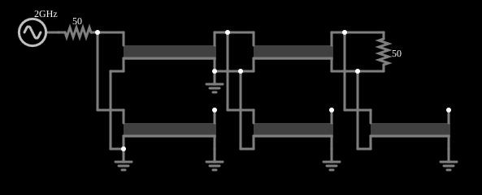

# Filtro passa-baixas de linhas de transmissão

<!-- navegacao:inicio -->
[Índice](README.md) · [Anterior: Stub Frequency Response](tlfreq.md) · [Próximo: Light Switch](tllight.md)
<!-- navegacao:fim -->

## Objetivo

Mostrar um **filtro passa-baixas de microondas** feito só de pedaços de linha de transmissão, sem indutores nem capacitores: linhas de alta impedância no lugar de indutores em série e tocos em aberto de baixa impedância no lugar de capacitores em paralelo.

## O circuito

<!-- esquema:inicio -->

<!-- esquema:fim -->

Uma fonte de varredura linear de $2\ \text{GHz}$ a $8\ \text{GHz}$ em $10\ \text{ns}$, com resistência interna de $50\ \Omega$, alimenta uma carga de $50\ \Omega$ por cinco linhas, todas com atraso de $31{,}3\ \text{ps}$:

1. toco em aberto de $64{,}9\ \Omega$ na entrada;
2. linha em série de $217{,}5\ \Omega$;
3. toco em aberto de $70{,}3\ \Omega$;
4. linha em série de $217{,}5\ \Omega$;
5. toco em aberto de $64{,}9\ \Omega$ na carga.

O osciloscópio mostra a tensão na carga.

<!-- componentes:inicio -->
| N.º | Tipo | Elemento | Valores |
|----:|------|----------|---------|
| 0 | `SweepElm` | sweep (linear) | Min Frequency (Hz) = 2G; Max Frequency (Hz) = 8G; Sweep Time (s) = 10n; Logarithmic = não; Max Voltage = 5; Bidirectional = sim |
| 1 | `TransLineElm` | transmission line | Delay (s) = 31.3p; Impedance (ohms) = 64.9 |
| 2 | `TransLineElm` | transmission line | Delay (s) = 31.3p; Impedance (ohms) = 217.5 |
| 6 | `TransLineElm` | transmission line | Delay (s) = 31.3p; Impedance (ohms) = 217.5 |
| 7 | `TransLineElm` | transmission line | Delay (s) = 31.3p; Impedance (ohms) = 70.3 |
| 8 | `TransLineElm` | transmission line | Delay (s) = 31.3p; Impedance (ohms) = 64.9 |
| 23 | `GroundElm` | ground | Symbol = Earth |
| 24 | `GroundElm` | ground | Symbol = Earth |
| 25 | `GroundElm` | ground | Symbol = Earth |
| 28 | `ResistorElm` | resistor | Resistance (ohms) = 50 |
| 29 | `GroundElm` | ground | Symbol = Earth |
| 30 | `GroundElm` | ground | Symbol = Earth |
| 31 | `ResistorElm` | resistor | Resistance (ohms) = 50 |
<!-- componentes:fim -->

## Teoria

Pela transformação de Richards, um pedaço de linha de comprimento elétrico $\theta = 2\pi f\tau$ se comporta como um indutor (em série, linha curta de alta impedância, $X \approx Z_0\tan\theta$) ou como um capacitor (em paralelo, toco aberto de baixa impedância, $B \approx \tan\theta/Z_0$). Os valores de $Z_0$ de cada seção são os de um filtro passa-baixas de ladder com cinco elementos: alternando indutores e capacitores, o filtro passa as baixas frequências e rejeita as altas.

Em $8\ \text{GHz}$, $\theta = 2\pi\cdot 8\ \text{GHz}\cdot 31{,}3\ \text{ps} = 90^\circ$: os tocos têm um quarto de onda, a impedância deles em aberto é nula e eles curto-circuitam a carga. A resposta em regime permanente, calculada com as matrizes $ABCD$ de cada seção, é:

| $f$ | $2{,}2$ | $3{,}0$ | $3{,}4$ | $4{,}0$ | $4{,}4$ | $5{,}0$ | $5{,}9\ \text{GHz}$ |
|---|---:|---:|---:|---:|---:|---:|---:|
| $\lvert V_L\rvert$ (teoria) | $1{,}77$ | $1{,}92$ | $2{,}37$ | $1{,}81$ | $0{,}80$ | $0{,}28$ | $0{,}06\ \text{V}$ |

## Resultados esperados

O simulador dá, para a amplitude máxima na carga numa janela de $0{,}2\ \text{ns}$ em torno de cada instante da varredura:

| Instante | $f$ | Carga |
|---:|---:|---:|
| $0{,}4\ \text{ns}$ | $2{,}2\ \text{GHz}$ | $1{,}95\ \text{V}$ |
| $1{,}6\ \text{ns}$ | $3{,}0\ \text{GHz}$ | $1{,}79\ \text{V}$ |
| $2{,}4\ \text{ns}$ | $3{,}4\ \text{GHz}$ | $2{,}04\ \text{V}$ |
| $3{,}3\ \text{ns}$ | $4{,}0\ \text{GHz}$ | $2{,}20\ \text{V}$ |
| $4{,}0\ \text{ns}$ | $4{,}4\ \text{GHz}$ | $1{,}53\ \text{V}$ |
| $5{,}1\ \text{ns}$ | $5{,}1\ \text{GHz}$ | $0{,}31\ \text{V}$ |
| $6{,}6\ \text{ns}$ | $5{,}9\ \text{GHz}$ | $0{,}08\ \text{V}$ |

O filtro passa até cerca de $4\ \text{GHz}$, com ondulação em torno de $2\ \text{V}$ (metade da fonte de $5\ \text{V}$ mais ou menos o efeito dos tocos), e cai depressa acima de $4{,}4\ \text{GHz}$, chegando a menos de $0{,}1\ \text{V}$ perto de $6\ \text{GHz}$.

## O que observar

Veja no osciloscópio a amplitude da carga acompanhando a frequência: plana (com ondulação) na faixa de passagem e despencando na faixa de rejeição. Os valores teóricos acima e os do simulador têm a mesma forma e a mesma região de corte.

## Limites do modelo

- O simulador e a teoria de regime permanente diferem em até cerca de $20\ \%$ na faixa de passagem (por exemplo, $2{,}04\ \text{V}$ contra $2{,}37\ \text{V}$ em $3{,}4\ \text{GHz}$) e concordam melhor na rejeição ($0{,}31\ \text{V}$ contra $0{,}28\ \text{V}$ em $5\ \text{GHz}$). A varredura não é um regime permanente, e este projeto não investigou a causa da diferença.
- As linhas são ideais e as junções não têm efeitos de borda, que num filtro real em microfita deslocam a frequência de corte.
- Cada valor é o máximo de uma janela de tempo, não uma medida de amplitude em frequência fixa.

## Referências

Pozar, *Microwave Engineering*, capítulo 2 (linhas de transmissão) e capítulo 5 (casamento de impedâncias); Ramo, Whinnery e Van Duzer, *Fields and Waves in Communication Electronics*, capítulo sobre linhas de transmissão.

O circuito deste exemplo faz parte da coleção do simulador original de Paul Falstad e Iain Sharp (CircuitJS1); a explicação é deste projeto.
