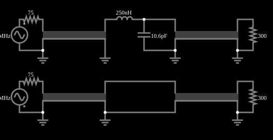

# Casamento de impedâncias com uma seção L

<!-- navegacao:inicio -->
[Índice](README.md) · [Anterior: Mismatched lines (Standing Wave)](tlmis1.md) · [Próximo: Impedance Matching (Shunt Stub)](tlmatch2.md)
<!-- navegacao:fim -->

## Objetivo

Mostrar como um indutor em série e um capacitor em paralelo (uma **seção L**) casam uma linha de $75\ \Omega$ com uma carga de $300\ \Omega$, e quanto isso aumenta a potência entregue em comparação com a ligação direta.

## O circuito

<!-- esquema:inicio -->

<!-- esquema:fim -->

Dois circuitos iguais, alimentados por fontes senoidais de $5\ \text{V}$ e $90\ \text{MHz}$ com resistência interna de $75\ \Omega$. Cada um tem uma linha de $75\ \Omega$ e $20\ \text{ns}$, seguida de uma linha de $300\ \Omega$ e $20\ \text{ns}$, terminada em $300\ \Omega$.

- **Circuito de cima (casado):** entre as duas linhas há um indutor de $250\ \text{nH}$ em série e um capacitor de $10{,}6\ \text{pF}$ para a terra, do lado da linha de $300\ \Omega$.
- **Circuito de baixo (descasado):** as duas linhas estão ligadas diretamente.

Os osciloscópios mostram a tensão na carga de cada circuito.

<!-- componentes:inicio -->
| N.º | Tipo | Elemento | Valores |
|----:|------|----------|---------|
| 0 | `TransLineElm` | transmission line | Delay (s) = 20n; Impedance (ohms) = 75 |
| 1 | `TransLineElm` | transmission line | Delay (s) = 20n; Impedance (ohms) = 300 |
| 2 | `ResistorElm` | resistor | Resistance (ohms) = 75 |
| 6 | `ResistorElm` | resistor | Resistance (ohms) = 300 |
| 7 | `VoltageElm` | A/C source | Max Voltage = 5; Waveform = A/C; DC Offset (V) = 0; Internal Resistance (ohms) = 0; Show Voltage = não; Frequency (Hz) = 90M; Phase Offset (degrees) = 0 |
| 8 | `GroundElm` | ground | Symbol = Earth |
| 9 | `GroundElm` | ground | Symbol = Earth |
| 10 | `GroundElm` | ground | Symbol = Earth |
| 11 | `InductorElm` | inductor | Inductance (H) = 250n; Trapezoidal Approximation = sim; Initial Current (on Reset) (A) = 0; Saturation Current (A) (0=none) = 0 |
| 12 | `CapacitorElm` | capacitor | Capacitance (F) = 10.6p; Trapezoidal Approximation = sim; Initial Voltage (on Reset) = 1m; Series Resistance = 0 |
| 15 | `VoltageElm` | A/C source | Max Voltage = 5; Waveform = A/C; DC Offset (V) = 0; Internal Resistance (ohms) = 0; Show Voltage = não; Frequency (Hz) = 90M; Phase Offset (degrees) = 0 |
| 16 | `ResistorElm` | resistor | Resistance (ohms) = 75 |
| 18 | `TransLineElm` | transmission line | Delay (s) = 20n; Impedance (ohms) = 75 |
| 19 | `TransLineElm` | transmission line | Delay (s) = 20n; Impedance (ohms) = 300 |
| 24 | `GroundElm` | ground | Symbol = Earth |
| 25 | `GroundElm` | ground | Symbol = Earth |
| 26 | `GroundElm` | ground | Symbol = Earth |
| 27 | `GroundElm` | ground | Symbol = Earth |
| 28 | `ResistorElm` | resistor | Resistance (ohms) = 300 |
<!-- componentes:fim -->

## Símbolos e parâmetros

Os símbolos usados neste documento (definições completas no [glossário](../glossario-simbolos.md)):

| Símbolo | Nome | Significado | Unidade |
|---------|------|-------------|---------|
| $R_1$ | resistência do resistor 1 | resistência do resistor chamado $R_1$ no circuito | Ω |
| $R_2$ | resistência do resistor 2 | resistência do resistor chamado $R_2$ no circuito | Ω |
| $Q$ | fator de qualidade | mede o quão seletivo é um circuito ressonante: $f_0/B$, razão entre a frequência central e a largura de banda | — |
| $X_L$ | reatância indutiva | oposição de um indutor à corrente alternada, $\omega L$ | Ω |
| $X_C$ | reatância capacitiva | oposição de um capacitor à corrente alternada, $1/(\omega C)$ | Ω |
| $V_p$ | tensão de pico | valor máximo atingido por uma senoide | V |
| $R_s$ | resistência em série | resistor em série com a fonte ou com o dispositivo | Ω |
| $V_L$ | tensão no indutor | tensão entre os terminais do indutor | V |
| $P_L$ | potência na carga | potência entregue à carga | W |
| $R_L$ | resistência de carga | resistor ligado à saída, que consome a energia do circuito | Ω |

## Teoria

Uma seção L passa-baixas casa a resistência menor $R_1$ com a maior $R_2$ com o fator de qualidade $Q = \sqrt{R_2/R_1 - 1}$ e as reatâncias

$$X_L = Q R_1,\qquad X_C = \frac{R_2}{Q}.$$

Para $75\to 300\ \Omega$: $Q = \sqrt 3 = 1{,}732$, $X_L = 129{,}9\ \Omega$ e $X_C = 173{,}2\ \Omega$. A $90\ \text{MHz}$, o indutor de $250\ \text{nH}$ tem $X_L = 141{,}4\ \Omega$ e o capacitor de $10{,}6\ \text{pF}$ tem $X_C = 166{,}8\ \Omega$, valores próximos dos ideais: o casamento é muito bom, mas não perfeito.

Sem a seção, a linha de $75\ \Omega$ vê a carga de $300\ \Omega$ com $|\Gamma| = 0{,}6$ e, como a fonte é casada, entrega só a fração $1 - |\Gamma|^2 = 0{,}64$ da potência disponível $V_p^2/(8R_s) = 41{,}7\ \text{mW}$. Resolvendo a cascata das matrizes de transmissão ($\text{ABCD}$) das linhas e da seção na frequência de $90\ \text{MHz}$:

| | Impedância de entrada | $\lvert V_L\rvert$ | $P_L = V_L^2/2R_L$ |
|---|---:|---:|---:|
| Com a seção L | $69{,}0\ \Omega$ | $4{,}975\ \text{V}$ | $41{,}3\ \text{mW}$ |
| Ligação direta | $30{,}6\ \Omega$ | $4{,}000\ \text{V}$ | $26{,}7\ \text{mW}$ |

## Resultados esperados

O simulador dá, em regime permanente:

- **Carga do circuito casado:** amplitude de $4{,}975\ \text{V}$, o que corresponde a $41{,}3\ \text{mW}$, $99\ \%$ da potência disponível.
- **Carga do circuito descasado:** amplitude de $4{,}000\ \text{V}$, $26{,}7\ \text{mW}$, $64\ \%$ da potência disponível.
- **Entrada da linha de $75\ \Omega$:** $2{,}406\ \text{V}$ no circuito casado e $1{,}560\ \text{V}$ no descasado, as tensões das entradas das linhas calculadas pela teoria.
- **Corrente nas fontes:** $34{,}9\ \text{mA}$ (casado) e $50{,}9\ \text{mA}$ (descasado): a fonte do circuito descasado fornece mais corrente e entrega menos potência à carga.

## O que observar

Os dois osciloscópios mostram a carga: a amplitude de cima ($4{,}98\ \text{V}$) é maior que a de baixo ($4{,}00\ \text{V}$). Mude a frequência da fonte e veja o casamento se perder: a seção L é de banda estreita, projetada para uma frequência.

## Limites do modelo

- A seção L casa só em torno de $90\ \text{MHz}$; fora dessa frequência a impedância de entrada se afasta de $75\ \Omega$.
- Indutor e capacitor são ideais, sem resistência série nem parasitas; componentes reais reduzem o rendimento.
- As linhas são ideais, sem perdas.

## Referências

Pozar, *Microwave Engineering*, capítulo 2 (linhas de transmissão) e capítulo 5 (casamento de impedâncias); Ramo, Whinnery e Van Duzer, *Fields and Waves in Communication Electronics*, capítulo sobre linhas de transmissão.

O circuito deste exemplo faz parte da coleção do simulador original de Paul Falstad e Iain Sharp (CircuitJS1); a explicação é deste projeto.
