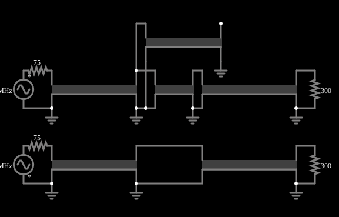

# Casamento de impedâncias com um toco em paralelo

<!-- navegacao:inicio -->
[Índice](README.md) · [Anterior: Impedance Matching (L-Section)](tlmatch1.md) · [Próximo: Stub Frequency Response](tlfreq.md)
<!-- navegacao:fim -->

## Objetivo

Mostrar como um **toco em aberto** (um pedaço de linha em paralelo) cancela a parte reativa da impedância vista pela linha e a casa com a fonte, sem nenhum componente concentrado.

## O circuito

<!-- esquema:inicio -->

<!-- esquema:fim -->

Dois circuitos iguais, alimentados por fontes senoidais de $5\ \text{V}$ e $100\ \text{MHz}$ com resistência interna de $75\ \Omega$. A carga é de $300\ \Omega$, ligada por uma linha de $300\ \Omega$ e $10\ \text{ns}$ (um comprimento de onda completo, que repete a carga sem alterá-la).

- **Circuito de cima (casado):** a linha de $75\ \Omega$ tem dois trechos, de $10\ \text{ns}$ e de $1{,}76\ \text{ns}$, e na junção entre eles há um toco de $75\ \Omega$ e $3{,}44\ \text{ns}$ com a ponta aberta.
- **Circuito de baixo (descasado):** a mesma linha de $75\ \Omega$, de $11{,}76\ \text{ns}$ no total, sem toco.

<!-- componentes:inicio -->
| N.º | Tipo | Elemento | Valores |
|----:|------|----------|---------|
| 0 | `TransLineElm` | transmission line | Delay (s) = 10n; Impedance (ohms) = 75 |
| 1 | `ResistorElm` | resistor | Resistance (ohms) = 75 |
| 5 | `ResistorElm` | resistor | Resistance (ohms) = 300 |
| 6 | `VoltageElm` | A/C source | Max Voltage = 5; Waveform = A/C; DC Offset (V) = 0; Internal Resistance (ohms) = 0; Show Voltage = não; Frequency (Hz) = 100M; Phase Offset (degrees) = 0 |
| 7 | `GroundElm` | ground | Symbol = Earth |
| 8 | `VoltageElm` | A/C source | Max Voltage = 5; Waveform = A/C; DC Offset (V) = 0; Internal Resistance (ohms) = 0; Show Voltage = não; Frequency (Hz) = 100M; Phase Offset (degrees) = 0 |
| 9 | `ResistorElm` | resistor | Resistance (ohms) = 75 |
| 11 | `TransLineElm` | transmission line | Delay (s) = 11.8n; Impedance (ohms) = 75 |
| 14 | `GroundElm` | ground | Symbol = Earth |
| 15 | `GroundElm` | ground | Symbol = Earth |
| 16 | `GroundElm` | ground | Symbol = Earth |
| 17 | `ResistorElm` | resistor | Resistance (ohms) = 300 |
| 24 | `GroundElm` | ground | Symbol = Earth |
| 25 | `TransLineElm` | transmission line | Delay (s) = 1.8n; Impedance (ohms) = 75 |
| 26 | `GroundElm` | ground | Symbol = Earth |
| 27 | `TransLineElm` | transmission line | Delay (s) = 3.4n; Impedance (ohms) = 75 |
| 28 | `TransLineElm` | transmission line | Delay (s) = 10n; Impedance (ohms) = 300 |
| 29 | `TransLineElm` | transmission line | Delay (s) = 10n; Impedance (ohms) = 300 |
| 34 | `GroundElm` | ground | Symbol = Earth |
| 35 | `GroundElm` | ground | Symbol = Earth |
<!-- componentes:fim -->

## Teoria

A impedância de uma linha em aberto é puramente reativa, com susceptância $B = \tan(\beta\ell)/Z_0$, e ela pode cancelar a parte imaginária da admitância vista. A $100\ \text{MHz}$, o trecho de $1{,}76\ \text{ns}$ ($63{,}4^\circ$) de linha de $75\ \Omega$ transforma a carga de $300\ \Omega$ em

$$Y_{\text{in}} = \frac{1}{75}\thinspace(1 + j1{,}5)\ \text{S}.$$

A parte real ($1/75\ \text{S}$) é a admitância da linha: está casada. O que sobra é uma susceptância de $+1{,}5/75$. O toco aberto de $3{,}44\ \text{ns}$ ($123{,}7^\circ$) tem susceptância $\tan(123{,}7^\circ)/75 = -1{,}5/75$, que cancela exatamente a parte imaginária. A admitância total é $1/75\ \text{S}$ e a linha da fonte vê $75\ \Omega$ puros.

Sem o toco, a linha de $75\ \Omega$ termina em $Y_{\text{in}}$ complexa, a impedância vista pela fonte é $41{,}6\ \Omega$ e só $1 - 0{,}6^2 = 64\ \%$ da potência chega à carga. Resolvendo a cascata na frequência de $100\ \text{MHz}$:

| | Impedância de entrada | $\lvert V_L\rvert$ | $P_L = V_L^2/2R_L$ |
|---|---:|---:|---:|
| Com o toco | $75{,}0\ \Omega$ | $5{,}000\ \text{V}$ | $41{,}7\ \text{mW}$ |
| Sem o toco | $41{,}6\ \Omega$ | $4{,}000\ \text{V}$ | $26{,}7\ \text{mW}$ |

## Resultados esperados

O simulador dá, em regime permanente:

- **Carga do circuito com toco:** $5{,}000\ \text{V}$ de amplitude (entrega toda a potência disponível, $41{,}7\ \text{mW}$).
- **Carga do circuito sem toco:** $4{,}000\ \text{V}$ ($26{,}7\ \text{mW}$, $64\ \%$ da potência disponível).
- **Corrente nas fontes:** $33{,}3\ \text{mA}$ com o toco ($2{,}5\ \text{V}/75\ \Omega$, a fonte vê uma carga casada) e $48{,}0\ \text{mA}$ sem ele.
- **Entrada da linha:** $2{,}505\ \text{V}$ com o toco e $2{,}004\ \text{V}$ sem ele.

## O que observar

Os dois osciloscópios mostram a carga: com o toco a amplitude ($5{,}0\ \text{V}$) é a máxima possível, a tensão da fonte. O toco só funciona na frequência de projeto: mude a frequência e o casamento se perde.

## Limites do modelo

- O casamento vale para uma única frequência, pois os comprimentos do trecho e do toco foram escolhidos para $100\ \text{MHz}$.
- As linhas são ideais, sem perdas; um toco real tem perdas e um efeito de borda na ponta aberta.
- O toco entra em paralelo com a linha principal; o simulador não modela o acoplamento entre eles.

## Referências

Pozar, *Microwave Engineering*, capítulo 2 (linhas de transmissão) e capítulo 5 (casamento de impedâncias); Ramo, Whinnery e Van Duzer, *Fields and Waves in Communication Electronics*, capítulo sobre linhas de transmissão.

O circuito deste exemplo faz parte da coleção do simulador original de Paul Falstad e Iain Sharp (CircuitJS1); a explicação é deste projeto.
