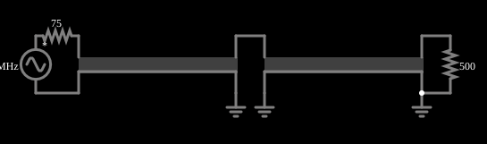

# Linhas de impedâncias diferentes em cascata: onda estacionária

<!-- navegacao:inicio -->
[Índice](README.md) · [Anterior: Mismatched lines (Pulse)](tlmismatch.md) · [Próximo: Impedance Matching (L-Section)](tlmatch1.md)
<!-- navegacao:fim -->

## Objetivo

Mostrar a **onda estacionária** que aparece numa linha quando ela termina numa impedância diferente da sua, e que a linha seguinte, esta sim casada com a carga, não tem onda estacionária.

## O circuito

<!-- esquema:inicio -->

<!-- esquema:fim -->

Uma fonte senoidal de $5\ \text{V}$ e $187\ \text{MHz}$, com resistência interna de $75\ \Omega$, alimenta uma linha de $75\ \Omega$ e $10\ \text{ns}$, seguida de uma linha de $500\ \Omega$ e $10\ \text{ns}$ que termina num resistor de $500\ \Omega$. Dois osciloscópios mostram a tensão na junção e na carga.

<!-- componentes:inicio -->
| N.º | Tipo | Elemento | Valores |
|----:|------|----------|---------|
| 0 | `TransLineElm` | transmission line | Delay (s) = 10n; Impedance (ohms) = 75 |
| 1 | `ResistorElm` | resistor | Resistance (ohms) = 75 |
| 5 | `ResistorElm` | resistor | Resistance (ohms) = 500 |
| 6 | `VoltageElm` | A/C source | Max Voltage = 5; Waveform = A/C; DC Offset (V) = 0; Internal Resistance (ohms) = 0; Show Voltage = não; Frequency (Hz) = 187M; Phase Offset (degrees) = 0 |
| 7 | `GroundElm` | ground | Symbol = Earth |
| 8 | `GroundElm` | ground | Symbol = Earth |
| 9 | `GroundElm` | ground | Symbol = Earth |
| 10 | `TransLineElm` | transmission line | Delay (s) = 10n; Impedance (ohms) = 500 |
<!-- componentes:fim -->

## Teoria

A linha de $500\ \Omega$ está casada com sua carga, então só viaja nela a onda progressiva. Para a linha de $75\ \Omega$ a carga equivalente é de $500\ \Omega$:

$$\Gamma = \frac{500 - 75}{500 + 75} = 0{,}739,\qquad \text{SWR} = \frac{1 + |\Gamma|}{1 - |\Gamma|} = 6{,}67.$$

Como a fonte é casada com a linha de $75\ \Omega$, a onda refletida na junção é absorvida pela fonte e não há re-reflexão. A tensão na linha de $75\ \Omega$ varia entre $V^{+}(1 - |\Gamma|)$ e $V^{+}(1 + |\Gamma|)$ com $V^{+} = 2{,}5\ \text{V}$:

$$V_{\max} = 2{,}5\cdot 1{,}739 = 4{,}348\ \text{V},\qquad V_{\min} = 2{,}5\cdot 0{,}261 = 0{,}652\ \text{V}.$$

A junção é um ventre ($4{,}348\ \text{V}$) e a tensão na entrada da linha é $V^{+}\thinspace|1 + \Gamma e^{-j2\theta}|$, com $\theta = 2\pi f\tau = 11{,}75\ \text{rad}$, o que dá $3{,}01\ \text{V}$. A carga recebe a mesma amplitude da junção, $4{,}348\ \text{V}$, porque a linha de $500\ \Omega$ está casada.

## Resultados esperados

O simulador dá, em regime permanente:

- **Junção e carga:** amplitude de $4{,}348\ \text{V}$ nos dois pontos (acima dos $2{,}5\ \text{V}$ incidentes).
- **Entrada da linha de $75\ \Omega$:** amplitude de $3{,}014\ \text{V}$, valor intermediário da onda estacionária.
- **Corrente da fonte:** pico de $42{,}7\ \text{mA}$.

## O que observar

A tensão na carga ($4{,}35\ \text{V}$) é *maior* que a incidente na fonte. Mude a frequência e veja a tensão na entrada oscilar entre $0{,}65\ \text{V}$ e $4{,}35\ \text{V}$ enquanto a da junção e da carga ficam fixas.

## Limites do modelo

- Só se observam as extremidades de cada linha: a onda estacionária completa dentro da linha não aparece no simulador.
- O resultado depende de a fonte ser casada com a primeira linha; com outra impedância de fonte, haveria uma segunda reflexão.

## Referências

Pozar, *Microwave Engineering*, capítulo 2 (teoria de linhas de transmissão); Ramo, Whinnery e Van Duzer, *Fields and Waves in Communication Electronics*, capítulo sobre linhas de transmissão.

O circuito deste exemplo faz parte da coleção do simulador original de Paul Falstad e Iain Sharp (CircuitJS1); a explicação é deste projeto.
