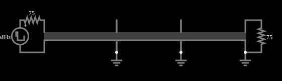

# Linhas de impedâncias diferentes em cascata: pulso

<!-- navegacao:inicio -->
[Índice](README.md) · [Anterior: Termination](tlterm.md) · [Próximo: Mismatched lines (Standing Wave)](tlmis1.md)
<!-- navegacao:fim -->

## Objetivo

Mostrar o que acontece com um pulso quando a impedância da linha **muda no meio do caminho**: em cada junção, parte do pulso é transmitida e parte é refletida, e a carga recebe uma sequência de pulsos cada vez menores.

## O circuito

<!-- esquema:inicio -->

<!-- esquema:fim -->

Três linhas de $10\ \text{ns}$ cada são ligadas em cascata: $75\ \Omega$, $500\ \Omega$ e $75\ \Omega$. A fonte (pulso de $0$ a $5\ \text{V}$, $3\ \text{ns}$ de largura, $10\ \text{MHz}$) tem resistência interna $75\ \Omega$ e a carga é de $75\ \Omega$. Os dois extremos são, portanto, casados com a linha de $75\ \Omega$; só as duas junções refletem.

<!-- componentes:inicio -->
| N.º | Tipo | Elemento | Valores |
|----:|------|----------|---------|
| 0 | `TransLineElm` | transmission line | Delay (s) = 10n; Impedance (ohms) = 75 |
| 1 | `TransLineElm` | transmission line | Delay (s) = 10n; Impedance (ohms) = 500 |
| 2 | `TransLineElm` | transmission line | Delay (s) = 10n; Impedance (ohms) = 75 |
| 3 | `ResistorElm` | resistor | Resistance (ohms) = 75 |
| 7 | `ResistorElm` | resistor | Resistance (ohms) = 75 |
| 8 | `VoltageElm` | square wave gen | Max Voltage = 2.5; Waveform = Square Wave; DC Offset (V) = 2.5; Internal Resistance (ohms) = 0; Show Voltage = não; Specify As = Frequency/Duty Cycle; Frequency (Hz) = 10M; Phase Offset (degrees) = 0; Duty Cycle = 3; Rise/Fall Time (s) = 0 |
| 9 | `GroundElm` | ground | Symbol = Earth |
| 10 | `GroundElm` | ground | Symbol = Earth |
| 11 | `GroundElm` | ground | Symbol = Earth |
<!-- componentes:fim -->

## Símbolos e parâmetros

Os símbolos usados neste documento (definições completas no [glossário](../glossario-simbolos.md)):

| Símbolo | Nome | Significado | Unidade |
|---------|------|-------------|---------|
| $T$ | período | duração de um ciclo completo de um sinal periódico | s |
| $Z_1$ | impedância 1 | impedância chamada $Z_1$ no circuito | Ω |
| $Z_2$ | impedância 2 | impedância chamada $Z_2$ no circuito | Ω |

## Teoria

Numa junção entre as impedâncias $Z_1$ (de onde a onda vem) e $Z_2$:

$$\Gamma = \frac{Z_2 - Z_1}{Z_2 + Z_1},\qquad T = 1 + \Gamma = \frac{2Z_2}{Z_2 + Z_1}.$$

O pulso lançado tem $5\cdot 75/(75 + 75) = 2{,}5\ \text{V}$. Na junção $75\to 500$: $\Gamma = 425/575 = +0{,}739$ e $T = 1{,}739$, então a linha de $500\ \Omega$ recebe $4{,}348\ \text{V}$, e $1{,}848\ \text{V}$ voltam e são absorvidos pela fonte (casada). Na junção $500\to 75$: $\Gamma = -0{,}739$ e $T = 0{,}261$, e a carga recebe $4{,}348\cdot 0{,}261 = 1{,}135\ \text{V}$ após $30\ \text{ns}$. Os $-3{,}213\ \text{V}$ refletidos voltam à primeira junção, onde reflete $\Gamma = -0{,}739$ de novo e $+2{,}375\ \text{V}$ seguem para a carga: $2{,}375\cdot 0{,}261 = 0{,}620\ \text{V}$, $20\ \text{ns}$ depois do primeiro pulso, e assim por diante.

## Resultados esperados

O simulador dá:

- **Na linha de $500\ \Omega$:** $4{,}348\ \text{V}$, o maior valor do circuito, maior que o pulso lançado de $2{,}5\ \text{V}$.
- **Primeiro pulso na carga** ($30$ a $33\ \text{ns}$): $1{,}134\ \text{V}$.
- **Segundo pulso** ($50\ \text{ns}$): $0{,}620\ \text{V}$, o que confirma o eco entre as duas junções.

## O que observar

Compare o primeiro pulso da carga ($1{,}13\ \text{V}$) com o pulso lançado ($2{,}5\ \text{V}$): o trecho de alta impedância *perde* mais da metade da amplitude, apesar de os dois extremos estarem casados. Um trecho de impedância diferente, mesmo curto, é uma descontinuidade que deve ser evitada em circuitos rápidos.

## Limites do modelo

- A linha é ideal; numa linha real os ecos também sofrem atenuação e dispersão.
- A largura de $3\ \text{ns}$ do pulso é menor que o atraso de cada trecho, por isso os ecos aparecem separados; para pulsos mais largos eles se sobrepõem.

## Referências

Pozar, *Microwave Engineering*, capítulo 2 (teoria de linhas de transmissão); Ramo, Whinnery e Van Duzer, *Fields and Waves in Communication Electronics*, capítulo sobre linhas de transmissão.

O circuito deste exemplo faz parte da coleção do simulador original de Paul Falstad e Iain Sharp (CircuitJS1); a explicação é deste projeto.
