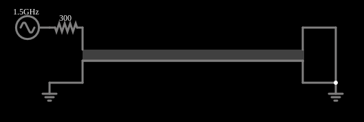

# Onda estacionária numa linha em curto

<!-- navegacao:inicio -->
[Índice](README.md) · [Anterior: Simple TL](tl.md) · [Próximo: Termination](tlterm.md)
<!-- navegacao:fim -->

## Objetivo

Mostrar a **onda estacionária** que nasce quando uma linha termina em curto-circuito: a onda incidente e a refletida (com sinal trocado) se somam em pontos fixos da linha, e a tensão na entrada vai a zero.

## O circuito

<!-- esquema:inicio -->

<!-- esquema:fim -->

Uma fonte senoidal de $5\ \text{V}$ e $1{,}5\ \text{GHz}$ alimenta, por um resistor de $300\ \Omega$, uma linha de $Z_0 = 300\ \Omega$ e atraso $2\ \text{ns}$. A outra ponta da linha está **em curto-circuito** (os dois condutores ligados à terra). O osciloscópio acompanha o resistor da fonte.

<!-- componentes:inicio -->
| N.º | Tipo | Elemento | Valores |
|----:|------|----------|---------|
| 0 | `TransLineElm` | transmission line | Delay (s) = 2n; Impedance (ohms) = 300 |
| 4 | `ResistorElm` | resistor | Resistance (ohms) = 300 |
| 5 | `GroundElm` | ground | Symbol = Earth |
| 6 | `GroundElm` | ground | Symbol = Earth |
| 7 | `RailElm` | A/C source | Max Voltage = 5; Waveform = A/C; DC Offset (V) = 0; Internal Resistance (ohms) = 0; Show Voltage = não; Frequency (Hz) = 1.5G; Phase Offset (degrees) = 0 |
<!-- componentes:fim -->

## Símbolos e parâmetros

Os símbolos usados neste documento (definições completas no [glossário](../glossario-simbolos.md)):

| Símbolo | Nome | Significado | Unidade |
|---------|------|-------------|---------|
| $x$ | posição do cursor | fração do curso do potenciômetro, de $0$ a $1$ | — |
| $f$ | frequência | número de ciclos por segundo de um sinal periódico | Hz |
| $V$ | tensão | diferença de potencial elétrico entre dois pontos do circuito | V |
| $Z_0$ | impedância característica | razão entre tensão e corrente de uma onda que percorre a linha | Ω |
| $I$ | corrente | intensidade da corrente elétrica que passa por um ramo | A |
| $R_L$ | resistência de carga | resistor ligado à saída, que consome a energia do circuito | Ω |
| $\beta$ | ganho de corrente | razão $I_C/I_B$ do transistor bipolar | — |
| $\tau$ | constante de tempo | tempo característico de carga ou descarga de um circuito (por exemplo, $RC$ ou $L/R$) | s |
| $R_s$ | resistência em série | resistor em série com a fonte ou com o dispositivo | Ω |

## Teoria

Com $R_L = 0$ o coeficiente de reflexão é $\Gamma = (0 - Z_0)/(0 + Z_0) = -1$: a onda volta com a mesma amplitude e o sinal trocado. A tensão ao longo da linha é

$$V(x) = V^{+}\bigl(e^{-j\beta x} - e^{j\beta x}\bigr) = -2jV^{+}\sin\beta x,$$

com nós (tensão nula) na carga e a cada meio comprimento de onda, e ventres (tensão $2V^{+}$) entre eles. A corrente tem a distribuição complementar.

A $1{,}5\ \text{GHz}$ o comprimento de onda é tal que $f\tau = 1{,}5\ \text{GHz}\cdot 2\ \text{ns} = 3$: a linha mede **três comprimentos de onda**, um número inteiro de meios comprimentos de onda. A entrada coincide com um nó de tensão, a linha parece um curto para a fonte, e como $R_s = Z_0$ a onda incidente tem amplitude $V^{+} = 5\cdot 300/(300 + 300) = 2{,}5\ \text{V}$.

No regime permanente a corrente na entrada é a da fonte contra o resistor: $I = 5\ \text{V}/300\ \Omega = 16{,}7\ \text{mA}$, o dobro da corrente da onda incidente ($2{,}5/300 = 8{,}33\ \text{mA}$).

## Resultados esperados

O simulador dá:

- **Antes de a reflexão voltar** (os primeiros $4\ \text{ns}$, a ida e a volta da linha): a tensão na entrada é $2{,}5\ \text{V}$, só a onda incidente.
- **Regime permanente:** a tensão na entrada vai a $0\ \text{V}$ (nó da onda estacionária) e a da carga permanece em $0\ \text{V}$.
- **Corrente no resistor da fonte:** pico de $16{,}7\ \text{mA}$, valor eficaz de $11{,}8\ \text{mA}$ ($16{,}7/\sqrt 2$).

## O que observar

No osciloscópio, o sinal do resistor muda nos primeiros nanossegundos e depois passa a oscilar com amplitude constante: é o regime em que a onda estacionária se estabeleceu. Mude a frequência da fonte para um valor que não seja múltiplo de $0{,}25\ \text{GHz}$ e a entrada deixa de ser um nó, com a tensão e a corrente na entrada ambas diferentes de zero.

## Limites do modelo

- O simulador mostra tensões só nos terminais da linha, não ao longo dela: os nós e os ventres internos da onda estacionária aparecem só pela teoria.
- O curto-circuito é ideal ($0\ \Omega$); com um curto real a reflexão teria $|\Gamma| < 1$.

## Referências

Pozar, *Microwave Engineering*, capítulo 2 (teoria de linhas de transmissão); Ramo, Whinnery e Van Duzer, *Fields and Waves in Communication Electronics*, capítulo sobre linhas de transmissão.

O circuito deste exemplo faz parte da coleção do simulador original de Paul Falstad e Iain Sharp (CircuitJS1); a explicação é deste projeto.
