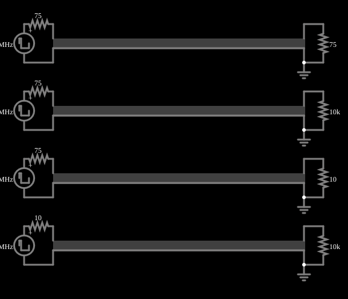

# Terminação de uma linha: casada, aberta e em curto

<!-- navegacao:inicio -->
[Índice](README.md) · [Anterior: Standing Wave](tlstand.md) · [Próximo: Mismatched lines (Pulse)](tlmismatch.md)
<!-- navegacao:fim -->

## Objetivo

Mostrar como o **coeficiente de reflexão** da carga muda a forma de um pulso que chega ao fim da linha: casada, quase aberta e quase em curto, e como a impedância da fonte também reflete.

## O circuito

<!-- esquema:inicio -->

<!-- esquema:fim -->

Quatro linhas idênticas de $Z_0 = 75\ \Omega$ e atraso $10\ \text{ns}$ recebem o mesmo pulso: uma onda quadrada de $0$ a $5\ \text{V}$, $10\ \text{MHz}$, com ciclo de trabalho de $3\ \%$ (pulsos de $3\ \text{ns}$ a cada $100\ \text{ns}$), mais curto que o atraso da linha. As combinações de resistor da fonte $R_s$ e da carga $R_L$ são:

1. $R_s = 75\ \Omega$, $R_L = 75\ \Omega$ (casada);
2. $R_s = 75\ \Omega$, $R_L = 10\ \text{k}\Omega$ (quase aberta);
3. $R_s = 75\ \Omega$, $R_L = 10\ \Omega$ (quase em curto);
4. $R_s = 10\ \Omega$, $R_L = 10\ \text{k}\Omega$ (fonte de baixa impedância, linha quase aberta).

<!-- componentes:inicio -->
| N.º | Tipo | Elemento | Valores |
|----:|------|----------|---------|
| 0 | `TransLineElm` | transmission line | Delay (s) = 10n; Impedance (ohms) = 75 |
| 1 | `ResistorElm` | resistor | Resistance (ohms) = 75 |
| 5 | `ResistorElm` | resistor | Resistance (ohms) = 75 |
| 6 | `VoltageElm` | square wave gen | Max Voltage = 2.5; Waveform = Square Wave; DC Offset (V) = 2.5; Internal Resistance (ohms) = 0; Show Voltage = não; Specify As = Frequency/Duty Cycle; Frequency (Hz) = 10M; Phase Offset (degrees) = 0; Duty Cycle = 3; Rise/Fall Time (s) = 0 |
| 7 | `GroundElm` | ground | Symbol = Earth |
| 8 | `TransLineElm` | transmission line | Delay (s) = 10n; Impedance (ohms) = 75 |
| 9 | `ResistorElm` | resistor | Resistance (ohms) = 75 |
| 13 | `ResistorElm` | resistor | Resistance (ohms) = 10k |
| 14 | `VoltageElm` | square wave gen | Max Voltage = 2.5; Waveform = Square Wave; DC Offset (V) = 2.5; Internal Resistance (ohms) = 0; Show Voltage = não; Specify As = Frequency/Duty Cycle; Frequency (Hz) = 10M; Phase Offset (degrees) = 0; Duty Cycle = 3; Rise/Fall Time (s) = 0 |
| 15 | `GroundElm` | ground | Symbol = Earth |
| 16 | `TransLineElm` | transmission line | Delay (s) = 10n; Impedance (ohms) = 75 |
| 17 | `ResistorElm` | resistor | Resistance (ohms) = 75 |
| 21 | `ResistorElm` | resistor | Resistance (ohms) = 10 |
| 22 | `VoltageElm` | square wave gen | Max Voltage = 2.5; Waveform = Square Wave; DC Offset (V) = 2.5; Internal Resistance (ohms) = 0; Show Voltage = não; Specify As = Frequency/Duty Cycle; Frequency (Hz) = 10M; Phase Offset (degrees) = 0; Duty Cycle = 3; Rise/Fall Time (s) = 0 |
| 23 | `GroundElm` | ground | Symbol = Earth |
| 24 | `TransLineElm` | transmission line | Delay (s) = 10n; Impedance (ohms) = 75 |
| 25 | `ResistorElm` | resistor | Resistance (ohms) = 10 |
| 29 | `ResistorElm` | resistor | Resistance (ohms) = 10k |
| 30 | `VoltageElm` | square wave gen | Max Voltage = 2.5; Waveform = Square Wave; DC Offset (V) = 2.5; Internal Resistance (ohms) = 0; Show Voltage = não; Specify As = Frequency/Duty Cycle; Frequency (Hz) = 10M; Phase Offset (degrees) = 0; Duty Cycle = 3; Rise/Fall Time (s) = 0 |
| 31 | `GroundElm` | ground | Symbol = Earth |
<!-- componentes:fim -->

## Teoria

O pulso lançado na linha tem a tensão do divisor formado por $R_s$ e $Z_0$:

$$V_{\text{lanç}} = V_p \frac{Z_0}{R_s + Z_0}.$$

Ao chegar à carga, a tensão passa a $V_{\text{lanç}}(1 + \Gamma_L)$ com $\Gamma_L = (R_L - Z_0)/(R_L + Z_0)$, e a onda refletida de amplitude $\Gamma_L V_{\text{lanç}}$ volta para a fonte, onde reflete de novo com $\Gamma_s = (R_s - Z_0)/(R_s + Z_0)$. Para $R_s = Z_0$ a reflexão na fonte é nula e o pulso passa só uma vez; para $R_s \ne Z_0$ ele fica quicando, a cada $2\tau = 20\ \text{ns}$.

| Caso | $V_{\text{lanç}}$ | $\Gamma_L$ | Tensão na carga |
|-----:|---:|---:|---:|
| 1 | $2{,}5\ \text{V}$ | $0$ | $2{,}50\ \text{V}$ |
| 2 | $2{,}5\ \text{V}$ | $+0{,}985$ | $4{,}96\ \text{V}$ |
| 3 | $2{,}5\ \text{V}$ | $-0{,}765$ | $0{,}588\ \text{V}$ |
| 4 | $4{,}41\ \text{V}$ | $+0{,}985$ | $8{,}76\ \text{V}$ |

## Resultados esperados

O simulador dá, para o primeiro pulso que chega à carga ($10$ a $13\ \text{ns}$):

- **Lançamento:** $2{,}5\ \text{V}$ nos casos 1 a 3 e $4{,}41\ \text{V}$ no caso 4, com $3\ \text{ns}$ de largura; antes de $10\ \text{ns}$ a carga fica em $0\ \text{V}$.
- **Caso 1:** $2{,}500\ \text{V}$ na carga.
- **Caso 2:** $4{,}963\ \text{V}$, quase o dobro (reflexão positiva).
- **Caso 3:** $0{,}588\ \text{V}$ (reflexão negativa).
- **Caso 4:** $8{,}758\ \text{V}$, mais que a própria fonte de $5\ \text{V}$: uma linha quase aberta alimentada por uma fonte de baixa impedância pode produzir *sobretensão*.

## O que observar

Observe que o pulso no caso 4 passa de $5\ \text{V}$ sem que haja nenhum componente amplificando: a tensão é a soma da onda incidente com a refletida. É por isso que a terminação correta é indispensável em linhas rápidas.

## Limites do modelo

- A linha é ideal, sem perdas nem dispersão: os pulsos voltam com a mesma forma e não se arredondam como num cabo real.
- O ciclo de trabalho de $3\ \%$ vale para a frequência de $10\ \text{MHz}$ do exemplo; se a frequência mudar, a largura do pulso muda.
- O simulador mostra as tensões nos terminais; a forma de onda ao longo da linha não aparece.

## Referências

Pozar, *Microwave Engineering*, capítulo 2 (teoria de linhas de transmissão); Ramo, Whinnery e Van Duzer, *Fields and Waves in Communication Electronics*, capítulo sobre linhas de transmissão.

O circuito deste exemplo faz parte da coleção do simulador original de Paul Falstad e Iain Sharp (CircuitJS1); a explicação é deste projeto.
