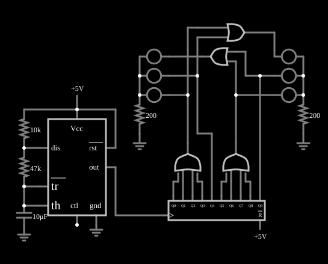

# Semáforo

<!-- navegacao:inicio -->
[Índice](README.md) · [Anterior: LED Flasher](ledflasher.md) · [Próximo: Static RAM](sram.md)
<!-- navegacao:fim -->

## Objetivo

Mostrar um controlador de semáforo para um cruzamento de duas vias: um 555 dá o relógio, um contador em anel de 10 passos define as fases, e portas OR combinam os passos para acender as luzes de cada via.

## O circuito

<!-- esquema:inicio -->

<!-- esquema:fim -->

- **Relógio:** um [555 astável](555square.md) com $R_1 = 10\ \text{k}\Omega$, $R_2 = 47\ \text{k}\Omega$ e $C = 10\ \mu\text{F}$.
- **Sequência:** um contador em anel de 10 saídas, $Q_0$ a $Q_9$, avança um passo por pulso do 555.
- **Via da esquerda:** o verde (elemento 22) acende em $Q_0$ a $Q_3$ (uma OR de quatro entradas); o amarelo (elemento 21), em $Q_4$; o vermelho (elemento 20), quando a outra via está em verde ou amarelo (uma OR de duas entradas).
- **Via da direita:** o verde (elemento 18) em $Q_5$ a $Q_8$; o amarelo (elemento 17) em $Q_9$; o vermelho (elemento 16) enquanto a via da esquerda está em verde ou amarelo.

Cada lado tem um resistor de $200\ \Omega$ em série com os seus três LEDs.

<!-- componentes:inicio -->
| N.º | Tipo | Elemento | Valores |
|----:|------|----------|---------|
| 0 | `RingCounterElm` | ring counter | High Logic Voltage = 5; Invert reset pin = sim; # of Bits = 10 |
| 1 | `RailElm` | voltage source | Voltage = 5; Waveform = D/C; DC Offset (V) = 0; Internal Resistance (ohms) = 0 |
| 2 | `OrGateElm` | OR gate | # of Inputs = 4; High Logic Voltage = 5; Schmitt Inputs = não; Invert Inputs = não; Propagation Delay (s) = 0; DeMorgan's Symbol = não |
| 15 | `OrGateElm` | OR gate | # of Inputs = 4; High Logic Voltage = 5; Schmitt Inputs = não; Invert Inputs = não; Propagation Delay (s) = 0; DeMorgan's Symbol = não |
| 16 | `LEDElm` | LED | Red Value (0-1) = 1; Green Value (0-1) = 0; Blue Value (0-1) = 0; Max Brightness Current (A) = 10m; Model = 1N4004 (general purpose) |
| 17 | `LEDElm` | LED | Red Value (0-1) = 1; Green Value (0-1) = 1; Blue Value (0-1) = 0; Max Brightness Current (A) = 10m; Model = 1N4004 (general purpose) |
| 18 | `LEDElm` | LED | Red Value (0-1) = 0; Green Value (0-1) = 1; Blue Value (0-1) = 0; Max Brightness Current (A) = 10m; Model = 1N4004 (general purpose) |
| 20 | `LEDElm` | LED | Red Value (0-1) = 1; Green Value (0-1) = 0; Blue Value (0-1) = 0; Max Brightness Current (A) = 10m; Model = 1N4004 (general purpose) |
| 21 | `LEDElm` | LED | Red Value (0-1) = 1; Green Value (0-1) = 1; Blue Value (0-1) = 0; Max Brightness Current (A) = 10m; Model = 1N4004 (general purpose) |
| 22 | `LEDElm` | LED | Red Value (0-1) = 0; Green Value (0-1) = 1; Blue Value (0-1) = 0; Max Brightness Current (A) = 10m; Model = 1N4004 (general purpose) |
| 39 | `OrGateElm` | OR gate | # of Inputs = 2; High Logic Voltage = 5; Schmitt Inputs = não; Invert Inputs = não; Propagation Delay (s) = 0; DeMorgan's Symbol = não |
| 46 | `ResistorElm` | resistor | Resistance (ohms) = 200 |
| 47 | `ResistorElm` | resistor | Resistance (ohms) = 200 |
| 48 | `GroundElm` | ground | Symbol = Earth |
| 49 | `GroundElm` | ground | Symbol = Earth |
| 50 | `OrGateElm` | OR gate | # of Inputs = 2; High Logic Voltage = 5; Schmitt Inputs = não; Invert Inputs = não; Propagation Delay (s) = 0; DeMorgan's Symbol = não |
| 51 | `RailElm` | voltage source | Voltage = 5; Waveform = D/C; DC Offset (V) = 0; Internal Resistance (ohms) = 0 |
| 53 | `ResistorElm` | resistor | Resistance (ohms) = 47k |
| 54 | `ResistorElm` | resistor | Resistance (ohms) = 10k |
| 57 | `TimerElm` | 555 Timer | Ground Pin = sim; Show Pin Numbers = não |
| 59 | `CapacitorElm` | capacitor | Capacitance (F) = 10μ; Trapezoidal Approximation = sim; Initial Voltage (on Reset) = 1m; Series Resistance = 0 |
| 60 | `GroundElm` | ground | Symbol = Earth |
| 66 | `GroundElm` | ground | Symbol = Earth |
<!-- componentes:fim -->

## Teoria

O 555 astável oscila com

$$t_{alto} = 0{,}693 (R_1 + R_2) C \approx 0{,}395\ \text{s}, \quad t_{baixo} = 0{,}693 R_2 C \approx 0{,}326\ \text{s},$$

isto é, período de $\approx 0{,}72\ \text{s}$ e frequência de $\approx 1{,}39\ \text{Hz}$. Os dez passos do contador formam o ciclo do semáforo:

| Passos | Esquerda | Direita |
|------|------|------|
| $Q_0$–$Q_3$ | verde | vermelho |
| $Q_4$ | amarelo | vermelho |
| $Q_5$–$Q_8$ | vermelho | verde |
| $Q_9$ | vermelho | amarelo |

Em nenhum passo as duas vias têm verde ou amarelo ao mesmo tempo, porque o vermelho de cada via é a OR das fases da outra. A duração de cada fase é um múltiplo do período do relógio, escolhido pelo número de saídas do contador ligadas a ela.

## Resultados esperados

O simulador dá o 555 com $t_{alto} \approx 0{,}397\ \text{s}$ e $t_{baixo} \approx 0{,}329\ \text{s}$, frequência de $1{,}38\ \text{Hz}$, e um ciclo completo do semáforo de cerca de $7{,}2\ \text{s}$. Verde à esquerda e vermelho à direita em $1{,}5\ \text{s}$; amarelo à esquerda em $3{,}0\ \text{s}$; verde à direita e vermelho à esquerda em $4{,}4\ \text{s}$; amarelo à direita em $6{,}6\ \text{s}$; e o ciclo recomeça perto de $7{,}3\ \text{s}$. Cada LED aceso conduz $15{,}6\ \text{mA}$.

## O que observar

Deixe a simulação correr e confira que as duas vias nunca ficam abertas ao mesmo tempo. Mudando $C$ ou os resistores do 555, o ritmo de todas as fases muda junto.

## Limites do modelo

- Um semáforo real tem um intervalo de "todos vermelhos" entre as fases e tempos diferentes para verde e amarelo; aqui as fases são múltiplos inteiros de um único período.
- As fórmulas do 555 ignoram as correntes de entrada do comparador e a resistência de descarga; a diferença de alguns por cento em relação à simulação vem também do passo de tempo de $1{,}2\ \text{ms}$.

## Referências

Texas Instruments, folha de dados do NE555 (modo astável); Wakerly, *Digital Design: Principles and Practices*, sobre máquinas de estados com contadores.

O circuito deste exemplo faz parte da coleção do simulador original de Paul Falstad e Iain Sharp (CircuitJS1); a explicação é deste projeto.
