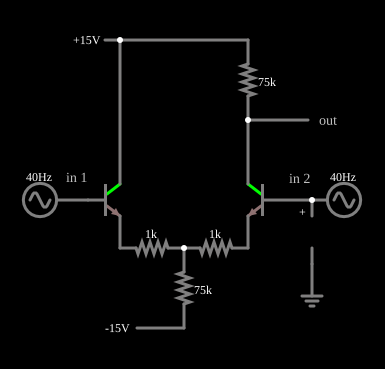

# Amplificador diferencial: entrada de modo comum

<!-- navegacao:inicio -->
[Índice](README.md) · [Anterior: Differential Input](trans-diffamp.md) · [Próximo: Common-Mode w/Current Source](trans-diffamp-cursrc.md)
<!-- navegacao:fim -->

## Objetivo

Mostrar como o amplificador diferencial trata um sinal de **modo comum**, aplicado igualmente às duas entradas: a saída quase não se move. É o complemento de [Differential Input](trans-diffamp.md): lá a diferença é amplificada; aqui o que é comum é rejeitado.

## O circuito

<!-- esquema:inicio -->

<!-- esquema:fim -->

É o mesmo par diferencial de [Differential Input](trans-diffamp.md): dois NPN iguais ($\beta = 100$), resistores de emissor de $1\ \text{k}\Omega$, cauda de $75\ \text{k}\Omega$ até $-15\ \text{V}$, coletor de Q1 em $+15\ \text{V}$ e coletor de Q2 ligado a $+15\ \text{V}$ por $75\ \text{k}\Omega$ (a saída). A diferença está nas entradas: as duas bases (**in 1** e **in 2**) recebem a mesma fonte de $1\ \text{V}$ de pico a $40\ \text{Hz}$, em fase; a entrada diferencial é nula.

<!-- componentes:inicio -->
| N.º | Tipo | Elemento | Valores |
|----:|------|----------|---------|
| 0 | `NTransistorElm` | transistor | Beta/hFE = 100; Swap E/C = não; Draw Circle = não; Model = default |
| 1 | `NTransistorElm` | transistor | Beta/hFE = 100; Swap E/C = não; Draw Circle = não; Model = default |
| 4 | `ResistorElm` | resistor | Resistance (ohms) = 1k |
| 5 | `ResistorElm` | resistor | Resistance (ohms) = 1k |
| 6 | `ResistorElm` | resistor | Resistance (ohms) = 75k |
| 7 | `ResistorElm` | resistor | Resistance (ohms) = 75k |
| 9 | `RailElm` | voltage source | Voltage = 15; Waveform = D/C; DC Offset (V) = 0; Internal Resistance (ohms) = 0 |
| 10 | `RailElm` | voltage source | Voltage = -15; Waveform = D/C; DC Offset (V) = 0; Internal Resistance (ohms) = 0 |
| 11 | `RailElm` | A/C source | Max Voltage = 1; Waveform = A/C; DC Offset (V) = 0; Internal Resistance (ohms) = 0; Show Voltage = não; Frequency (Hz) = 40; Phase Offset (degrees) = 0 |
| 12 | `RailElm` | A/C source | Max Voltage = 1; Waveform = A/C; DC Offset (V) = 0; Internal Resistance (ohms) = 0; Show Voltage = não; Frequency (Hz) = 40; Phase Offset (degrees) = 0 |
| 13 | `ProbeElm` | voltmeter | Show Voltage = não; Value = Voltage; Scale = Auto; Use Circle Symbol = não; Series Resistance (0 = infinite) = 0 |
| 14 | `GroundElm` | ground | Symbol = Earth |
| 17 | `OutputElm` | output | Show Voltage = não |
| 18 | `TextElm` | text | Text = in 1; Size = 14; Draw Bar On Top = não; Color = #c0c0c0 |
| 19 | `TextElm` | text | Text = in 2; Size = 14; Draw Bar On Top = não; Color = #c0c0c0 |
<!-- componentes:fim -->

## Teoria

Com $v_1 = v_2 = v_{cm}$ a entrada diferencial é $v_d = 0$ e só o ganho de modo comum atua (o transistor segue o modelo de Ebers–Moll de [Transistor NPN](npn.md)). Os emissores acompanham a base e a corrente da cauda varia com a tensão do nó dos emissores:

$$\Delta I_T \approx \frac{\Delta v_{cm}}{R_T}, \qquad A_{cm} = \frac{v_o}{v_{cm}} \approx -\frac{R_C}{R_E + r_e + 2R_T}.$$

Com $r_e = V_T/I_E \approx 270\ \Omega$ (corrente de repouso de $95{,}8\ \mu\text{A}$ por ramo): $A_{cm} \approx -75\,000/151\,270 \approx -0{,}496$. O ganho diferencial do mesmo circuito é $A_d \approx 29{,}5$, o que dá $\text{CMRR} \approx 59{,}5$ ($35{,}5\ \text{dB}$).

## Resultados esperados

A corrente de repouso da cauda é $191{,}6\ \mu\text{A}$ e a saída fica em $7{,}886\ \text{V}$ (em $t = 12{,}5\ \text{ms}$). Com $1\ \text{V}$ de pico na entrada comum a corrente da cauda varia de $178{,}4\ \mu\text{A}$ a $204{,}8\ \mu\text{A}$, isto é, $\pm 13{,}2\ \mu\text{A}$, que é $1\ \text{V} / 75\ \text{k}\Omega = 13{,}3\ \mu\text{A}$. A saída vai de $7{,}395\ \text{V}$ a $8{,}377\ \text{V}$ em torno de $7{,}886\ \text{V}$: amplitude de $0{,}491\ \text{V}$, isto é, ganho de modo comum de $0{,}491$ contra $0{,}496$ previstos (diferença de $1\%$). O mesmo $1\ \text{V}$ aplicado como entrada diferencial daria cerca de $29{,}5\ \text{V}$ de pico: a saída seria $60$ vezes maior. As verificações conferem a tensão de repouso, a corrente da cauda (repouso, máximo e mínimo), o valor eficaz da entrada ($0{,}707\ \text{V}$) e o máximo, o mínimo e a média da saída (tolerância de $1\%$).

## O que observar

A entrada tem $1\ \text{V}$ de pico e a saída, menos de $0{,}5\ \text{V}$ de pico sobre um nível contínuo de $7{,}9\ \text{V}$, em oposição de fase. Para testar: aumente $R_T$ (por exemplo, para $150\ \text{k}\Omega$) e veja o ganho de modo comum cair pela metade, ou reduza-o e veja crescer; inverta uma das fontes (uma delas com $-1\ \text{V}$): a entrada passa a ser diferencial e a saída deixa de ser pequena, como em [Differential Input](trans-diffamp.md).

## Limites do modelo

- Sem efeito Early nem capacitâncias, o resultado é independente da frequência; num par real o ganho de modo comum cresce com a frequência por causa da capacitância parasita da cauda.
- A fórmula de $A_{cm}$ supõe $r_e$ igual nos dois transistores; qualquer assimetria (descasamento de $\beta$ ou dos resistores) converte parte do modo comum em sinal diferencial, o que a simulação, com componentes idênticos, não mostra.
- A cauda é um resistor; o exemplo [Common-Mode w/Current Source](trans-diffamp-cursrc.md) a substitui por uma fonte de corrente para rejeitar melhor o modo comum.

## Referências

Sedra e Smith, *Microelectronic Circuits*, capítulo sobre o par diferencial; Horowitz e Hill, *The Art of Electronics*, seção 2.3 (amplificadores diferenciais).

O circuito deste exemplo faz parte da coleção do simulador original de Paul Falstad e Iain Sharp (CircuitJS1); a explicação é deste projeto.
