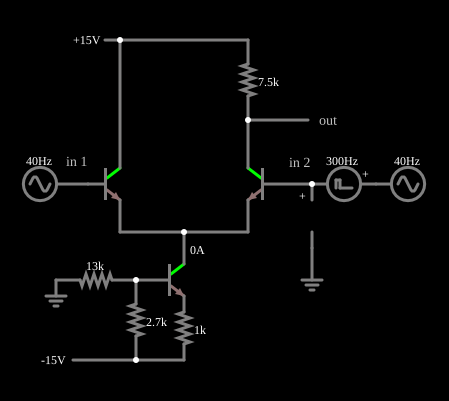

# Amplificador diferencial: modo comum com fonte de corrente

<!-- navegacao:inicio -->
[Índice](README.md) · [Anterior: Common-Mode Input](trans-diffamp-common.md)
<!-- navegacao:fim -->

## Objetivo

Mostrar o ganho do amplificador diferencial quando a cauda resistiva é trocada por uma **fonte de corrente** feita com um transistor: a rejeição de modo comum fica muito melhor, de modo que um sinal comum de $4\ \text{V}$ de pico não aparece na saída, e um pequeno pulso diferencial a faz comutar entre dois níveis.

## O circuito

<!-- esquema:inicio -->

<!-- esquema:fim -->

Os dois NPN do par ($\beta = 100$) têm os emissores ligados diretamente ao coletor de um terceiro NPN, Q3, que faz o papel de cauda. Q3 tem um divisor de base (um resistor de $13\ \text{k}\Omega$ à terra e um de $2{,}7\ \text{k}\Omega$ à fonte de $-15\ \text{V}$) e um resistor de emissor de $1\ \text{k}\Omega$, também a $-15\ \text{V}$. O coletor de Q1 está em $+15\ \text{V}$ e o de Q2, que é a saída, liga-se a $+15\ \text{V}$ por $7{,}5\ \text{k}\Omega$. As duas bases recebem a mesma fonte de $4\ \text{V}$ de pico a $40\ \text{Hz}$ (modo comum); em série com a base de Q2 há um gerador de pulsos de $0{,}4\ \text{V}$, $300\ \text{Hz}$ e razão cíclica de $15{,}9\%$, que subtrai $0{,}4\ \text{V}$ da entrada 2 durante cada pulso (modo diferencial).

<!-- componentes:inicio -->
| N.º | Tipo | Elemento | Valores |
|----:|------|----------|---------|
| 0 | `NTransistorElm` | transistor | Beta/hFE = 100; Swap E/C = não; Draw Circle = não; Model = default |
| 1 | `NTransistorElm` | transistor | Beta/hFE = 100; Swap E/C = não; Draw Circle = não; Model = default |
| 4 | `ResistorElm` | resistor | Resistance (ohms) = 7.5k |
| 6 | `RailElm` | voltage source | Voltage = 15; Waveform = D/C; DC Offset (V) = 0; Internal Resistance (ohms) = 0 |
| 7 | `RailElm` | A/C source | Max Voltage = 4; Waveform = A/C; DC Offset (V) = 0; Internal Resistance (ohms) = 0; Show Voltage = não; Frequency (Hz) = 40; Phase Offset (degrees) = 0 |
| 8 | `RailElm` | A/C source | Max Voltage = 4; Waveform = A/C; DC Offset (V) = 0; Internal Resistance (ohms) = 0; Show Voltage = não; Frequency (Hz) = 40; Phase Offset (degrees) = 0 |
| 9 | `ProbeElm` | voltmeter | Show Voltage = não; Value = Voltage; Scale = Auto; Use Circle Symbol = não; Series Resistance (0 = infinite) = 0 |
| 10 | `GroundElm` | ground | Symbol = Earth |
| 13 | `OutputElm` | output | Show Voltage = não |
| 14 | `TextElm` | text | Text = in 1; Size = 14; Draw Bar On Top = não; Color = #c0c0c0 |
| 15 | `TextElm` | text | Text = in 2; Size = 14; Draw Bar On Top = não; Color = #c0c0c0 |
| 18 | `NTransistorElm` | transistor | Beta/hFE = 100; Swap E/C = não; Draw Circle = não; Model = default |
| 21 | `ResistorElm` | resistor | Resistance (ohms) = 2.7k |
| 22 | `ResistorElm` | resistor | Resistance (ohms) = 1k |
| 23 | `ResistorElm` | resistor | Resistance (ohms) = 13k |
| 24 | `GroundElm` | ground | Symbol = Earth |
| 25 | `RailElm` | voltage source | Voltage = -15; Waveform = D/C; DC Offset (V) = 0; Internal Resistance (ohms) = 0 |
| 26 | `VoltageElm` | pulse gen | Max Voltage = 400m; Waveform = Pulse; DC Offset (V) = 0; Internal Resistance (ohms) = 0; Show Voltage = não; Specify As = Frequency/Duty Cycle; Frequency (Hz) = 300; Phase Offset (degrees) = 0; Duty Cycle = 15.9; Rise/Fall Time (s) = 0 |
<!-- componentes:fim -->

## Teoria

**A fonte de corrente.** O divisor fixa a tensão da base de Q3 em $V_B \approx -15 + 15 \cdot 2{,}7/15{,}7 \approx -12{,}42\ \text{V}$ (o simulador dá $-12{,}46\ \text{V}$, já com a carga da corrente de base). O emissor fica $V_{BE}$ abaixo, em cerca de $-13{,}08\ \text{V}$, e o resistor de $1\ \text{k}\Omega$ fixa a corrente:

$$I_{E3} = \frac{V_B - V_{BE} - (-15)}{R} \approx \frac{1{,}92}{1\ \text{k}\Omega} \approx 1{,}92\ \text{mA},$$

quase igual à do coletor, que é a corrente do par ($I_E = I_T/2 \approx 0{,}94\ \text{mA}$ por ramo). Num transistor ideal essa corrente não depende da tensão do coletor: a resistência de saída da fonte é $r_o = V_A/I_C$, infinita se não há efeito Early ($V_A \to \infty$), e em geral de dezenas de $\text{k}\Omega$ a $\text{M}\Omega$ num transistor real.

**Modo comum.** Como $A_{cm} \approx -R_C/(2 r_o)$, com $r_o \to \infty$ o ganho de modo comum tende a zero: a saída não vê a variação comum das bases, desde que Q3 continue na região ativa.

**Modo diferencial.** Para pequenos sinais $A_d = R_C/(2 r_e)$, com $r_e = V_T/I_E = 25{,}865\ \text{mV}/0{,}94\ \text{mA} \approx 27{,}4\ \Omega$, ou seja $\approx 137$, mas esse valor só vale para $|v_d| \ll 2V_T \approx 52\ \text{mV}$. O pulso de $0{,}4\ \text{V}$ é cerca de $15$ vezes $V_T$: a razão entre as correntes dos dois ramos é $e^{-0{,}4/V_T} \approx 2 \cdot 10^{-7}$, de modo que toda a corrente da cauda passa por Q1 e Q2 corta. O par age como uma chave de corrente.

## Resultados esperados

Sem pulso, as duas bases estão no mesmo potencial, a corrente da cauda ($1{,}925\ \text{mA}$ no resistor de $1\ \text{k}\Omega$ de Q3) divide-se ao meio e a saída fica em $15 - 7500 \cdot 0{,}9434\ \text{mA} \approx 7{,}924\ \text{V}$. Esse valor **não muda** quando a entrada comum está no pico positivo ($t = 106{,}25\ \text{ms}$, $+4\ \text{V}$) nem no pico negativo ($t = 118{,}75\ \text{ms}$, $-4\ \text{V}$): em ambos o simulador dá $7{,}9243\ \text{V}$, com o nó dos emissores acompanhando a entrada (de $+3{,}4\ \text{V}$ a $-4{,}6\ \text{V}$). Durante o pulso ($t = 100{,}25\ \text{ms}$, por exemplo) Q2 corta e a saída vai a $15\ \text{V}$ (o resistor de $7{,}5\ \text{k}\Omega$ não conduz). A saída é, portanto, uma onda quadrada de $300\ \text{Hz}$ entre $7{,}924\ \text{V}$ e $15\ \text{V}$; com razão cíclica de $15{,}9\%$ a média é $7{,}924 + 0{,}159 \cdot (15 - 7{,}924) \approx 9{,}05\ \text{V}$ (o simulador dá $9{,}053\ \text{V}$). As verificações conferem a tensão de base de Q3, a corrente do resistor de emissor, a saída nos dois picos de entrada, durante o pulso, e o máximo, o mínimo e a média na janela de $50\ \text{ms}$ (tolerância de $1\%$, ou $0{,}1\%$ para os níveis).

## O que observar

Nos osciloscópios, in 1 e in 2 mostram a senoide de $4\ \text{V}$ (a in 2 com um pequeno degrau a cada pulso) e a saída, apenas pulsos retangulares: a senoide de $40\ \text{Hz}$ não aparece. Para testar: troque a fonte de corrente por um resistor de $75\ \text{k}\Omega$ (como em [Common-Mode Input](trans-diffamp-common.md)) e veja a senoide reaparecer; aumente a amplitude do pulso e veja que a saída não muda (já satura em $15\ \text{V}$); diminua-a para algumas dezenas de $\text{mV}$ e veja o regime linear, com ganho próximo de $137$.

## Limites do modelo

- O modelo do transistor não tem efeito Early: a rejeição de modo comum aqui é praticamente perfeita (variação da saída abaixo de $10^{-8}\ \text{V}$), o que um circuito real não alcança; com $V_A$ finito ela é limitada por $r_o$.
- A rejeição vale enquanto Q3 está na região ativa: se a entrada comum chegasse perto de $-13\ \text{V}$, o coletor de Q3 encostaria no emissor e a fonte de corrente deixaria de funcionar.
- O ganho de $137$ é uma estimativa de pequenos sinais; o pulso de $0{,}4\ \text{V}$ está fora dessa região.

## Referências

Sedra e Smith, *Microelectronic Circuits*, capítulo sobre o par diferencial; Horowitz e Hill, *The Art of Electronics*, seção 2.3 (amplificadores diferenciais).

O circuito deste exemplo faz parte da coleção do simulador original de Paul Falstad e Iain Sharp (CircuitJS1); a explicação é deste projeto.
