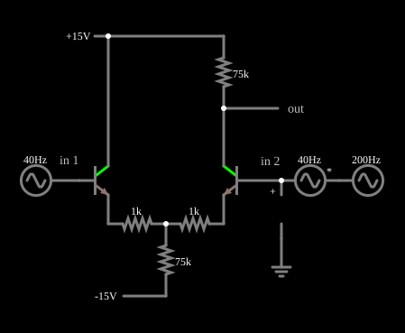

# Amplificador diferencial: entrada diferencial

<!-- navegacao:inicio -->
[Índice](README.md) · [Próximo: Common-Mode Input](trans-diffamp-common.md)
<!-- navegacao:fim -->

## Objetivo

Mostrar o amplificador diferencial de transistores bipolares: ele amplifica a **diferença** entre as duas entradas e rejeita, em grande parte, o que é **comum** a elas. Aqui as duas entradas trazem o mesmo sinal de $40\ \text{Hz}$ (modo comum), e apenas a entrada 2 traz, além dele, um sinal de $200\ \text{Hz}$ (modo diferencial): a saída mostra o de $200\ \text{Hz}$ amplificado e o de $40\ \text{Hz}$ quase eliminado.

## O circuito

<!-- esquema:inicio -->

<!-- esquema:fim -->

Dois transistores NPN iguais ($\beta = 100$) formam o par diferencial. Cada emissor tem um resistor de $1\ \text{k}\Omega$ ($R_E$) até um nó comum, ligado por um resistor de $75\ \text{k}\Omega$ ($R_T$, a "cauda") à fonte de $-15\ \text{V}$. O coletor de Q1 está ligado direto a $+15\ \text{V}$; o de Q2 liga-se a $+15\ \text{V}$ por um resistor de $75\ \text{k}\Omega$ ($R_C$), e a saída é tomada nele. A base de Q1 (**in 1**) recebe $0{,}1\ \text{V}$ de pico a $40\ \text{Hz}$; a base de Q2 (**in 2**) recebe esse mesmo sinal de $40\ \text{Hz}$ mais uma fonte de $0{,}1\ \text{V}$ de pico a $200\ \text{Hz}$. Três osciloscópios mostram in 1, in 2 e a saída.

<!-- componentes:inicio -->
| N.º | Tipo | Elemento | Valores |
|----:|------|----------|---------|
| 0 | `NTransistorElm` | transistor | Beta/hFE = 100; Swap E/C = não; Draw Circle = não; Model = default |
| 1 | `NTransistorElm` | transistor | Beta/hFE = 100; Swap E/C = não; Draw Circle = não; Model = default |
| 4 | `ResistorElm` | resistor | Resistance (ohms) = 1k |
| 5 | `ResistorElm` | resistor | Resistance (ohms) = 1k |
| 6 | `ResistorElm` | resistor | Resistance (ohms) = 75k |
| 7 | `ResistorElm` | resistor | Resistance (ohms) = 75k |
| 9 | `RailElm` | voltage source | Voltage = 15; Waveform = D/C; DC Offset (V) = 0; Internal Resistance (ohms) = 0 |
| 10 | `RailElm` | voltage source | Voltage = -15; Waveform = D/C; DC Offset (V) = 0; Internal Resistance (ohms) = 0 |
| 11 | `RailElm` | A/C source | Max Voltage = 100m; Waveform = A/C; DC Offset (V) = 0; Internal Resistance (ohms) = 0; Show Voltage = não; Frequency (Hz) = 40; Phase Offset (degrees) = 0 |
| 12 | `VoltageElm` | A/C source | Max Voltage = -100m; Waveform = A/C; DC Offset (V) = 0; Internal Resistance (ohms) = 0; Show Voltage = não; Frequency (Hz) = 40; Phase Offset (degrees) = 0 |
| 13 | `RailElm` | A/C source | Max Voltage = 100m; Waveform = A/C; DC Offset (V) = 0; Internal Resistance (ohms) = 0; Show Voltage = não; Frequency (Hz) = 200; Phase Offset (degrees) = 0 |
| 14 | `ProbeElm` | voltmeter | Show Voltage = não; Value = Voltage; Scale = Auto; Use Circle Symbol = não; Series Resistance (0 = infinite) = 0 |
| 15 | `GroundElm` | ground | Symbol = Earth |
| 18 | `OutputElm` | output | Show Voltage = não |
| 19 | `TextElm` | text | Text = in 1; Size = 14; Draw Bar On Top = não; Color = #c0c0c0 |
| 20 | `TextElm` | text | Text = in 2; Size = 14; Draw Bar On Top = não; Color = #c0c0c0 |
<!-- componentes:fim -->

## Teoria

O transistor usa o modelo de Ebers–Moll descrito em [Transistor NPN](npn.md). Chamam-se $v_d = v_1 - v_2$ a entrada diferencial e $v_{cm} = (v_1 + v_2)/2$ a de modo comum.

**Ponto de operação.** Com as bases em $0\ \text{V}$, o nó dos emissores fica em $-V_{BE} - I_E R_E \approx -0{,}63\ \text{V}$ e a corrente da cauda é

$$I_T = \frac{V_E - (-15)}{R_T} \approx \frac{14{,}37}{75\,000} \approx 191{,}6\ \mu\text{A},$$

dividida igualmente entre os dois ramos: $I_E \approx 95{,}8\ \mu\text{A}$. A resistência de emissor do modelo de pequenos sinais é $r_e = V_T/I_E = 25{,}865\ \text{mV}/95{,}8\ \mu\text{A} \approx 270\ \Omega$.

**Ganhos** (saída no coletor de Q2, pequenos sinais):

$$A_d = \frac{v_o}{v_d} \approx \frac{R_C}{2\,(R_E + r_e)}, \qquad A_{cm} = \frac{v_o}{v_{cm}} \approx -\frac{R_C}{R_E + r_e + 2R_T},$$

e a taxa de rejeição de modo comum $\text{CMRR} = |A_d / A_{cm}|$. A cauda resistiva é o que limita a rejeição: quanto maior $R_T$, menor o ganho de modo comum.

## Resultados esperados

Com $R_C = 75\ \text{k}\Omega$, $R_E = 1\ \text{k}\Omega$, $R_T = 75\ \text{k}\Omega$ e $r_e \approx 270\ \Omega$:

$$A_d \approx \frac{75\,000}{2\,(1000 + 270)} \approx 29{,}5, \qquad A_{cm} \approx -\frac{75\,000}{1000 + 270 + 150\,000} \approx -0{,}496, \qquad \text{CMRR} \approx 59{,}5\ (35{,}5\ \text{dB}).$$

No repouso (todas as entradas em zero, como em $t = 12{,}5\ \text{ms}$) a corrente da cauda é $191{,}6\ \mu\text{A}$ e o coletor de Q2 fica em $15 - 75\,000 \cdot I_C \approx 7{,}87\ \text{V}$ (o simulador dá $7{,}868\ \text{V}$).

Com as entradas ligadas, a saída oscila em torno de $7{,}88\ \text{V}$ e vai de $4{,}92\ \text{V}$ a $10{,}84\ \text{V}$: um pico de cerca de $2{,}96\ \text{V}$, que é $A_d \cdot 0{,}1\ \text{V}$ ($2{,}95\ \text{V}$) para o sinal de $200\ \text{Hz}$ ($v_d$ de $0{,}1\ \text{V}$ de pico), somado a uma pequena parcela do de $40\ \text{Hz}$. Analisando a saída por Fourier em $25\ \text{ms}$, o componente de $200\ \text{Hz}$ tem $2{,}92\ \text{V}$ de amplitude (ganho de $29{,}2$) e o de $40\ \text{Hz}$, $0{,}049\ \text{V}$ para $0{,}1\ \text{V}$ de entrada comum (ganho de $0{,}49$): ambos dentro de $2\%$ do previsto acima. As verificações conferem a corrente da cauda e a tensão de repouso, o valor eficaz de in 2 e o máximo, o mínimo e a média da saída (tolerância de $1\%$).

## O que observar

Nos osciloscópios, in 1 e in 2 têm o mesmo sinal lento, mas in 2 tem uma ondulação rápida a mais; a saída mostra essa ondulação de $200\ \text{Hz}$ bem maior ($\approx 3\ \text{V}$ de pico contra $0{,}1\ \text{V}$ na entrada) e quase nada do sinal de $40\ \text{Hz}$, que na entrada tem o mesmo tamanho. Para testar: troque o resistor de $75\ \text{k}\Omega$ da cauda por $7{,}5\ \text{k}\Omega$ e veja o sinal de $40\ \text{Hz}$ crescer na saída (a rejeição piora e a corrente de repouso aumenta); mude os resistores de emissor e veja o ganho diferencial variar com $1/(R_E + r_e)$.

## Limites do modelo

- O transistor do simulador não tem efeito Early, capacitâncias nem resistências série; num par real o ganho cai com a frequência e a rejeição de modo comum piora nas frequências altas.
- As fórmulas de ganho valem para pequenos sinais (variações da tensão base-emissor bem menores que $2V_T \approx 52\ \text{mV}$ de cada lado); aqui, com $0{,}1\ \text{V}$ nas bases e $R_E = 1\ \text{k}\Omega$, a degeneração mantém o circuito quase linear.
- A saída é tomada num só coletor (saída simples); uma saída diferencial entre os dois coletores dobra o ganho e anula o modo comum se o par for simétrico.
- As amplitudes de Fourier citadas vêm do simulador, não de uma verificação automática.

## Referências

Sedra e Smith, *Microelectronic Circuits*, capítulo sobre o par diferencial; Horowitz e Hill, *The Art of Electronics*, seção 2.3 (amplificadores diferenciais).

O circuito deste exemplo faz parte da coleção do simulador original de Paul Falstad e Iain Sharp (CircuitJS1); a explicação é deste projeto.
