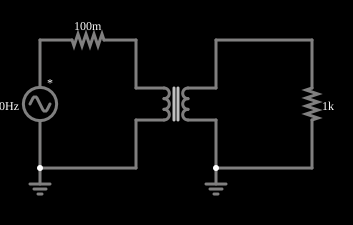

# Transformador 1:1

<!-- navegacao:inicio -->
[Índice](README.md) · [Próximo: Transformer w/ DC](transformerdc.md)
<!-- navegacao:fim -->

## Objetivo

Mostrar um transformador de razão 1:1: a tensão do primário aparece, quase igual, no secundário, que está eletricamente separado do primário, e a corrente da carga é refletida de volta na fonte.

## O circuito

<!-- esquema:inicio -->

<!-- esquema:fim -->

Uma fonte senoidal de $10\ \text{V}$ de pico e $60\ \text{Hz}$ alimenta, através de um resistor de $0{,}1\ \Omega$ (a resistência da fonte), o primário de um transformador de $100\ \text{H}$ com razão $1{:}1$. O secundário alimenta um resistor de carga de $1\ \text{k}\Omega$. Cada lado tem sua própria terra. Dois osciloscópios mostram a tensão da fonte e a da carga.

<!-- componentes:inicio -->
| N.º | Tipo | Elemento | Valores |
|----:|------|----------|---------|
| 0 | `VoltageElm` | A/C source | Max Voltage = 10; Waveform = A/C; DC Offset (V) = 0; Internal Resistance (ohms) = 0; Show Voltage = não; Frequency (Hz) = 60; Phase Offset (degrees) = 0 |
| 2 | `TransformerElm` | transformer | Primary Inductance (H) = 100; Ratio (N1/N2) = 1; Coupling Coefficient = 999m; Trapezoidal Approximation = sim; Swap Secondary Polarity = não; Saturation Current (A) (0=none) = 0 |
| 5 | `ResistorElm` | resistor | Resistance (ohms) = 100m |
| 9 | `ResistorElm` | resistor | Resistance (ohms) = 1k |
| 11 | `GroundElm` | ground | Symbol = Earth |
| 12 | `GroundElm` | ground | Symbol = Earth |
<!-- componentes:fim -->

## Teoria

Dois enrolamentos que compartilham fluxo magnético formam um transformador. Com indutâncias próprias $L_1$ e $L_2$ e indutância mútua $M = k\sqrt{L_1 L_2}$ (o coeficiente de acoplamento $k$ vale $0{,}999$ nestes exemplos),

$$v_1 = L_1\frac{di_1}{dt} - M\frac{di_2}{dt},\qquad v_2 = M\frac{di_1}{dt} - L_2\frac{di_2}{dt},$$

com $i_2$ a corrente que o secundário entrega à carga. A razão de espiras $n = N_1/N_2$ liga as indutâncias, $L_2 = L_1/n^2$. No limite ideal ($k \to 1$, $L_1\to\infty$):

$$\frac{V_2}{V_1} = \frac{1}{n},\qquad \frac{I_2}{I_1} = n,\qquad Z_{refletida} = n^2 R_L,$$

e a potência se conserva ($V_1 I_1 = V_2 I_2$). Em regime senoidal, com $R_s$ a resistência em série com a fonte, $Z_1 = R_s + j\omega L_1$ e $Z_2 = R_L + j\omega L_2$, a resolução exata do circuito dá

$$I_1 = \frac{V\,Z_2}{Z_1 Z_2 + \omega^2 M^2},\qquad \frac{V_L}{V} = \frac{j\omega M\,R_L}{Z_1 Z_2 + \omega^2 M^2}.$$

A diferença para o caso ideal vem da indutância de magnetização finita (que consome uma corrente reativa $V/\omega L_1$), da indutância de dispersão $(1-k^2)L_1$ e da resistência série $R_s$.

## Resultados esperados

A reatância do primário é $\omega L_1 = 2\pi\cdot 60\cdot 100 = 37{,}7\ \text{k}\Omega$, muito maior que a carga de $1\ \text{k}\Omega$: o transformador está próximo do ideal. Pela fórmula exata:

$$|V_L| = 9{,}961\ \text{V},\qquad |I_2| = 9{,}961\ \text{mA}\ (\text{pico}),\qquad |I_1| = 9{,}974\ \text{mA}\ (\text{pico}).$$

Em valores eficazes, $I_2 = 7{,}043\ \text{mA}$ e $I_1 = 7{,}053\ \text{mA}$. A pequena diferença entre $I_1$ e $I_2$ é a corrente de magnetização. As verificações conferem a tensão de pico da carga e as duas correntes eficazes, numa janela de um ciclo (de $0{,}2$ a $0{,}2167\ \text{s}$), com tolerância de 2% (o simulador fica a menos de 0,3% da teoria).

## O que observar

- As duas formas de onda dos osciloscópios coincidem em fase e amplitude: a carga recebe $99{,}6\%$ da tensão da fonte.
- O secundário não tem ligação elétrica com o primário; só o fluxo magnético os acopla.
- Reduza a indutância do primário (clique duas vezes no transformador) e veja a tensão de saída cair: a reatância $\omega L_1$ deixa de ser grande frente à carga.

## Limites do modelo

O transformador é modelado só por indutâncias acopladas; um transformador real tem perdas no núcleo (histerese e correntes parasitas), resistência dos enrolamentos e capacitâncias entre espiras. A fonte começa no cruzamento por zero, o que cria na corrente de magnetização uma componente contínua que decai com a constante $L_1/R_s$ (da ordem de $1000\ \text{s}$); por isso as correntes são conferidas pelo valor eficaz, que praticamente não é afetado por ela, e não pelo pico.

## Referências

- C. K. Alexander e M. N. O. Sadiku, *Fundamentos de Circuitos Elétricos*, AMGH.
- J. W. Nilsson e S. A. Riedel, *Circuitos Elétricos*, Pearson.

O circuito deste exemplo faz parte da coleção do simulador original de Paul Falstad e Iain Sharp (CircuitJS1); a explicação é deste projeto.
