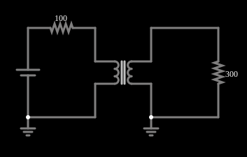

# Transformador com corrente contínua

<!-- navegacao:inicio -->
[Índice](README.md) · [Anterior: Transformer](transformer.md) · [Próximo: Step-Up Transformer](transformerup.md)
<!-- navegacao:fim -->

## Objetivo

Mostrar que um transformador não transmite corrente contínua: ligada uma fonte de $10\ \text{V}$ contínuos, a tensão no secundário aparece de repente e depois decai a zero, enquanto a corrente do primário cresce até o valor limitado só pela resistência.

## O circuito

<!-- esquema:inicio -->

<!-- esquema:fim -->

Uma fonte de $10\ \text{V}$ contínuos é ligada, através de um resistor de $100\ \Omega$, ao primário de um transformador $1{:}1$ de $10\ \text{H}$ (acoplamento $0{,}999$); o secundário alimenta um resistor de $300\ \Omega$. Dois osciloscópios mostram a tensão da fonte e a da carga.

<!-- componentes:inicio -->
| N.º | Tipo | Elemento | Valores |
|----:|------|----------|---------|
| 0 | `VoltageElm` | voltage source | Voltage = 10; Waveform = D/C; DC Offset (V) = 0; Internal Resistance (ohms) = 0; Show Voltage = não; Circle Symbol = não |
| 2 | `TransformerElm` | transformer | Primary Inductance (H) = 10; Ratio (N1/N2) = 1; Coupling Coefficient = 999m; Trapezoidal Approximation = sim; Swap Secondary Polarity = não; Saturation Current (A) (0=none) = 0 |
| 5 | `ResistorElm` | resistor | Resistance (ohms) = 100 |
| 9 | `ResistorElm` | resistor | Resistance (ohms) = 300 |
| 11 | `GroundElm` | ground | Symbol = Earth |
| 12 | `GroundElm` | ground | Symbol = Earth |
<!-- componentes:fim -->

## Símbolos e parâmetros

Os símbolos usados neste documento (definições completas no [glossário](../glossario-simbolos.md)):

| Símbolo | Nome | Significado | Unidade |
|---------|------|-------------|---------|
| $t$ | tempo | instante, contado a partir do início da simulação | s |
| $n$ | razão de espiras | $N_1/N_2$: relação entre o número de espiras do primário e do secundário | — |
| $i$ | corrente instantânea | valor da corrente em cada instante, que pode variar no tempo | A |
| $v$ | tensão instantânea | valor da tensão em cada instante, que pode variar no tempo | V |
| $R$ | resistência | oposição de um resistor à passagem da corrente ($V = R I$) | Ω |
| $V$ | tensão | diferença de potencial elétrico entre dois pontos do circuito | V |
| $M$ | indutância mútua | acoplamento entre duas bobinas: o fluxo de uma induz tensão na outra | H |
| $L$ | indutância | quanto fluxo magnético uma bobina cria por ampère | H |
| $L_1$ | indutância do indutor 1 | indutância do indutor chamado $L_1$ no circuito | H |
| $L_2$ | indutância do indutor 2 | indutância do indutor chamado $L_2$ no circuito | H |
| $k$ | coeficiente de acoplamento | fração do fluxo de uma bobina que atravessa a outra (de $0$ a $1$) | — |
| $v_1$ | tensão instantânea 1 | tensão instantânea chamada $v_1$ no circuito | V |
| $i_1$ | corrente instantânea 1 | corrente instantânea chamada $i_1$ no circuito | A |
| $i_2$ | corrente instantânea 2 | corrente instantânea chamada $i_2$ no circuito | A |
| $v_2$ | tensão instantânea 2 | tensão instantânea chamada $v_2$ no circuito | V |
| $N_1$ | espiras do primário | número de espiras do enrolamento primário | — |
| $N_2$ | espiras do secundário | número de espiras do enrolamento secundário | — |
| $V_2$ | tensão 2 | tensão chamada $V_2$ no circuito | V |
| $V_1$ | tensão 1 | tensão chamada $V_1$ no circuito | V |
| $I_2$ | corrente 2 | corrente chamada $I_2$ no circuito | A |
| $I_1$ | corrente 1 | corrente chamada $I_1$ no circuito | A |
| $Z_{\text{refletida}}$ | impedância refletida | impedância da carga vista do primário, $n^2 R_L$ | Ω |
| $R_L$ | resistência de carga | resistor ligado à saída, que consome a energia do circuito | Ω |
| $R_s$ | resistência em série | resistor em série com a fonte ou com o dispositivo | Ω |
| $Z_1$ | impedância 1 | impedância chamada $Z_1$ no circuito | Ω |
| $\omega$ | frequência angular | $2\pi f$: a frequência medida em radianos por segundo | rad/s |
| $Z_2$ | impedância 2 | impedância chamada $Z_2$ no circuito | Ω |
| $V_L$ | tensão no indutor | tensão entre os terminais do indutor | V |
| $\tau_1$ | constante de tempo lenta | constante de tempo da parte lenta do transitório | s |
| $\tau_2$ | constante de tempo rápida | constante de tempo da parte rápida do transitório | s |
| $v_L$ | tensão no indutor | tensão entre os terminais do indutor | V |

## Teoria

Dois enrolamentos que compartilham fluxo magnético formam um transformador. Com indutâncias próprias $L_1$ e $L_2$ e indutância mútua $M = k\sqrt{L_1 L_2}$ (o coeficiente de acoplamento $k$ vale $0{,}999$ nestes exemplos),

$$v_1 = L_1\frac{di_1}{dt} - M\frac{di_2}{dt},\qquad v_2 = M\frac{di_1}{dt} - L_2\frac{di_2}{dt},$$

com $i_2$ a corrente que o secundário entrega à carga. A razão de espiras $n = N_1/N_2$ liga as indutâncias, $L_2 = L_1/n^2$. No limite ideal ($k \to 1$, $L_1\to\infty$):

$$\frac{V_2}{V_1} = \frac{1}{n},\qquad \frac{I_2}{I_1} = n,\qquad Z_{refletida} = n^2 R_L,$$

e a potência se conserva ($V_1 I_1 = V_2 I_2$). Em regime senoidal, com $R_s$ a resistência em série com a fonte, $Z_1 = R_s + j\omega L_1$ e $Z_2 = R_L + j\omega L_2$, a resolução exata do circuito dá

$$I_1 = \frac{V\thinspace Z_2}{Z_1 Z_2 + \omega^2 M^2},\qquad \frac{V_L}{V} = \frac{j\omega M\thinspace R_L}{Z_1 Z_2 + \omega^2 M^2}.$$

A diferença para o caso ideal vem da indutância de magnetização finita (que consome uma corrente reativa $V/\omega L_1$), da indutância de dispersão $(1-k^2)L_1$ e da resistência série $R_s$.

Para uma tensão contínua, as equações acopladas se resolvem com a matriz das indutâncias: $\mathbf{L}\thinspace\dot{\mathbf{i}} = \mathbf{v} - \mathbf{R}\thinspace\mathbf{i}$, e a resposta é uma soma de exponenciais com os autovalores de $\mathbf{L}^{-1}\mathbf{R}$. Aqui há duas constantes de tempo: uma **lenta**, $\tau_1 \approx L_1/(R_s\thinspace\|\thinspace R_L) = 10/75 = 133\ \text{ms}$, da indutância de magnetização carregando-se, e uma **rápida**, $\tau_2 = 50\ \mu\text{s}$, da indutância de dispersão.

## Resultados esperados

Logo depois do fechamento (alguns $\tau_2$), o transformador de acoplamento quase total se comporta como um fio entre primário e secundário, e a carga recebe o divisor de tensão $V R_L/(R_s + R_L) = 10\cdot 300/400 = 7{,}5\ \text{V}$. Depois a tensão decai com $\tau_1$:

$$v_L(t) \approx 7{,}5\thinspace e^{-t/\tau_1}\ \text{V}.$$

Pela resolução exata: $v_L(5\ \text{ms}) = 7{,}222\ \text{V}$, $v_L(20\ \text{ms}) = 6{,}453\ \text{V}$, $v_L(50\ \text{ms}) = 5{,}153\ \text{V}$; a corrente da fonte tende a $V/R_s = 100\ \text{mA}$ e vale $98{,}24\ \text{mA}$ em $0{,}5\ \text{s}$. As verificações conferem esses quatro valores (tolerância de 2%; o simulador fica a menos de 0,1% da resolução exata).

## O que observar

- A tensão na carga salta e depois murcha com uma constante de tempo de décimos de segundo; a corrente do primário sobe devagar até $100\ \text{mA}$.
- Quando a corrente do primário se estabiliza, não há mais variação de fluxo e o secundário não recebe nada: é por isso que transformadores só funcionam em corrente alternada.
- Aumente a indutância do primário e veja a tensão na carga durar mais tempo: $\tau_1$ cresce com $L_1$.

## Limites do modelo

Indutâncias acopladas ideais, sem saturação do núcleo. Com corrente contínua, um transformador real saturaria o núcleo muito antes de a corrente atingir o valor final (veja os exemplos de núcleo saturável, mais adiante).

## Referências

- C. K. Alexander e M. N. O. Sadiku, *Fundamentos de Circuitos Elétricos*, AMGH.
- J. W. Nilsson e S. A. Riedel, *Circuitos Elétricos*, Pearson.

O circuito deste exemplo faz parte da coleção do simulador original de Paul Falstad e Iain Sharp (CircuitJS1); a explicação é deste projeto.
