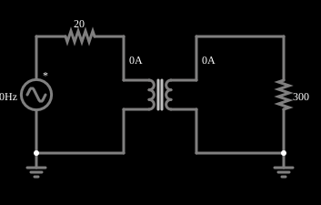

# Transformador abaixador

<!-- navegacao:inicio -->
[Índice](README.md) · [Anterior: Step-Up Transformer](transformerup.md) · [Próximo: Long-Distance Power Transmission](longdist.md)
<!-- navegacao:fim -->

## Objetivo

Mostrar um transformador abaixador: o primário tem 10 vezes mais espiras que o secundário, então a tensão da rede de $120\ \text{V}$ eficazes cai para cerca de $12\ \text{V}$ e a corrente sobe 10 vezes.

## O circuito

<!-- esquema:inicio -->

<!-- esquema:fim -->

Uma fonte senoidal de $169{,}7\ \text{V}$ de pico ($120\ \text{V}$ eficazes), $60\ \text{Hz}$ e fase de $90^\circ$ (ou seja, começando no pico) alimenta, através de $20\ \Omega$ em série, o primário de $1000\ \text{H}$ de um transformador com razão $N_1/N_2 = 10$. O secundário alimenta um resistor de $300\ \Omega$. Dois osciloscópios mostram as tensões da fonte e da carga.

<!-- componentes:inicio -->
| N.º | Tipo | Elemento | Valores |
|----:|------|----------|---------|
| 0 | `VoltageElm` | A/C source | Max Voltage = 169.7; Waveform = A/C; DC Offset (V) = 0; Internal Resistance (ohms) = 0; Show Voltage = não; Frequency (Hz) = 60; Phase Offset (degrees) = 90 |
| 2 | `TransformerElm` | transformer | Primary Inductance (H) = 1k; Ratio (N1/N2) = 10; Coupling Coefficient = 999m; Trapezoidal Approximation = sim; Swap Secondary Polarity = não; Saturation Current (A) (0=none) = 0 |
| 5 | `ResistorElm` | resistor | Resistance (ohms) = 20 |
| 9 | `ResistorElm` | resistor | Resistance (ohms) = 300 |
| 11 | `GroundElm` | ground | Symbol = Earth |
| 12 | `GroundElm` | ground | Symbol = Earth |
<!-- componentes:fim -->

## Teoria

Dois enrolamentos que compartilham fluxo magnético formam um transformador. Com indutâncias próprias $L_1$ e $L_2$ e indutância mútua $M = k\sqrt{L_1 L_2}$ (o coeficiente de acoplamento $k$ vale $0{,}999$ nestes exemplos),

$$v_1 = L_1\frac{di_1}{dt} - M\frac{di_2}{dt},\qquad v_2 = M\frac{di_1}{dt} - L_2\frac{di_2}{dt},$$

com $i_2$ a corrente que o secundário entrega à carga. A razão de espiras $n = N_1/N_2$ liga as indutâncias, $L_2 = L_1/n^2$. No limite ideal ($k \to 1$, $L_1\to\infty$):

$$\frac{V_2}{V_1} = \frac{1}{n},\qquad \frac{I_2}{I_1} = n,\qquad Z_{refletida} = n^2 R_L,$$

e a potência se conserva ($V_1 I_1 = V_2 I_2$). Em regime senoidal, com $R_s$ a resistência em série com a fonte, $Z_1 = R_s + j\omega L_1$ e $Z_2 = R_L + j\omega L_2$, a resolução exata do circuito dá

$$I_1 = \frac{V\,Z_2}{Z_1 Z_2 + \omega^2 M^2},\qquad \frac{V_L}{V} = \frac{j\omega M\,R_L}{Z_1 Z_2 + \omega^2 M^2}.$$

A diferença para o caso ideal vem da indutância de magnetização finita (que consome uma corrente reativa $V/\omega L_1$), da indutância de dispersão $(1-k^2)L_1$ e da resistência série $R_s$.

## Resultados esperados

No limite ideal, $V_2 = 169{,}7/10 = 16{,}97\ \text{V}$ de pico ($12\ \text{V}$ eficazes) e a carga de $300\ \Omega$ aparece no primário como $300\cdot 10^2 = 30\ \text{k}\Omega$, muito maior que os $20\ \Omega$ em série, que quase não atrapalham. A resolução exata ($\omega L_1 = 377\ \text{k}\Omega$) dá

$$|V_L| = 16{,}937\ \text{V},\qquad I_2 = 56{,}46\ \text{mA}\ (\text{pico}) = 39{,}92\ \text{mA}\ (\text{eficaz}),\qquad I_1 = 5{,}669\ \text{mA}\ (\text{pico}) = 4{,}009\ \text{mA}\ (\text{eficaz}).$$

A potência na carga é $16{,}94^2/(2\cdot 300) = 0{,}478\ \text{W}$. As verificações conferem a tensão de pico e as duas correntes eficazes (tolerâncias de 2% e 3%).

## O que observar

- A tensão da carga é a décima parte da da fonte, e a corrente do secundário é 10 vezes a do primário.
- A fase de $90^\circ$ faz a fonte começar no pico, o que evita o transitório de corrente contínua que a partida no zero causaria na corrente de magnetização.
- A resistência de $20\ \Omega$ em série quase não afeta o resultado, porque a carga refletida ($30\ \text{k}\Omega$) é muito maior.

## Limites do modelo

Modelo só com indutâncias acopladas e resistores ideais. Um transformador de potência real tem perdas no núcleo e nos enrolamentos (da ordem de poucos por cento) e regulação de tensão sob carga, que este modelo não representa além da dispersão.

## Referências

- C. K. Alexander e M. N. O. Sadiku, *Fundamentos de Circuitos Elétricos*, AMGH.
- J. W. Nilsson e S. A. Riedel, *Circuitos Elétricos*, Pearson.

O circuito deste exemplo faz parte da coleção do simulador original de Paul Falstad e Iain Sharp (CircuitJS1); a explicação é deste projeto.
