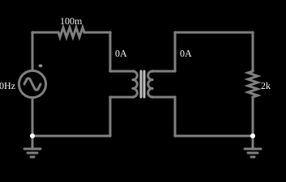

# Transformador elevador

<!-- navegacao:inicio -->
[Índice](README.md) · [Anterior: Transformer w/ DC](transformerdc.md) · [Próximo: Step-Down Transformer](transformerdown.md)
<!-- navegacao:fim -->

## Objetivo

Mostrar um transformador elevador: o secundário tem 10 vezes mais espiras que o primário, então a tensão sobe 10 vezes e a corrente cai na mesma proporção.

## O circuito

<!-- esquema:inicio -->

<!-- esquema:fim -->

Uma fonte senoidal de $10\ \text{V}$ de pico e $60\ \text{Hz}$, com $0{,}1\ \Omega$ em série, alimenta o primário (de $1\ \text{H}$) de um transformador com razão $N_1/N_2 = 1/10$. O secundário alimenta um resistor de $2\ \text{k}\Omega$. Dois osciloscópios mostram as tensões da fonte e da carga (a escala da carga é 10 vezes maior).

<!-- componentes:inicio -->
| N.º | Tipo | Elemento | Valores |
|----:|------|----------|---------|
| 0 | `VoltageElm` | A/C source | Max Voltage = 10; Waveform = A/C; DC Offset (V) = 0; Internal Resistance (ohms) = 0; Show Voltage = não; Frequency (Hz) = 60; Phase Offset (degrees) = 0 |
| 2 | `TransformerElm` | transformer | Primary Inductance (H) = 1; Ratio (N1/N2) = 100m; Coupling Coefficient = 999m; Trapezoidal Approximation = sim; Swap Secondary Polarity = não; Saturation Current (A) (0=none) = 0 |
| 5 | `ResistorElm` | resistor | Resistance (ohms) = 100m |
| 9 | `ResistorElm` | resistor | Resistance (ohms) = 2k |
| 11 | `GroundElm` | ground | Symbol = Earth |
| 12 | `GroundElm` | ground | Symbol = Earth |
<!-- componentes:fim -->

## Teoria

Dois enrolamentos que compartilham fluxo magnético formam um transformador. Com indutâncias próprias $L_1$ e $L_2$ e indutância mútua $M = k\sqrt{L_1 L_2}$ (o coeficiente de acoplamento $k$ vale $0{,}999$ nestes exemplos),

$$v_1 = L_1\frac{di_1}{dt} - M\frac{di_2}{dt},\qquad v_2 = M\frac{di_1}{dt} - L_2\frac{di_2}{dt},$$

com $i_2$ a corrente que o secundário entrega à carga. A razão de espiras $n = N_1/N_2$ liga as indutâncias, $L_2 = L_1/n^2$. No limite ideal ($k \to 1$, $L_1\to\infty$):

$$\frac{V_2}{V_1} = \frac{1}{n},\qquad \frac{I_2}{I_1} = n,\qquad Z_{refletida} = n^2 R_L,$$

e a potência se conserva ($V_1 I_1 = V_2 I_2$). Em regime senoidal, com $R_s$ a resistência em série com a fonte, $Z_1 = R_s + j\omega L_1$ e $Z_2 = R_L + j\omega L_2$, a resolução exata do circuito dá

$$I_1 = \frac{V\,Z_2}{Z_1 Z_2 + \omega^2 M^2},\qquad \frac{V_L}{V} = \frac{j\omega M\,R_L}{Z_1 Z_2 + \omega^2 M^2}.$$

A diferença para o caso ideal vem da indutância de magnetização finita (que consome uma corrente reativa $V/\omega L_1$), da indutância de dispersão $(1-k^2)L_1$ e da resistência série $R_s$.

## Resultados esperados

No limite ideal, $V_2 = 10\cdot 10 = 100\ \text{V}$ de pico e $I_2 = 100/2000 = 50\ \text{mA}$, e a carga de $2\ \text{k}\Omega$ aparece no primário como $2000/10^2 = 20\ \Omega$. A resolução exata, com $\omega L_1 = 377\ \Omega$, dá

$$|V_L| = 99{,}33\ \text{V},\qquad I_2 = 49{,}67\ \text{mA}\ (\text{pico}) = 35{,}12\ \text{mA}\ (\text{eficaz}),\qquad I_1 = 497{,}9\ \text{mA}\ (\text{pico}) = 352{,}1\ \text{mA}\ (\text{eficaz}).$$

A potência na carga é $99{,}33^2/(2\cdot 2000) = 2{,}47\ \text{W}$; a única perda do modelo é a dos $0{,}1\ \Omega$ da fonte ($0{,}012\ \text{W}$), de modo que o rendimento é de $99{,}5\%$. As verificações conferem a tensão de pico e as duas correntes eficazes (tolerâncias de 2% e 3%; o simulador fica a menos de 0,2% da teoria).

## O que observar

- A tensão da carga tem amplitude 10 vezes a da fonte, mas a corrente no primário é 10 vezes a do secundário: a potência é a mesma.
- Aumente a carga (por exemplo, para $20\ \text{k}\Omega$): a corrente refletida cai e a tensão de saída chega mais perto de $100\ \text{V}$.
- Compare com o transformador abaixador mais adiante: a mesma máquina, ligada ao contrário.

## Limites do modelo

Modelo só com indutâncias acopladas (sem perdas no núcleo, capacitâncias ou saturação). A fonte começa em fase zero e a componente contínua da corrente de magnetização praticamente não decai no tempo simulado; por isso a corrente da fonte é conferida pelo valor eficaz e com tolerância de 3%.

## Referências

- C. K. Alexander e M. N. O. Sadiku, *Fundamentos de Circuitos Elétricos*, AMGH.
- J. W. Nilsson e S. A. Riedel, *Circuitos Elétricos*, Pearson.

O circuito deste exemplo faz parte da coleção do simulador original de Paul Falstad e Iain Sharp (CircuitJS1); a explicação é deste projeto.
