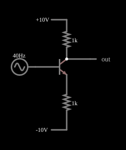

# Retificador de onda completa com um transistor

<!-- navegacao:inicio -->
[Índice](README.md) · [Anterior: Joule Thief](joule-thief.md) · [Próximo: Early Effect](early.md)
<!-- navegacao:fim -->

## Objetivo

Mostrar que **um único transistor** pode retificar uma senoide em onda completa, sem diodos: no semiciclo negativo da entrada ele funciona como amplificador inversor e no positivo satura, de modo que a saída (o coletor) vale $|v|$ nos dois semiciclos.

## O circuito

<!-- esquema:inicio -->

<!-- esquema:fim -->

Um NPN com $\beta = 1000$ tem o coletor ligado a $+10\ \text{V}$ por um resistor de $1\ \text{k}\Omega$ e o emissor, a $-10\ \text{V}$ por outro de $1\ \text{k}\Omega$. A base recebe uma fonte senoidal de $5\ \text{V}$ de pico e $40\ \text{Hz}$ com um nível contínuo de $0{,}655\ \text{V}$, que compensa a queda base-emissor de modo que o emissor reproduz a senoide $v_s$ sem esse deslocamento. A saída é a tensão do coletor; dois osciloscópios mostram a entrada e a saída.

<!-- componentes:inicio -->
| N.º | Tipo | Elemento | Valores |
|----:|------|----------|---------|
| 0 | `NTransistorElm` | transistor | Beta/hFE = 1k; Swap E/C = não; Draw Circle = não; Model = default |
| 1 | `ResistorElm` | resistor | Resistance (ohms) = 1k |
| 2 | `ResistorElm` | resistor | Resistance (ohms) = 1k |
| 4 | `RailElm` | voltage source | Voltage = 10; Waveform = D/C; DC Offset (V) = 0; Internal Resistance (ohms) = 0 |
| 5 | `RailElm` | voltage source | Voltage = -10; Waveform = D/C; DC Offset (V) = 0; Internal Resistance (ohms) = 0 |
| 6 | `OutputElm` | output | Show Voltage = não |
| 7 | `RailElm` | A/C source | Max Voltage = 5; Waveform = A/C; DC Offset (V) = 655m; Internal Resistance (ohms) = 0; Show Voltage = não; Frequency (Hz) = 40; Phase Offset (degrees) = 0 |
<!-- componentes:fim -->

## Teoria

Seja $v_s$ a senoide de $5\ \text{V}$ (sem o nível contínuo). Com a queda $V_{BE} \approx 0{,}655\ \text{V}$ compensada, a tensão do emissor é $V_E \approx v_s$ e a corrente de emissor é

$$I_E = \frac{V_E - (-10)}{1\ \text{k}\Omega} = \frac{v_s + 10}{1\ \text{k}\Omega} \quad (\text{mA, com } v_s \text{ em V}).$$

- **$v_s < 0$ (região ativa):** como $\beta$ é alto, $I_C \approx I_E$ e $V_C = 10 - 1\ \text{k}\Omega \cdot I_C = 10 - (v_s + 10) = -v_s = |v_s|$. O transistor inverte o semiciclo negativo e o torna positivo.
- **$v_s > 0$ (saturação):** a fórmula acima daria $V_C = -v_s < V_E$, o que a junção base-coletor não permite: a junção entra em condução (saturação) e o coletor fica preso ao emissor, $V_C \approx V_E = v_s = |v_s|$.

Em ambos os semiciclos, $v_o \approx |v_s|$. Para uma senoide de pico $V_p$, a retificação de onda completa tem valor médio $2V_p/\pi$, valor eficaz $V_p/\sqrt{2}$ e componente fundamental em $2f$ de amplitude $4V_p/(3\pi)$.

## Resultados esperados

Com $V_p = 5\ \text{V}$: valor médio $2 \cdot 5/\pi = 3{,}183\ \text{V}$, valor eficaz $3{,}536\ \text{V}$ e fundamental de $80\ \text{Hz}$ com $2{,}122\ \text{V}$. O simulador dá, em dois períodos da saída (janela de $25\ \text{ms}$): máximo $5{,}000\ \text{V}$, mínimo $0{,}095\ \text{V}$, média $3{,}190\ \text{V}$ (diferença de $0{,}2\%$), valor eficaz $3{,}536\ \text{V}$ e componente de $80\ \text{Hz}$ de $2{,}104\ \text{V}$ ($0{,}8\%$ abaixo do ideal), enquanto o de $40\ \text{Hz}$ vale só $0{,}010\ \text{V}$: a frequência dobrou. Nos picos de $\pm 5\ \text{V}$ da entrada ($t = 56{,}25\ \text{ms}$ e $68{,}75\ \text{ms}$) a saída é $5{,}000\ \text{V}$ (transistor saturado, corrente de emissor de $14{,}98\ \text{mA}$) e $4{,}987\ \text{V}$ (região ativa). Perto de zero da entrada ($t = 62{,}5\ \text{ms}$) a saída é $0{,}117\ \text{V}$, não zero: é onde o transistor muda de região. As verificações conferem a saída nesses três pontos, a corrente de emissor em $v_s = 5\ \text{V}$ e o máximo, o mínimo, a média e o valor eficaz na janela (tolerância de $0{,}5\%$ ou $0{,}01\ \text{V}$ absolutos).

## O que observar

A saída é uma sequência de arcos positivos, com o dobro da frequência da entrada e sem valores negativos; quando a entrada passa por zero, a saída desce a cerca de $0{,}1\ \text{V}$, não a zero. Para testar: retire o nível contínuo de $0{,}655\ \text{V}$ e veja a saída perder a simetria (a queda base-emissor deixa de ser compensada); diminua a amplitude e veja o defeito perto de zero ficar relativamente maior; troque o resistor do emissor para $2\ \text{k}\Omega$ e veja o patamar de saturação mudar.

## Limites do modelo

- A compensação de $0{,}655\ \text{V}$ vale para uma corrente de emissor de $\sim 10\ \text{mA}$; com outras correntes ou outra temperatura a queda base-emissor muda e a simetria se perde.
- O circuito aproveita a saturação do transistor, que é lenta num transistor real (tempo de armazenamento): a retificação perde a qualidade em frequências mais altas, o que o modelo sem capacitâncias não mostra.
- A saída não chega a zero: o mínimo de $0{,}09\ \text{V}$ é do modelo; a forma exata do cruzamento por zero depende do transistor.
- Os valores de Fourier e a explicação das duas regiões vêm da análise do circuito e do simulador; as verificações automáticas cobrem as tensões e correntes citadas.

## Referências

Horowitz e Hill, *The Art of Electronics*, seção 4.x (retificadores de precisão); Sedra e Smith, *Microelectronic Circuits*, capítulo sobre circuitos com transistores em saturação.

O circuito deste exemplo faz parte da coleção do simulador original de Paul Falstad e Iain Sharp (CircuitJS1); a explicação é deste projeto.
