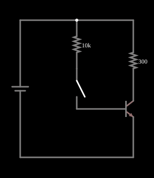

# Transistor como chave

<!-- navegacao:inicio -->
[Índice](README.md) · [Anterior: PNP Transistor](pnp.md) · [Próximo: Emitter Follower](follower.md)
<!-- navegacao:fim -->

## Objetivo

Mostrar o uso de um transistor como chave eletrônica: uma pequena corrente de base liga uma corrente muito maior de carga (transistor saturado), e sem corrente de base o transistor desliga a carga (corte).

## O circuito

<!-- esquema:inicio -->

<!-- esquema:fim -->

Uma fonte de $5\ \text{V}$ alimenta uma carga de $300\ \Omega$ (por exemplo, uma lâmpada ou um relé) ligada ao coletor de um NPN com o emissor na terra. A base é alimentada pela mesma fonte através de um resistor de $10\ \text{k}\Omega$ e de uma chave. O exemplo abre com a chave **aberta**: o transistor está desligado.

<!-- componentes:inicio -->
| N.º | Tipo | Elemento | Valores |
|----:|------|----------|---------|
| 0 | `VoltageElm` | voltage source | Voltage = 5; Waveform = D/C; DC Offset (V) = 0; Internal Resistance (ohms) = 0; Show Voltage = não; Circle Symbol = não |
| 2 | `NTransistorElm` | transistor | Beta/hFE = 100; Swap E/C = não; Draw Circle = não; Model = default |
| 3 | `ResistorElm` | resistor | Resistance (ohms) = 10k |
| 4 | `SwitchElm` | switch (SPST) | Momentary Switch = não; IEC Symbol = não; Label (for linking) = ; Keyboard Shortcut = ; On Resistance (ohms) = 0 |
| 6 | `ResistorElm` | resistor | Resistance (ohms) = 300 |
<!-- componentes:fim -->

## Teoria

O transistor bipolar do simulador (modelo "default") segue o modelo de Ebers–Moll, com $V_{BE}$ e $V_{BC}$ as tensões base-emissor e base-coletor (para um NPN):

$$I_C = I_s\left(e^{V_{BE}/V_T} - e^{V_{BC}/V_T}\right) - \frac{I_s}{\beta_R}\left(e^{V_{BC}/V_T} - 1\right),\qquad I_B = \frac{I_s}{\beta}\left(e^{V_{BE}/V_T} - 1\right) + \frac{I_s}{\beta_R}\left(e^{V_{BC}/V_T} - 1\right),$$

com $I_s = 10^{-13}\ \text{A}$, $\beta = 100$, $\beta_R = 1$ e $V_T = 25{,}865\ \text{mV}$; sem efeito Early, sem capacitâncias e sem resistências série. Na **região ativa** ($V_{BE} \approx 0{,}65$ a $0{,}75\ \text{V}$, junção base-coletor com polarização inversa) isso se reduz a $I_C = \beta I_B = I_s\,e^{V_{BE}/V_T}$, com transcondutância $g_m = I_C/V_T$ e resistência de emissor $r_e = V_T/I_E$. O PNP é o complementar, com todas as tensões e correntes invertidas.

## Resultados esperados

- **Corte (chave aberta):** sem corrente de base, $I_C \approx 0$ e toda a tensão da fonte aparece no transistor: $V_{CE} = 5\ \text{V}$.
- **Saturação (chave fechada):** a corrente de base é $I_B = (5 - V_{BE})/10\ \text{k}\Omega = 0{,}433\ \text{mA}$. Se o transistor estivesse na região ativa, $I_C = \beta I_B = 43{,}3\ \text{mA}$, mas a carga só deixa passar, no máximo, $5/300 = 16{,}7\ \text{mA}$. A junção base-coletor entra em polarização direta (saturação) e $V_{CE}$ cai ao valor de saturação, $V_{CE(sat)}$, pequeno:

$$I_C = \frac{5 - V_{CE(sat)}}{300\ \Omega}.$$

O **fator de saturação** $\beta I_B/I_C = 43{,}3/16{,}3 = 2{,}7$ indica o quanto a base está "sobrecarregada"; projetos práticos usam fatores de 2 a 10.

## O que observar

Resolvendo as equações do circuito com o transistor saturado (cálculo à parte, pelo modelo de Ebers–Moll): $V_{BE} = 0{,}6686\ \text{V}$, $V_{CE(sat)} = 0{,}1074\ \text{V}$, $I_B = 0{,}4331\ \text{mA}$ e $I_C = 16{,}31\ \text{mA}$, em acordo com o simulador. Com a chave aberta, a corrente da carga é da ordem de $0{,}5\ \text{nA}$ (vazamento numérico do modelo). Em saturação o transistor dissipa só $V_{CE(sat)}I_C = 1{,}8\ \text{mW}$, contra $81\ \text{mW}$ na carga. As verificações conferem a corrente da carga com a chave aberta ($\approx 0$) e fechada, a tensão $V_{CE(sat)}$ e a corrente de base (tolerância de 1% a 2%).

## Limites do modelo

- Feche a chave: a carga recebe $16\ \text{mA}$ e a tensão do coletor cai a cerca de $0{,}1\ \text{V}$.
- Aumente o resistor de base: a corrente de base cai e, abaixo de $I_C/\beta = 0{,}16\ \text{mA}$, o transistor sai da saturação.
- Uma corrente de $0{,}4\ \text{mA}$ na base comanda $16\ \text{mA}$ na carga: ganho de corrente de $\approx 38$ (menor que $\beta$ porque o transistor satura).

## Referências

Modelo sem tempos de comutação: um transistor real leva centenas de nanossegundos para sair da saturação (tempo de armazenamento). $V_{CE(sat)}$ depende da corrente e da temperatura, e o valor de $0{,}1\ \text{V}$ aqui vem do modelo de Ebers–Moll com $\beta_R = 1$.

O circuito deste exemplo faz parte da coleção do simulador original de Paul Falstad e Iain Sharp (CircuitJS1); a explicação é deste projeto.
