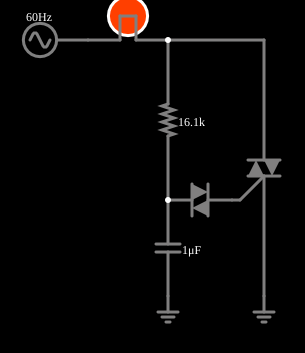

# Dimmer com DIAC e TRIAC

<!-- navegacao:inicio -->
[Índice](README.md) · [Anterior: LED Array](ledarray.md) · [Próximo: Unijunction Oscillator](ujtosc.md)
<!-- navegacao:fim -->

## Objetivo

Mostrar o **controle de fase** de uma lâmpada: um TRIAC liga a lâmpada num ponto de cada semiciclo da rede, e um circuito RC com um DIAC decide em que ponto. Quanto mais tarde ele dispara, menos potência chega à lâmpada.

## O circuito

<!-- esquema:inicio -->

<!-- esquema:fim -->

A rede ($120\ \text{V}$ eficazes, $60\ \text{Hz}$, pico de $169{,}7\ \text{V}$) alimenta uma lâmpada de $100\ \text{W}$ e $120\ \text{V}$ em série com um TRIAC. Em paralelo com o TRIAC há um resistor de $16{,}1\ \text{k}\Omega$ (o potenciômetro de ajuste, fixo nesse valor) em série com um capacitor de $1\ \mu\text{F}$. O DIAC (tensão de disparo de $30\ \text{V}$) liga o capacitor ao gatilho do TRIAC.

<!-- componentes:inicio -->
| N.º | Tipo | Elemento | Valores |
|----:|------|----------|---------|
| 0 | `GroundElm` | ground | Symbol = Earth |
| 2 | `ResistorElm` | resistor | Resistance (ohms) = 16.1k |
| 3 | `RailElm` | A/C source | Max Voltage = 169.7; Waveform = A/C; DC Offset (V) = 0; Internal Resistance (ohms) = 0; Show Voltage = não; Frequency (Hz) = 60; Phase Offset (degrees) = 0 |
| 4 | `TriacElm` | TRIAC | Trigger Current (A) = 11m; Holding Current (A) = 8m; Gate-MT1 Resistance (ohms) = 100 |
| 5 | `CapacitorElm` | capacitor | Capacitance (F) = 1μ; Trapezoidal Approximation = sim; Initial Voltage (on Reset) = 1m; Series Resistance = 0 |
| 6 | `GroundElm` | ground | Symbol = Earth |
| 7 | `DiacElm` | DIAC | On resistance (ohms) = 500; Off resistance (ohms) = 100M; Breakdown voltage (volts) = 30; Hold current (amps) = 10m |
| 8 | `LampElm` | lamp | Nominal Power = 100; Nominal Voltage = 120; Warmup Time (s) = 400m; Cooldown Time (s) = 400m |
<!-- componentes:fim -->

## Teoria

O capacitor carrega pelo resistor seguindo a rede, com atraso de fase. Quando a tensão do capacitor atinge a de disparo do DIAC ($30\ \text{V}$), o DIAC passa a conduzir e descarrega um pulso de corrente no gatilho do TRIAC. O TRIAC, uma vez disparado, continua conduzindo até que a corrente caia abaixo da de manutenção, isto é, até o fim do semiciclo. A lâmpada recebe então a rede só do ângulo de disparo $\alpha$ até $\pi$.

Para uma carga resistiva, o valor eficaz da tensão na lâmpada é

$$V_{ef} = V_{rede}\sqrt{\frac{\pi - \alpha + \tfrac12\sin 2\alpha}{\pi}}.$$

O pico visto pela lâmpada é a tensão da rede no instante do disparo, $V_p\sin\alpha$, quando $\alpha > 90^\circ$. Com o pico medido, $155{,}3\ \text{V}$, resulta $\sin\alpha = 155{,}3/169{,}7 = 0{,}915$, isto é, $\alpha = 113{,}7^\circ$. A fórmula acima dá com esse ângulo $V_{ef} = 60{,}1\ \text{V}$.

## Resultados esperados

O simulador dá, em regime permanente:

- **Rede:** $120\ \text{V}$ eficazes.
- **Capacitor:** pico de $\pm 30{,}04\ \text{V}$, a tensão de disparo do DIAC.
- **Lâmpada:** valor eficaz de $60{,}4\ \text{V}$ (a fórmula dá $60{,}1\ \text{V}$ com o ângulo de disparo obtido do pico) e tensão máxima de $155{,}3\ \text{V}$; a corrente eficaz é de $0{,}555\ \text{A}$. O valor médio da tensão na lâmpada é zero, como numa onda alternada simétrica.
- **TRIAC:** a tensão máxima sobre o TRIAC aberto é de $168{,}7\ \text{V}$, quase o pico da rede.

## O que observar

Mude o valor do resistor: com um valor maior o capacitor carrega mais devagar, o disparo atrasa e a lâmpada fica mais fraca; com um valor menor o disparo adianta e ela brilha mais. No osciloscópio, a tensão na lâmpada mostra o corte no início de cada semiciclo.

## Limites do modelo

- A lâmpada é um filamento cuja resistência varia com a temperatura (o modelo tem tempos de aquecimento e resfriamento de $0{,}4\ \text{s}$); a fórmula acima supõe resistência constante e por isso é aproximada.
- Não há filtro de interferência: o dimmer real tem um indutor para suavizar o corte abrupto e a radiofrequência que ele gera.
- DIAC e TRIAC têm modelos simples: resistência de condução fixa, tensão de disparo fixa.

## Referências

Rashid, *Power Electronics*, capítulo sobre controladores de tensão CA; Horowitz e Hill, *The Art of Electronics*, seção sobre dimmers de fase.

O circuito deste exemplo faz parte da coleção do simulador original de Paul Falstad e Iain Sharp (CircuitJS1); a explicação é deste projeto.
