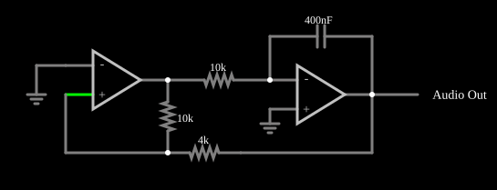

# Gerador de onda triangular

<!-- navegacao:inicio -->
[Índice](README.md) · [Anterior: Phase-Shift Oscillator](phaseshiftosc.md) · [Próximo: Sine Wave Generator](sine.md)
<!-- navegacao:fim -->

## Objetivo

Mostrar um gerador de onda triangular com dois amplificadores operacionais: um comparador com histerese (disparador de Schmitt) gera uma onda quadrada, e um integrador a transforma em uma onda triangular, que realimenta o comparador.

## O circuito

<!-- esquema:inicio -->

<!-- esquema:fim -->

O primeiro amplificador operacional é um disparador de Schmitt: sua entrada inversora está no terra e a entrada não inversora recebe, por um resistor de $10\ \text{k}\Omega$, a sua própria saída (a onda quadrada) e, por um resistor de $4\ \text{k}\Omega$, a saída do segundo estágio. O segundo operacional é um integrador: um resistor de $10\ \text{k}\Omega$ leva a onda quadrada à entrada inversora, e um capacitor de $400\ \text{nF}$ liga a saída à mesma entrada. Um elemento de saída de áudio e um osciloscópio mostram a onda triangular.

<!-- componentes:inicio -->
| N.º | Tipo | Elemento | Valores |
|----:|------|----------|---------|
| 0 | `OpAmpElm` | op-amp | Max Output (V) = 15; Min Output (V) = -15; Gain = 100k |
| 3 | `ResistorElm` | resistor | Resistance (ohms) = 10k |
| 4 | `OpAmpElm` | op-amp | Max Output (V) = 15; Min Output (V) = -15; Gain = 100k |
| 5 | `ResistorElm` | resistor | Resistance (ohms) = 4k |
| 9 | `CapacitorElm` | capacitor | Capacitance (F) = 400n; Trapezoidal Approximation = sim; Initial Voltage (on Reset) = 1m; Series Resistance = 0 |
| 11 | `ResistorElm` | resistor | Resistance (ohms) = 10k |
| 12 | `GroundElm` | ground | Symbol = Earth |
| 14 | `GroundElm` | ground | Symbol = Earth |
| 15 | `AudioOutputElm` | audio output | Duration (s) = 1; Sampling Rate = 8000 |
<!-- componentes:fim -->

## Teoria

O comparador troca de estado quando a tensão em sua entrada não inversora passa por $0\ \text{V}$. Essa tensão é a média ponderada entre a saída quadrada $\pm V_\text{sat}$ e a triangular $v_t$:

$$v_+ = \frac{R_5\,v_q + R_3\,v_t}{R_3 + R_5} = 0 \quad\Longrightarrow\quad v_t = \mp\,\frac{R_5}{R_3}\,V_\text{sat} = \mp\,0{,}4\cdot 15 = \mp 6\ \text{V}.$$

O integrador, alimentado por uma tensão constante $\pm V_\text{sat}$, produz uma rampa de inclinação $\pm V_\text{sat}/(RC) = 15/(10\ \text{k}\Omega\cdot 400\ \text{nF}) = 3750\ \text{V/s}$. A rampa vai de $-6$ a $+6\ \text{V}$ em $12/3750 = 3{,}2\ \text{ms}$, então o período é $6{,}4\ \text{ms}$ e

$$f = \frac{R_3}{4\,R_5\,R\,C} = \frac{10\ \text{k}\Omega}{4\cdot 4\ \text{k}\Omega\cdot 10\ \text{k}\Omega\cdot 400\ \text{nF}} = 156{,}25\ \text{Hz}.$$

## Resultados esperados

| Grandeza | Valor |
|----------|------:|
| Saída do integrador | triangular entre $-6$ e $+6\ \text{V}$ |
| Saída do comparador | quadrada entre $-15$ e $+15\ \text{V}$ |
| Frequência | $156{,}25\ \text{Hz}$ ($T = 6{,}4\ \text{ms}$) |

As verificações conferem a frequência e os extremos das duas saídas, numa janela de $0{,}1\ \text{s}$ depois do transitório.

## O que observar

- A onda triangular é simétrica (50% do ciclo de subida e 50% de descida) e a quadrada muda de estado nos picos da triangular.
- O pico da triangular é fixado pela razão $R_5/R_3$; a frequência, também por $RC$.
- Para variar a amplitude sem mudar a frequência é preciso mudar $R_5$ e compensar a mudança com $R$ (ou $C$), já que $f \propto 1/(R_5 R C)$.

## Limites do modelo

Operacionais ideais com saída saturada em $\pm 15\ \text{V}$ e comutação instantânea. Em um gerador real a saturação do comparador, o *slew rate* e o *offset* do integrador (que o faz derivar) mudam a amplitude, a frequência e a simetria.

## Referências

- A. S. Sedra e K. C. Smith, *Microeletrônica*, Pearson.
- P. Horowitz e W. Hill, *The Art of Electronics*, Cambridge University Press.
- S. Franco, *Design with Operational Amplifiers and Analog Integrated Circuits*, McGraw-Hill.

O circuito deste exemplo faz parte da coleção do simulador original de Paul Falstad e Iain Sharp (CircuitJS1); a explicação é deste projeto.
