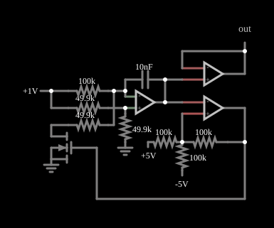

# VCO de onda triangular

<!-- navegacao:inicio -->
[Índice](README.md) · [Anterior: Voltage-Controlled Oscillator](vco.md)
<!-- navegacao:fim -->

## Objetivo

Mostrar um VCO que gera uma onda triangular simétrica, em torno de $0\ \text{V}$, com a frequência proporcional à tensão de um *slider* ("frequency"). É a versão com alimentação simétrica ($\pm 5\ \text{V}$) do VCO do exemplo anterior.

## O circuito

<!-- esquema:inicio -->

<!-- esquema:fim -->

Um *slider* de $0$ a $5\ \text{V}$ ("frequency", em $1\ \text{V}$ ao abrir) é a tensão de controle $V_c$. Um operacional integrador, com capacitor de $10\ \text{nF}$ na realimentação, recebe $V_c/2$ na entrada não inversora (divisor de dois resistores de $49{,}9\ \text{k}\Omega$) e $V_c$ por um resistor de $100\ \text{k}\Omega$ na inversora; um MOSFET, comandado pela saída de um comparador, liga a entrada inversora à terra por um resistor de $49{,}9\ \text{k}\Omega$ e inverte a rampa. A saída do integrador passa por um seguidor de tensão e vai a um comparador com histerese (alimentado com $\pm 5\ \text{V}$, por resistores de $100\ \text{k}\Omega$ ligados a $+5\ \text{V}$, a $-5\ \text{V}$ e à própria saída). Um osciloscópio mostra a saída.

<!-- componentes:inicio -->
| N.º | Tipo | Elemento | Valores |
|----:|------|----------|---------|
| 0 | `OpAmpElm` | op-amp | Max Output (V) = 5; Min Output (V) = -5; Gain = 100k |
| 1 | `CapacitorElm` | capacitor | Capacitance (F) = 10n; Trapezoidal Approximation = sim; Initial Voltage (on Reset) = 1m; Series Resistance = 0 |
| 4 | `ResistorElm` | resistor | Resistance (ohms) = 49.9k |
| 6 | `GroundElm` | ground | Symbol = Earth |
| 8 | `ResistorElm` | resistor | Resistance (ohms) = 49.9k |
| 12 | `ResistorElm` | resistor | Resistance (ohms) = 100k |
| 17 | `ResistorElm` | resistor | Resistance (ohms) = 49.9k |
| 21 | `NMosfetElm` | MOSFET | Model = default-nodiode; Swap D/S = não |
| 22 | `GroundElm` | ground | Symbol = Earth |
| 23 | `OpAmpElm` | op-amp | Max Output (V) = 5; Min Output (V) = -5; Gain = 100k |
| 25 | `ResistorElm` | resistor | Resistance (ohms) = 100k |
| 26 | `ResistorElm` | resistor | Resistance (ohms) = 100k |
| 29 | `RailElm` | voltage source | Voltage = 5; Waveform = D/C; DC Offset (V) = 0; Internal Resistance (ohms) = 0 |
| 30 | `ResistorElm` | resistor | Resistance (ohms) = 100k |
| 35 | `VarRailElm` | voltage source | Min Voltage = 0; Max Voltage = 5; Slider Text = frequency |
| 36 | `OutputElm` | output | Show Voltage = não |
| 37 | `RailElm` | voltage source | Voltage = -5; Waveform = D/C; DC Offset (V) = 0; Internal Resistance (ohms) = 0 |
| 38 | `OpAmpElm` | op-amp | Max Output (V) = 5; Min Output (V) = -5; Gain = 100k |
<!-- componentes:fim -->

## Teoria

A análise é a do VCO do exemplo anterior: a corrente que o integrador recebe vale $\pm V_c/(200\ \text{k}\Omega)$, e a rampa tem módulo $500\ \text{V/s}$ por volt de $V_c$. A diferença está nos limiares do comparador, que agora são simétricos: o divisor de três resistores de $100\ \text{k}\Omega$ (a $+5\ \text{V}$, a $-5\ \text{V}$ e à saída) dá

$$V_\text{lim} = \pm\,\frac{5}{3}\ \text{V} = \pm\,1{,}667\ \text{V}$$

(com saída em $\pm 5\ \text{V}$). A excursão é $\Delta V = 3{,}333\ \text{V}$ e a frequência é

$$f = \frac{500\,V_c}{2\,\Delta V} = 75\ \frac{\text{Hz}}{\text{V}}\;V_c.$$

## Resultados esperados

Com o *slider* em $1\ \text{V}$ ao abrir:

| Grandeza | Valor |
|----------|------:|
| Frequência | $75\ \text{Hz}$ (o simulador dá $75{,}02\ \text{Hz}$) |
| Triangular | de $-1{,}67$ a $+1{,}67\ \text{V}$ ($-1{,}667$ e $+1{,}672\ \text{V}$ medidos) |
| Saída do comparador | $\pm 5\ \text{V}$ |

As verificações conferem a frequência, os extremos da triangular e o máximo do comparador numa janela de $30\ \text{ms}$.

## O que observar

- Arraste o *slider* "frequency": a frequência muda na mesma proporção (dobrar a tensão dobra a frequência) e a amplitude da triangular não muda.
- Com o *slider* em $0\ \text{V}$ não há corrente de carga e a oscilação para.
- A onda é simétrica, porque os dois sentidos de rampa têm o mesmo módulo.

## Limites do modelo

Operacionais, MOSFET e comparador ideais, com saturação em $\pm 5\ \text{V}$. A relação $f \propto V_c$ vale enquanto o atraso de comutação do comparador for pequeno frente ao período; em frequências altas (voltagem de controle alta) a linearidade piora.

## Referências

- A. S. Sedra e K. C. Smith, *Microeletrônica*, Pearson.
- P. Horowitz e W. Hill, *The Art of Electronics*, Cambridge University Press.
- S. Franco, *Design with Operational Amplifiers and Analog Integrated Circuits*, McGraw-Hill.

O circuito deste exemplo faz parte da coleção do simulador original de Paul Falstad e Iain Sharp (CircuitJS1); a explicação é deste projeto.
