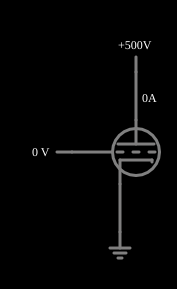

# Triodo a vácuo

<!-- navegacao:inicio -->
[Índice](README.md) · [Próximo: Amplifier](triodeamp.md)
<!-- navegacao:fim -->

## Objetivo

Mostrar o **triodo a vácuo**: uma tensão pequena na grade controla uma corrente grande de placa. A corrente depende da combinação $V_{GK} + V_{PK}/\mu$, não de uma das duas tensões isoladamente.

## O circuito

<!-- esquema:inicio -->

<!-- esquema:fim -->

Duas fontes de tensão ajustáveis por cursor alimentam o triodo: a da grade, de $-8\ \text{V}$ a $0\ \text{V}$ (*Grid Voltage*, inicialmente em $0\ \text{V}$), e a da placa, de $0$ a $500\ \text{V}$ (*Plate Voltage*, inicialmente em $500\ \text{V}$). O triodo tem $\mu = 93$ e $K_{g1} = 680$. O osciloscópio mostra a corrente de placa.

<!-- componentes:inicio -->
| N.º | Tipo | Elemento | Valores |
|----:|------|----------|---------|
| 0 | `VarRailElm` | voltage source | Min Voltage = -8; Max Voltage = 0; Slider Text = Grid Voltage |
| 3 | `VarRailElm` | voltage source | Min Voltage = 0; Max Voltage = 500; Slider Text = Plate Voltage |
| 4 | `GroundElm` | ground | Symbol = Earth |
| 5 | `TriodeElm` | triode | mu = 93; kg1 = 680 |
<!-- componentes:fim -->

## Teoria

A lei de Child–Langmuir, que o simulador usa para o triodo, dá a corrente de placa

$$I_P = \frac{1}{K_{g1}}\left(V_{GK} + \frac{V_{PK}}{\mu}\right)^{3/2}\quad\text{para}\quad V_{GK} + \frac{V_{PK}}{\mu} > 0,$$

e zero em caso contrário (corte). O fator de amplificação $\mu$ diz quantas vezes a grade controla mais que a placa; aqui $\mu = 93$ (como o de um 12AX7). A corrente de grade é desprezada enquanto $V_{GK} \le 0$; para $V_{GK} > 0$ o simulador a modela como um resistor de $6\ \text{k}\Omega$ entre grade e cátodo.

## Resultados esperados

Com a grade em $0\ \text{V}$ e a placa em $500\ \text{V}$, $V_{GK} + V_{PK}/\mu = 5{,}376\ \text{V}$ e

$$I_P = \frac{5{,}376^{3/2}}{680} = 18{,}33\ \text{mA}.$$

O simulador dá exatamente $18{,}33\ \text{mA}$. Com a grade em $-8\ \text{V}$, o triodo está **cortado** ($-8 + 500/93 = -2{,}62\ \text{V} < 0$ e corrente nula). Em geral, a grade corta a corrente quando $V_{GK} \le -V_{PK}/\mu$: com $500\ \text{V}$ na placa, em $-5{,}38\ \text{V}$.

## O que observar

Arraste o cursor da grade de $0$ a $-8\ \text{V}$: a corrente diminui como $(V_{GK} + 5{,}38)^{3/2}$ até zero em $-5{,}38\ \text{V}$. Reduza a tensão de placa e o ponto de corte se aproxima de zero: com $V_{PK} = 93\ \text{V}$, a corrente é zero para $V_{GK} \le -1\ \text{V}$.

## Limites do modelo

- Os parâmetros ($\mu$, $K_{g1}$) são fixos de um modelo simples; uma válvula real tem $\mu$ e transcondutância que variam um pouco com a tensão e a corrente, e tem corrente de grade e emissão que dependem da temperatura do filamento.
- O modelo não tem capacitâncias entre eletrodos, que limitam a resposta em alta frequência de um triodo real.

## Referências

Spangenberg, *Vacuum Tubes* (1948); Millman e Halkias, *Integrated Electronics*, capítulo sobre válvulas termiônicas; Langmuir, *The effect of space charge and residual gases on thermionic currents in high vacuum*, Physical Review 2 (1913).

O circuito deste exemplo faz parte da coleção do simulador original de Paul Falstad e Iain Sharp (CircuitJS1); a explicação é deste projeto.
