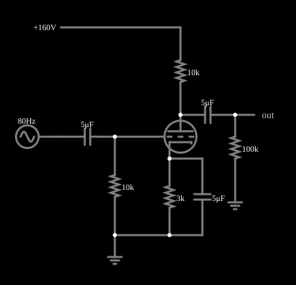

# Amplificador a triodo

<!-- navegacao:inicio -->
[Índice](README.md) · [Anterior: Triode](triode.md)
<!-- navegacao:fim -->

## Objetivo

Mostrar o **amplificador de cátodo comum** a válvula: um sinal pequeno na grade controla a corrente de placa, e a queda dessa corrente no resistor de carga dá um sinal grande e invertido na saída.

## O circuito

<!-- esquema:inicio -->

<!-- esquema:fim -->

O triodo ($\mu = 93$, $K_{g1} = 1{,}36\ \text{k}$) tem a placa ligada a $+160\ \text{V}$ por um resistor de carga de $10\ \text{k}\Omega$, e o cátodo ligado à terra por um resistor de $3\ \text{k}\Omega$ em paralelo com um capacitor de desacoplamento de $5\ \mu\text{F}$. A grade recebe um sinal de $0{,}5\ \text{V}$ de pico e $80\ \text{Hz}$ por um capacitor de acoplamento de $5\ \mu\text{F}$ e um resistor de fuga de $10\ \text{k}\Omega$. A saída sai da placa por outro capacitor de $5\ \mu\text{F}$ para uma carga de $100\ \text{k}\Omega$.

<!-- componentes:inicio -->
| N.º | Tipo | Elemento | Valores |
|----:|------|----------|---------|
| 1 | `ResistorElm` | resistor | Resistance (ohms) = 10k |
| 3 | `GroundElm` | ground | Symbol = Earth |
| 4 | `RailElm` | voltage source | Voltage = 160; Waveform = D/C; DC Offset (V) = 0; Internal Resistance (ohms) = 0 |
| 5 | `ResistorElm` | resistor | Resistance (ohms) = 10k |
| 6 | `ResistorElm` | resistor | Resistance (ohms) = 3k |
| 7 | `CapacitorElm` | capacitor | Capacitance (F) = 5μ; Trapezoidal Approximation = sim; Initial Voltage (on Reset) = 1m; Series Resistance = 0 |
| 8 | `RailElm` | A/C source | Max Voltage = 500m; Waveform = A/C; DC Offset (V) = 0; Internal Resistance (ohms) = 0; Show Voltage = não; Frequency (Hz) = 80; Phase Offset (degrees) = 0 |
| 9 | `CapacitorElm` | capacitor | Capacitance (F) = 5μ; Trapezoidal Approximation = sim; Initial Voltage (on Reset) = 1m; Series Resistance = 0 |
| 10 | `OutputElm` | output | Show Voltage = não |
| 11 | `ResistorElm` | resistor | Resistance (ohms) = 100k |
| 12 | `GroundElm` | ground | Symbol = Earth |
| 13 | `TriodeElm` | triode | mu = 93; kg1 = 1.4k |
| 15 | `CapacitorElm` | capacitor | Capacitance (F) = 5μ; Trapezoidal Approximation = sim; Initial Voltage (on Reset) = 1m; Series Resistance = 0 |
<!-- componentes:fim -->

## Teoria

A lei de Child–Langmuir, que o simulador usa para o triodo, dá a corrente de placa

$$I_P = \frac{1}{K_{g1}}\left(V_{GK} + \frac{V_{PK}}{\mu}\right)^{3/2}\quad\text{para}\quad V_{GK} + \frac{V_{PK}}{\mu} > 0,$$

e zero em caso contrário (corte). O fator de amplificação $\mu$ diz quantas vezes a grade controla mais que a placa; aqui $\mu = 93$ (como o de um 12AX7). A corrente de grade é desprezada enquanto $V_{GK} \le 0$; para $V_{GK} > 0$ o simulador a modela como um resistor de $6\ \text{k}\Omega$ entre grade e cátodo.

**Polarização.** O resistor do cátodo dá uma polarização automática: a corrente de placa $I$ cria no cátodo a tensão $V_K = 3\ \text{k}\Omega\cdot I$, e a grade, em $0\ \text{V}$ em média, fica em $V_{GK} = -V_K$. O ponto de operação satisfaz $I = (1{,}72 - 3140\,I)^{3/2}/1360$, de solução $I \approx 0{,}35\ \text{mA}$ ($V_K \approx 1{,}05\ \text{V}$, placa em $\approx 156{,}4\ \text{V}$).

**Pequenos sinais.** A transcondutância é $g_m = 1{,}5\sqrt{V_{GK} + V_{PK}/\mu}/K_{g1} = 0{,}87\ \text{mS}$, a resistência de placa $r_p = \mu/g_m = 107\ \text{k}\Omega$, e o ganho, com o cátodo desacoplado e a carga de $10\ \text{k}\Omega \parallel 100\ \text{k}\Omega$, é

$$A_v = -\frac{\mu R_L}{r_p + R_L} \approx -7{,}3;$$

com o desacoplamento real ($5\ \mu\text{F}$ a $80\ \text{Hz}$ não é um curto perfeito), o valor cai a cerca de $-6{,}7$.

## Resultados esperados

O simulador dá, em regime permanente:

- **Corrente de placa média:** $0{,}362\ \text{mA}$ (a polarização estática é $0{,}35\ \text{mA}$; a média sobe um pouco por causa da não linearidade com o sinal), tensão média de placa de $156{,}4\ \text{V}$ e de cátodo de $1{,}09\ \text{V}$.
- **Saída:** excursão de $+2{,}88\ \text{V}$ a $-3{,}51\ \text{V}$, amplitude de cerca de $3{,}2\ \text{V}$ para a entrada de $0{,}5\ \text{V}$: ganho de $-6{,}4$, em oposição de fase.
- **Placa:** oscila de $152{,}9\ \text{V}$ a $159{,}3\ \text{V}$.

## O que observar

A saída é assimétrica ($+2{,}88$ contra $-3{,}51\ \text{V}$): a lei de $3/2$ do triodo não é linear, o que dá distorção de segundo harmônico, característica do som de amplificadores a válvula. Aumente o sinal de entrada e a assimetria cresce.

## Limites do modelo

- A diferença de ganho entre teoria ($-6{,}7$) e simulador ($-6{,}4$) vem em parte de usar uma aproximação de pequenos sinais para um sinal que não é tão pequeno.
- O modelo não tem capacitâncias entre eletrodos nem o efeito Miller, que reduzem o ganho de um amplificador a válvula em alta frequência.

## Referências

Spangenberg, *Vacuum Tubes* (1948); Millman e Halkias, *Integrated Electronics*, capítulo sobre válvulas termiônicas; Langmuir, *The effect of space charge and residual gases on thermionic currents in high vacuum*, Physical Review 2 (1913).

O circuito deste exemplo faz parte da coleção do simulador original de Paul Falstad e Iain Sharp (CircuitJS1); a explicação é deste projeto.
