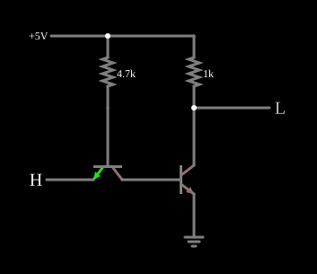

# Inversor TTL

<!-- navegacao:inicio -->
[Índice](README.md) · [Próximo: TTL NAND](ttlnand.md)
<!-- navegacao:fim -->

## Objetivo

Mostrar a ideia central da **lógica transistor-transistor (TTL)**: os diodos de entrada da DTL são substituídos pelas junções de um transistor de entrada, cujo emissor é a entrada da porta. O exemplo é uma versão simplificada, com saída por resistor (sem o estágio *totem-pole* dos circuitos 7400).

## O circuito

<!-- esquema:inicio -->

<!-- esquema:fim -->

O transistor de entrada tem a base ligada a $5\ \text{V}$ por $4{,}7\ \text{k}\Omega$, o emissor na entrada lógica ($0$ ou $5\ \text{V}$) e o coletor na base do transistor de saída. O transistor de saída tem o emissor na terra e o coletor (a saída) ligado a $5\ \text{V}$ por $1\ \text{k}\Omega$. Os dois têm $\beta = 100$. O exemplo abre com a entrada em $5\ \text{V}$.

<!-- componentes:inicio -->
| N.º | Tipo | Elemento | Valores |
|----:|------|----------|---------|
| 0 | `NTransistorElm` | transistor | Beta/hFE = 100; Swap E/C = não; Draw Circle = não; Model = default |
| 1 | `NTransistorElm` | transistor | Beta/hFE = 100; Swap E/C = não; Draw Circle = não; Model = default |
| 2 | `GroundElm` | ground | Symbol = Earth |
| 3 | `LogicInputElm` | logic input | Momentary Switch = não; High Logic Voltage = 5; Low Voltage = 0; Numeric = não; Ternary = não; Keyboard Shortcut =  |
| 4 | `ResistorElm` | resistor | Resistance (ohms) = 4.7k |
| 5 | `ResistorElm` | resistor | Resistance (ohms) = 1k |
| 7 | `LogicOutputElm` | logic output | Threshold = 2.5; Current Required = não; Numeric = não; Ternary = não |
| 8 | `RailElm` | voltage source | Voltage = 5; Waveform = D/C; DC Offset (V) = 0; Internal Resistance (ohms) = 0 |
<!-- componentes:fim -->

## Teoria

O transistor de entrada faz o papel dos dois diodos da [DTL](dtlinverter.md): a junção base-emissor é o diodo de entrada, e a junção base-coletor é o diodo que leva a corrente à base do transistor de saída.

- **Entrada baixa ($0\ \text{V}$):** a junção base-emissor conduz e a corrente do resistor de $4{,}7\ \text{k}\Omega$, $\approx (5 - 0{,}6)/4{,}7\ \text{k}\Omega \approx 0{,}93\ \text{mA}$, sai pela entrada. O transistor de entrada satura e **retira ativamente** a carga da base do transistor de saída, prendendo-a a poucos milivolts: o transistor de saída corta e a saída sobe para $5\ \text{V}$. Esta extração ativa da carga da base é a razão de a TTL ser mais rápida que a DTL.
- **Entrada alta ($5\ \text{V}$):** a junção base-emissor fica reversa; o transistor de entrada trabalha no **modo ativo inverso**, e a corrente do resistor passa pela junção base-coletor para a base do transistor de saída, que satura: a saída cai para algumas dezenas de milivolts.

Logo $Y = \overline{A}$.

## Resultados esperados

O simulador dá:

| Entrada | Saída | Corrente da alimentação |
|--------:|------:|------------------------:|
| $5\ \text{V}$ | $42{,}9\ \text{mV}$ | $5{,}76\ \text{mA}$ |
| $0$ | $5{,}00\ \text{V}$ | $0{,}934\ \text{mA}$ |

Com a entrada baixa, toda a corrente da alimentação passa pelo resistor de base e sai pela entrada: a fonte que aciona a entrada tem de a absorver (a TTL é uma família de entrada que *drena* corrente no nível baixo).

## O que observar

Clique na entrada e compare com o [Inversor DTL](dtlinverter.md): o comportamento lógico e as correntes são parecidos, mas aqui há um transistor no lugar dos diodos. A [TTL NAND](ttlnand.md) mostra por que a TTL usa um transistor de entrada com vários emissores.

## Limites do modelo

- A TTL real (série 7400) tem um estágio de saída *totem-pole* (dois transistores e um diodo) e um divisor de fase; aqui a saída tem só um resistor, como na DTL, e por isso o nível alto não é ativamente acionado.
- O modelo não tem capacitâncias: a vantagem de velocidade da TTL não aparece na simulação.

## Referências

Sedra e Smith, *Microelectronic Circuits*, capítulo sobre TTL; Hodges, Jackson e Saleh, *Analysis and Design of Digital Integrated Circuits*, capítulo sobre TTL.

O circuito deste exemplo faz parte da coleção do simulador original de Paul Falstad e Iain Sharp (CircuitJS1); a explicação é deste projeto.
