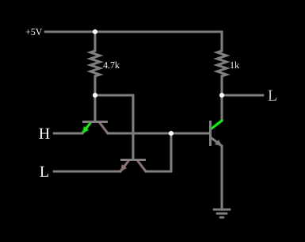

# Porta NAND TTL

<!-- navegacao:inicio -->
[Índice](README.md) · [Anterior: TTL Inverter](ttlinverter.md) · [Próximo: TTL NOR](ttlnor.md)
<!-- navegacao:fim -->

## Objetivo

Mostrar a porta **NAND** em TTL. Nos circuitos integrados, a entrada é um único transistor com **vários emissores**; o simulador não tem esse componente, e o exemplo o representa por dois transistores com as bases e os coletores ligados entre si.

## O circuito

<!-- esquema:inicio -->

<!-- esquema:fim -->

Dois transistores de entrada têm as bases ligadas entre si e a $5\ \text{V}$ por $4{,}7\ \text{k}\Omega$, os coletores ligados entre si e à base do transistor de saída, e cada emissor numa entrada lógica ($0$ ou $5\ \text{V}$). O transistor de saída tem o emissor na terra e o coletor (a saída) ligado a $5\ \text{V}$ por $1\ \text{k}\Omega$. Todos têm $\beta = 100$. O exemplo abre com a entrada de cima (elemento 10) em $5\ \text{V}$ e a de baixo (elemento 11) em $0$.

<!-- componentes:inicio -->
| N.º | Tipo | Elemento | Valores |
|----:|------|----------|---------|
| 0 | `RailElm` | voltage source | Voltage = 5; Waveform = D/C; DC Offset (V) = 0; Internal Resistance (ohms) = 0 |
| 1 | `ResistorElm` | resistor | Resistance (ohms) = 1k |
| 3 | `NTransistorElm` | transistor | Beta/hFE = 100; Swap E/C = não; Draw Circle = não; Model = default |
| 4 | `NTransistorElm` | transistor | Beta/hFE = 100; Swap E/C = não; Draw Circle = não; Model = default |
| 5 | `NTransistorElm` | transistor | Beta/hFE = 100; Swap E/C = não; Draw Circle = não; Model = default |
| 10 | `LogicInputElm` | logic input | Momentary Switch = não; High Logic Voltage = 5; Low Voltage = 0; Numeric = não; Ternary = não; Keyboard Shortcut =  |
| 11 | `LogicInputElm` | logic input | Momentary Switch = não; High Logic Voltage = 5; Low Voltage = 0; Numeric = não; Ternary = não; Keyboard Shortcut =  |
| 12 | `GroundElm` | ground | Symbol = Earth |
| 14 | `ResistorElm` | resistor | Resistance (ohms) = 4.7k |
| 15 | `LogicOutputElm` | logic output | Threshold = 2.5; Current Required = não; Numeric = não; Ternary = não |
<!-- componentes:fim -->

## Teoria

É o [Inversor TTL](ttlinverter.md) com dois emissores de entrada. Basta **um** emissor baixo para a corrente do resistor de base sair por ele: o transistor de entrada satura, retira a carga da base do transistor de saída, e a saída sobe. Só com **todos** os emissores altos a corrente passa pela junção base-coletor para a base do transistor de saída, que satura:

$$Y = \overline{A \cdot B}.$$

Os emissores múltiplos fazem a função E dos diodos de entrada da [DTL NAND](dtlnand.md), numa área de silício menor e com a extração ativa da carga da base.

## Resultados esperados

O simulador dá:

| $A$ (elemento 10) | $B$ (elemento 11) | Saída |
|----:|----:|------:|
| 0 | 0 | $5{,}00\ \text{V}$ |
| 0 | 1 | $5{,}00\ \text{V}$ |
| 1 | 0 | $5{,}00\ \text{V}$ |
| 1 | 1 | $42{,}9\ \text{mV}$ |

Com as duas entradas altas, a alimentação fornece $5{,}76\ \text{mA}$, a mesma corrente do inversor nesse estado.

## O que observar

Clique nas entradas: a saída só desce com as duas altas. Compare com a [TTL NOR](ttlnor.md), em que a função muda porque as saídas, e não as entradas, são ligadas entre si.

## Limites do modelo

- Os dois transistores separados imitam o transistor multiemissor, mas sem o acoplamento entre emissores do dispositivo integrado.
- A saída é por resistor, sem o *totem-pole* da série 7400; sem capacitâncias, a comutação é instantânea.

## Referências

Sedra e Smith, *Microelectronic Circuits*, capítulo sobre TTL; Hodges, Jackson e Saleh, *Analysis and Design of Digital Integrated Circuits*.

O circuito deste exemplo faz parte da coleção do simulador original de Paul Falstad e Iain Sharp (CircuitJS1); a explicação é deste projeto.
