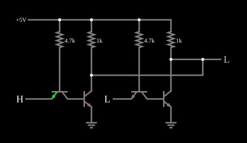

# Porta NOR TTL

<!-- navegacao:inicio -->
[Índice](README.md) · [Anterior: TTL NAND](ttlnand.md) · [Próximo: Fan-Out](fanout.md)
<!-- navegacao:fim -->

## Objetivo

Mostrar a **NOR** em TTL simplificada: dois inversores TTL com as saídas ligadas entre si, de modo que qualquer um deles que conduza puxa a saída para baixo.

## O circuito

<!-- esquema:inicio -->

<!-- esquema:fim -->

Há duas células do [Inversor TTL](ttlinverter.md): cada uma tem um transistor de entrada (base a $5\ \text{V}$ por $4{,}7\ \text{k}\Omega$, emissor numa entrada lógica) e um transistor de saída. Os coletores dos dois transistores de saída estão ligados entre si e à saída lógica, e cada um tem o seu resistor de $1\ \text{k}\Omega$ para $5\ \text{V}$ ($500\ \Omega$ em paralelo). O exemplo abre com a entrada da esquerda (elemento 2) em $5\ \text{V}$ e a da direita (elemento 14) em $0$.

<!-- componentes:inicio -->
| N.º | Tipo | Elemento | Valores |
|----:|------|----------|---------|
| 0 | `NTransistorElm` | transistor | Beta/hFE = 100; Swap E/C = não; Draw Circle = não; Model = default |
| 1 | `NTransistorElm` | transistor | Beta/hFE = 100; Swap E/C = não; Draw Circle = não; Model = default |
| 2 | `LogicInputElm` | logic input | Momentary Switch = não; High Logic Voltage = 5; Low Voltage = 0; Numeric = não; Ternary = não; Keyboard Shortcut =  |
| 3 | `ResistorElm` | resistor | Resistance (ohms) = 4.7k |
| 4 | `RailElm` | voltage source | Voltage = 5; Waveform = D/C; DC Offset (V) = 0; Internal Resistance (ohms) = 0 |
| 6 | `NTransistorElm` | transistor | Beta/hFE = 100; Swap E/C = não; Draw Circle = não; Model = default |
| 7 | `NTransistorElm` | transistor | Beta/hFE = 100; Swap E/C = não; Draw Circle = não; Model = default |
| 8 | `ResistorElm` | resistor | Resistance (ohms) = 4.7k |
| 11 | `ResistorElm` | resistor | Resistance (ohms) = 1k |
| 13 | `LogicOutputElm` | logic output | Threshold = 2.5; Current Required = não; Numeric = não; Ternary = não |
| 14 | `LogicInputElm` | logic input | Momentary Switch = não; High Logic Voltage = 5; Low Voltage = 0; Numeric = não; Ternary = não; Keyboard Shortcut =  |
| 15 | `ResistorElm` | resistor | Resistance (ohms) = 1k |
| 21 | `GroundElm` | ground | Symbol = Earth |
| 22 | `GroundElm` | ground | Symbol = Earth |
<!-- componentes:fim -->

## Teoria

Cada transistor de saída, sozinho, faria $\overline{A}$ ou $\overline{B}$. Em **paralelo** entre a saída e a terra, basta um saturado para a saída descer; a saída só sobe com as duas entradas baixas:

$$Y = \overline{A} \cdot \overline{B} = \overline{A + B}.$$

É o mesmo arranjo da [DTL NOR](dtlnor.md). Com um só transistor saturado, ele absorve a corrente dos dois resistores de coletor, e o seu nível baixo fica um pouco mais alto do que com os dois saturados.

## Resultados esperados

O simulador dá:

| $A$ (elemento 2) | $B$ (elemento 14) | Saída |
|----:|----:|------:|
| 0 | 0 | $5{,}00\ \text{V}$ |
| 1 | 0 | $56{,}1\ \text{mV}$ |
| 0 | 1 | $56{,}1\ \text{mV}$ |
| 1 | 1 | $42{,}9\ \text{mV}$ |

No estado inicial ($A = 1$, $B = 0$) a alimentação fornece $11{,}6\ \text{mA}$: os $\approx 10\ \text{mA}$ dos dois resistores de coletor, a corrente de base do transistor que conduz e a corrente que sai pela entrada baixa.

## O que observar

Clique nas entradas e confirme a tabela. Na série 7400 real, a NOR (7402) não é feita ligando saídas, porque as saídas *totem-pole* não podem ser ligadas entre si; usa-se um par de transistores divisores de fase em paralelo.

## Limites do modelo

- Ligar saídas só funciona aqui porque a saída é por resistor; com saídas *totem-pole* haveria um curto entre a alimentação e a terra.
- Sem capacitâncias, a comutação é instantânea.

## Referências

Sedra e Smith, *Microelectronic Circuits*, capítulo sobre TTL; Hodges, Jackson e Saleh, *Analysis and Design of Digital Integrated Circuits*.

O circuito deste exemplo faz parte da coleção do simulador original de Paul Falstad e Iain Sharp (CircuitJS1); a explicação é deste projeto.
