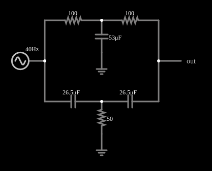

# Filtro T duplo (twin-T)

<!-- navegacao:inicio -->
[Índice](README.md) · [Anterior: Notch Filter](notch.md) · [Próximo: Crossover](crossover.md)
<!-- navegacao:fim -->

## Objetivo

Mostrar o filtro T duplo, um rejeita-faixa passivo feito só de resistores e capacitores (sem indutor), muito usado para eliminar uma frequência, como o zumbido de 60 Hz.

## O circuito

<!-- esquema:inicio -->

<!-- esquema:fim -->

Dois resistores de $100\ \Omega$ em série (de um lado) e dois capacitores de $26{,}5\ \mu\text{F}$ em série (do outro), com um capacitor de $53\ \mu\text{F}$ e um resistor de $50\ \Omega$ para a terra nos pontos centrais. O sinal de teste é uma fonte de **varredura de frequência**: uma senoide de 5 V de pico cuja frequência varia, de forma logarítmica, de 40 Hz a 80 Hz em 0,5 s e depois volta. Como a frequência é uma função conhecida do tempo, $f(t)=f_{min}(f_{max}/f_{min})^{t/T}$, a tensão de saída ao longo do tempo mostra a resposta em frequência do filtro.

<!-- componentes:inicio -->
| N.º | Tipo | Elemento | Valores |
|----:|------|----------|---------|
| 0 | `ResistorElm` | resistor | Resistance (ohms) = 100 |
| 1 | `ResistorElm` | resistor | Resistance (ohms) = 100 |
| 2 | `CapacitorElm` | capacitor | Capacitance (F) = 26.5μ; Trapezoidal Approximation = sim; Initial Voltage (on Reset) = 1m; Series Resistance = 0 |
| 3 | `CapacitorElm` | capacitor | Capacitance (F) = 26.5μ; Trapezoidal Approximation = sim; Initial Voltage (on Reset) = 1m; Series Resistance = 0 |
| 4 | `CapacitorElm` | capacitor | Capacitance (F) = 53μ; Trapezoidal Approximation = sim; Initial Voltage (on Reset) = 1m; Series Resistance = 0 |
| 5 | `GroundElm` | ground | Symbol = Earth |
| 6 | `ResistorElm` | resistor | Resistance (ohms) = 50 |
| 7 | `GroundElm` | ground | Symbol = Earth |
| 12 | `OutputElm` | output | Show Voltage = não |
| 13 | `SweepElm` | sweep (log) | Min Frequency (Hz) = 40; Max Frequency (Hz) = 80; Sweep Time (s) = 500m; Logarithmic = sim; Max Voltage = 5; Bidirectional = sim |
<!-- componentes:fim -->

## Teoria

O T duplo é a ligação em paralelo de dois filtros em T: um passa-baixas ($R$–$R$ com $2C$ para a terra) e um passa-altas ($C$–$C$ com $R/2$ para a terra). Para os valores $R$, $C$ e os centrais $2C$ e $R/2$, as duas respostas têm a mesma amplitude e fases opostas em

$$f_0 = \frac{1}{2\pi R C},$$

onde se cancelam: $H(j\omega_0)=0$. Aqui $R=100\ \Omega$ e $C=26{,}5\ \mu\text{F}$.

## Resultados esperados

$f_0 = 1/(2\pi\cdot100\cdot26{,}5\times10^{-6}) = 60{,}06\ \text{Hz}$, e a varredura passa por 60 Hz em $t = 292{,}5\ \text{ms}$.

| $f$ | $\|H\|$ | $V_{out,pico}$ |
|----:|--------:|---------------:|
| 40 Hz | 0,204 | 1,02 V |
| 50 Hz | 0,091 | 0,46 V |
| **60 Hz** | **0,000** | **≈ 0** |
| 70 Hz | 0,077 | 0,39 V |
| 80 Hz | 0,144 | 0,72 V |

Neste exemplo a saída é pequena em toda a faixa (o ganho máximo é de 0,2), pois o filtro foi montado com carga resistiva de $50\ \Omega$. As verificações conferem a saída em 70 Hz e que em torno de 60 Hz ela fica abaixo de $0{,}15\ \text{V}$.

## O que observar

- A curva de saída tem um vale profundo em 60 Hz.
- O rejeita-faixa dispensa indutor, o que é vantajoso (indutores são caros e captam interferência).

## Limites do modelo

Como a frequência varia continuamente, a amplitude vista num instante aproxima a resposta em regime permanente daquela frequência (as verificações usam janelas curtas em torno do instante e uma tolerância que cobre esse efeito). Componentes ideais. O vale é tanto mais profundo quanto mais exatos forem os valores dos componentes (o ideal exige $C_3=2C$ e $R_3=R/2$).

## Referências

- A. S. Sedra e K. C. Smith, *Microeletrônica*, Pearson.
- P. Horowitz e W. Hill, *The Art of Electronics*, Cambridge University Press.

O circuito deste exemplo faz parte da coleção do simulador original de Paul Falstad e Iain Sharp (CircuitJS1); a explicação é deste projeto.
