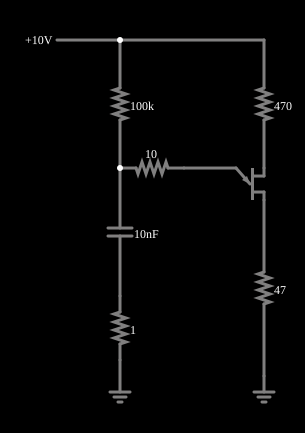

# Oscilador de relaxação com transistor unijunção

<!-- navegacao:inicio -->
[Índice](README.md) · [Anterior: DIAC/TRIAC Dimmer](triacdimmer.md) · [Próximo: 3-Phase Motor](3motor.md)
<!-- navegacao:fim -->

## Objetivo

Mostrar o **oscilador de relaxação** clássico com um transistor unijunção (UJT): um capacitor carrega lentamente por um resistor e descarrega de repente quando a tensão do emissor atinge o ponto de disparo do UJT.

## O circuito

<!-- esquema:inicio -->

<!-- esquema:fim -->

Uma fonte de $10\ \text{V}$ carrega um capacitor de $10\ \text{nF}$ por um resistor de $100\ \text{k}\Omega$. O capacitor está ligado ao emissor do UJT (por um resistor de $10\ \Omega$). As bases têm resistores em série: $470\ \Omega$ na base 2 e $47\ \Omega$ na base 1. Dois osciloscópios mostram o capacitor e a base 1.

<!-- componentes:inicio -->
| N.º | Tipo | Elemento | Valores |
|----:|------|----------|---------|
| 0 | `ResistorElm` | resistor | Resistance (ohms) = 470 |
| 1 | `ResistorElm` | resistor | Resistance (ohms) = 100k |
| 2 | `CapacitorElm` | capacitor | Capacitance (F) = 10n; Trapezoidal Approximation = sim; Initial Voltage (on Reset) = 1m; Series Resistance = 0 |
| 3 | `ResistorElm` | resistor | Resistance (ohms) = 47 |
| 4 | `GroundElm` | ground | Symbol = Earth |
| 5 | `GroundElm` | ground | Symbol = Earth |
| 6 | `RailElm` | voltage source | Voltage = 10; Waveform = D/C; DC Offset (V) = 0; Internal Resistance (ohms) = 0 |
| 8 | `ResistorElm` | resistor | Resistance (ohms) = 1 |
| 9 | `UnijunctionElm` | unijunction transistor |  |
| 10 | `ResistorElm` | resistor | Resistance (ohms) = 10 |
<!-- componentes:fim -->

## Teoria

O UJT é um dispositivo de resistência negativa: enquanto a tensão do emissor está abaixo da de pico $V_P \approx \eta V_{BB}$ ele não conduz e o capacitor carrega pelo resistor; ao atingir $V_P$ o emissor passa a conduzir, o capacitor descarrega depressa até a tensão de vale $V_V$ e o ciclo recomeça. O tempo de carga de $V_V$ a $V_P$ na constante $RC = 100\ \text{k}\Omega\cdot 10\ \text{nF} = 1\ \text{ms}$ é

$$T \approx RC\,\ln\frac{V_{CC} - V_V}{V_{CC} - V_P}.$$

Com os valores medidos, $V_P = 5{,}96\ \text{V}$ e $V_V = 1{,}73\ \text{V}$: $T = 1\ \text{ms}\cdot\ln(8{,}27/4{,}04) = 0{,}716\ \text{ms}$, isto é, $f = 1397\ \text{Hz}$.

## Resultados esperados

O simulador dá:

- **Frequência:** $1392\ \text{Hz}$, $0{,}3\ \%$ abaixo da calculada ($1397\ \text{Hz}$); a diferença é o tempo curto da descarga, que a fórmula despreza.
- **Capacitor:** oscila entre $1{,}73\ \text{V}$ (vale) e $5{,}96\ \text{V}$ (pico), uma dente de serra.
- **Base 1** (resistor de $47\ \Omega$): pulsos de até $2{,}34\ \text{V}$ a cada descarga; **base 2** (resistor de $470\ \Omega$): pulsos negativos de $-0{,}71\ \text{V}$.

## O que observar

Veja os dois osciloscópios: o capacitor sobe em forma de exponencial e cai de repente a cada disparo, e a base 1 dá um pulso estreito a cada queda. Aumente o resistor de $100\ \text{k}\Omega$ e a frequência cai na proporção.

## Limites do modelo

- Os valores $V_P$ e $V_V$ vêm do modelo do UJT do simulador, não de uma folha de dados; um UJT real tem $\eta$ de $0{,}5$ a $0{,}8$ e valores que variam com a temperatura.
- A fórmula supõe descarga instantânea; a corrente de pico do emissor é limitada só pelos resistores de $10\ \Omega$ e $47\ \Omega$.

## Referências

Horowitz e Hill, *The Art of Electronics*, seção sobre osciladores de relaxação com UJT; Sedra e Smith, *Microeletrônica*, capítulo sobre osciladores.

O circuito deste exemplo faz parte da coleção do simulador original de Paul Falstad e Iain Sharp (CircuitJS1); a explicação é deste projeto.
