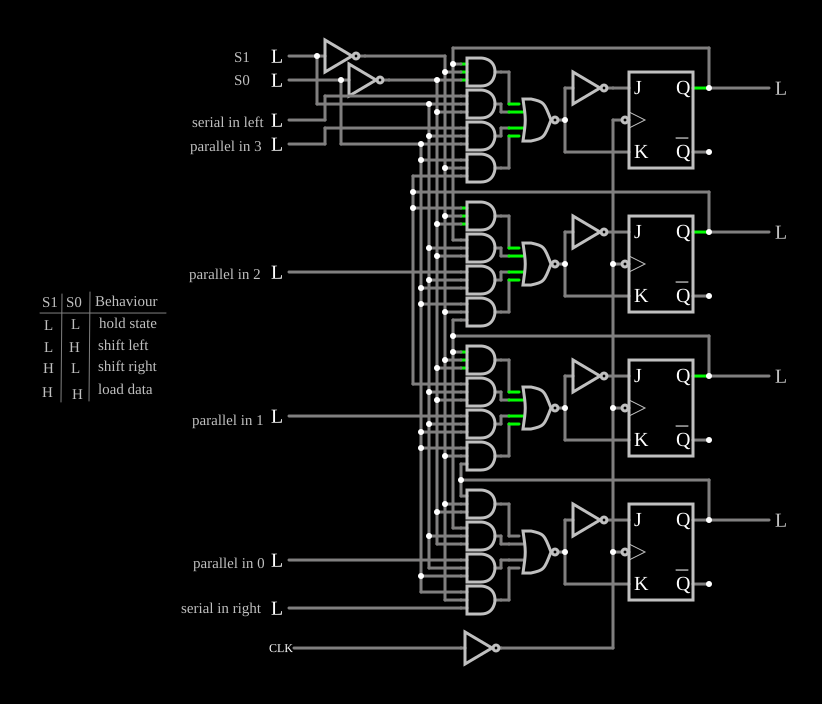

# Registrador de deslocamento universal

<!-- navegacao:inicio -->
[Índice](README.md) · [Anterior: Parallel-In Serial-Out](piso-sr.md)
<!-- navegacao:fim -->

## Objetivo

Mostrar o registrador **universal** de 4 bits, no estilo do 74194: duas entradas de modo escolhem entre guardar, deslocar para um lado, deslocar para o outro ou carregar em paralelo.

## O circuito

<!-- esquema:inicio -->

<!-- esquema:fim -->

Quatro flip-flops JK (cada um com um inversor entre $J$ e $K$, para funcionar como flip-flop D) recebem o relógio, uma onda quadrada de $100\ \text{Hz}$ invertida por um inversor, de modo que mudam na borda de subida do gerador ($10$, $20\ \text{ms}$, …). Antes de cada flip-flop, quatro ANDs de três entradas e uma NOR de quatro formam um multiplexador de 4 para 1. As entradas são $S_1$ (elemento 170) e $S_0$ (elemento 171), a entrada série esquerda (*serial in left*, 172), as entradas paralelas 3 a 0 (elementos 173, 178, 179 e 180) e a entrada série direita (*serial in right*, 181). As saídas, de cima para baixo, são os elementos 185 a 188 (posições 3 a 0). O exemplo abre com $S_1 = S_0 = 0$, todas as entradas em $0$ e as saídas em $1110$. A tabela de modos está impressa ao lado do circuito.

<!-- componentes:inicio -->
| N.º | Tipo | Elemento | Valores |
|----:|------|----------|---------|
| 0 | `AndGateElm` | AND gate | # of Inputs = 3; High Logic Voltage = 5; Schmitt Inputs = não; Invert Inputs = não; Propagation Delay (s) = 0; DeMorgan's Symbol = não |
| 1 | `AndGateElm` | AND gate | # of Inputs = 3; High Logic Voltage = 5; Schmitt Inputs = não; Invert Inputs = não; Propagation Delay (s) = 0; DeMorgan's Symbol = não |
| 2 | `AndGateElm` | AND gate | # of Inputs = 3; High Logic Voltage = 5; Schmitt Inputs = não; Invert Inputs = não; Propagation Delay (s) = 0; DeMorgan's Symbol = não |
| 3 | `AndGateElm` | AND gate | # of Inputs = 3; High Logic Voltage = 5; Schmitt Inputs = não; Invert Inputs = não; Propagation Delay (s) = 0; DeMorgan's Symbol = não |
| 4 | `NorGateElm` | NOR gate | # of Inputs = 4; High Logic Voltage = 5; Schmitt Inputs = não; Invert Inputs = não; Propagation Delay (s) = 0; DeMorgan's Symbol = não |
| 21 | `NorGateElm` | NOR gate | # of Inputs = 4; High Logic Voltage = 5; Schmitt Inputs = não; Invert Inputs = não; Propagation Delay (s) = 0; DeMorgan's Symbol = não |
| 22 | `AndGateElm` | AND gate | # of Inputs = 3; High Logic Voltage = 5; Schmitt Inputs = não; Invert Inputs = não; Propagation Delay (s) = 0; DeMorgan's Symbol = não |
| 23 | `AndGateElm` | AND gate | # of Inputs = 3; High Logic Voltage = 5; Schmitt Inputs = não; Invert Inputs = não; Propagation Delay (s) = 0; DeMorgan's Symbol = não |
| 24 | `AndGateElm` | AND gate | # of Inputs = 3; High Logic Voltage = 5; Schmitt Inputs = não; Invert Inputs = não; Propagation Delay (s) = 0; DeMorgan's Symbol = não |
| 25 | `AndGateElm` | AND gate | # of Inputs = 3; High Logic Voltage = 5; Schmitt Inputs = não; Invert Inputs = não; Propagation Delay (s) = 0; DeMorgan's Symbol = não |
| 34 | `NorGateElm` | NOR gate | # of Inputs = 4; High Logic Voltage = 5; Schmitt Inputs = não; Invert Inputs = não; Propagation Delay (s) = 0; DeMorgan's Symbol = não |
| 35 | `AndGateElm` | AND gate | # of Inputs = 3; High Logic Voltage = 5; Schmitt Inputs = não; Invert Inputs = não; Propagation Delay (s) = 0; DeMorgan's Symbol = não |
| 36 | `AndGateElm` | AND gate | # of Inputs = 3; High Logic Voltage = 5; Schmitt Inputs = não; Invert Inputs = não; Propagation Delay (s) = 0; DeMorgan's Symbol = não |
| 37 | `AndGateElm` | AND gate | # of Inputs = 3; High Logic Voltage = 5; Schmitt Inputs = não; Invert Inputs = não; Propagation Delay (s) = 0; DeMorgan's Symbol = não |
| 38 | `AndGateElm` | AND gate | # of Inputs = 3; High Logic Voltage = 5; Schmitt Inputs = não; Invert Inputs = não; Propagation Delay (s) = 0; DeMorgan's Symbol = não |
| 47 | `NorGateElm` | NOR gate | # of Inputs = 4; High Logic Voltage = 5; Schmitt Inputs = não; Invert Inputs = não; Propagation Delay (s) = 0; DeMorgan's Symbol = não |
| 48 | `AndGateElm` | AND gate | # of Inputs = 3; High Logic Voltage = 5; Schmitt Inputs = não; Invert Inputs = não; Propagation Delay (s) = 0; DeMorgan's Symbol = não |
| 49 | `AndGateElm` | AND gate | # of Inputs = 3; High Logic Voltage = 5; Schmitt Inputs = não; Invert Inputs = não; Propagation Delay (s) = 0; DeMorgan's Symbol = não |
| 50 | `AndGateElm` | AND gate | # of Inputs = 3; High Logic Voltage = 5; Schmitt Inputs = não; Invert Inputs = não; Propagation Delay (s) = 0; DeMorgan's Symbol = não |
| 51 | `AndGateElm` | AND gate | # of Inputs = 3; High Logic Voltage = 5; Schmitt Inputs = não; Invert Inputs = não; Propagation Delay (s) = 0; DeMorgan's Symbol = não |
| 55 | `InverterElm` | inverter | Slew Rate (V/ns) = 500m; High Logic Voltage = 5; DeMorgan's Symbol = não |
| 56 | `InverterElm` | inverter | Slew Rate (V/ns) = 500m; High Logic Voltage = 5; DeMorgan's Symbol = não |
| 57 | `InverterElm` | inverter | Slew Rate (V/ns) = 500m; High Logic Voltage = 5; DeMorgan's Symbol = não |
| 58 | `InverterElm` | inverter | Slew Rate (V/ns) = 500m; High Logic Voltage = 5; DeMorgan's Symbol = não |
| 59 | `JKFlipFlopElm` | JK flip-flop | High Logic Voltage = 5; Reset Pin = não; Positive Edge Triggered = não; Invert Reset = não |
| 60 | `JKFlipFlopElm` | JK flip-flop | High Logic Voltage = 5; Reset Pin = não; Positive Edge Triggered = não; Invert Reset = não |
| 61 | `JKFlipFlopElm` | JK flip-flop | High Logic Voltage = 5; Reset Pin = não; Positive Edge Triggered = não; Invert Reset = não |
| 62 | `JKFlipFlopElm` | JK flip-flop | High Logic Voltage = 5; Reset Pin = não; Positive Edge Triggered = não; Invert Reset = não |
| 158 | `InverterElm` | inverter | Slew Rate (V/ns) = 500m; High Logic Voltage = 5; DeMorgan's Symbol = não |
| 159 | `InverterElm` | inverter | Slew Rate (V/ns) = 500m; High Logic Voltage = 5; DeMorgan's Symbol = não |
| 170 | `LogicInputElm` | logic input | Momentary Switch = não; High Logic Voltage = 5; Low Voltage = 0; Numeric = não; Ternary = não; Keyboard Shortcut =  |
| 171 | `LogicInputElm` | logic input | Momentary Switch = não; High Logic Voltage = 5; Low Voltage = 0; Numeric = não; Ternary = não; Keyboard Shortcut =  |
| 172 | `LogicInputElm` | logic input | Momentary Switch = não; High Logic Voltage = 5; Low Voltage = 0; Numeric = não; Ternary = não; Keyboard Shortcut =  |
| 173 | `LogicInputElm` | logic input | Momentary Switch = não; High Logic Voltage = 5; Low Voltage = 0; Numeric = não; Ternary = não; Keyboard Shortcut =  |
| 178 | `LogicInputElm` | logic input | Momentary Switch = não; High Logic Voltage = 5; Low Voltage = 0; Numeric = não; Ternary = não; Keyboard Shortcut =  |
| 179 | `LogicInputElm` | logic input | Momentary Switch = não; High Logic Voltage = 5; Low Voltage = 0; Numeric = não; Ternary = não; Keyboard Shortcut =  |
| 180 | `LogicInputElm` | logic input | Momentary Switch = não; High Logic Voltage = 5; Low Voltage = 0; Numeric = não; Ternary = não; Keyboard Shortcut =  |
| 181 | `LogicInputElm` | logic input | Momentary Switch = não; High Logic Voltage = 5; Low Voltage = 0; Numeric = não; Ternary = não; Keyboard Shortcut =  |
| 184 | `InverterElm` | inverter | Slew Rate (V/ns) = 500m; High Logic Voltage = 5; DeMorgan's Symbol = não |
| 185 | `LogicOutputElm` | logic output | Threshold = 2.5; Current Required = não; Numeric = não; Ternary = não |
| 186 | `LogicOutputElm` | logic output | Threshold = 2.5; Current Required = não; Numeric = não; Ternary = não |
| 187 | `LogicOutputElm` | logic output | Threshold = 2.5; Current Required = não; Numeric = não; Ternary = não |
| 188 | `LogicOutputElm` | logic output | Threshold = 2.5; Current Required = não; Numeric = não; Ternary = não |
| 189 | `TextElm` | text | Text = S1; Size = 15; Draw Bar On Top = não; Color = #c0c0c0 |
| 190 | `RailElm` | square wave gen | Max Voltage = 2.5; Waveform = Square Wave; DC Offset (V) = 2.5; Internal Resistance (ohms) = 0; Show Voltage = não; Specify As = Frequency/Duty Cycle; Frequency (Hz) = 100; Phase Offset (degrees) = 0; Duty Cycle = 50; Rise/Fall Time (s) = 0 |
| 191 | `TextElm` | text | Text = S0; Size = 15; Draw Bar On Top = não; Color = #c0c0c0 |
| 192 | `TextElm` | text | Text = serial in left; Size = 15; Draw Bar On Top = não; Color = #c0c0c0 |
| 193 | `TextElm` | text | Text = parallel in 3; Size = 15; Draw Bar On Top = não; Color = #c0c0c0 |
| 194 | `TextElm` | text | Text = parallel in 2; Size = 15; Draw Bar On Top = não; Color = #c0c0c0 |
| 195 | `TextElm` | text | Text = parallel in 1; Size = 15; Draw Bar On Top = não; Color = #c0c0c0 |
| 196 | `TextElm` | text | Text = parallel in 0; Size = 15; Draw Bar On Top = não; Color = #c0c0c0 |
| 197 | `TextElm` | text | Text = serial in right; Size = 15; Draw Bar On Top = não; Color = #c0c0c0 |
| 198 | `LineElm` |  |  |
| 199 | `LineElm` |  |  |
| 200 | `LineElm` |  |  |
| 201 | `TextElm` | text | Text = hold state; Size = 15; Draw Bar On Top = não; Color = #c0c0c0 |
| 202 | `TextElm` | text | Text = load data; Size = 15; Draw Bar On Top = não; Color = #c0c0c0 |
| 203 | `TextElm` | text | Text = shift left; Size = 15; Draw Bar On Top = não; Color = #c0c0c0 |
| 204 | `TextElm` | text | Text = shift right; Size = 15; Draw Bar On Top = não; Color = #c0c0c0 |
| 205 | `TextElm` | text | Text = Behaviour; Size = 15; Draw Bar On Top = não; Color = #c0c0c0 |
| 206 | `TextElm` | text | Text = L; Size = 15; Draw Bar On Top = não; Color = #c0c0c0 |
| 207 | `TextElm` | text | Text = L; Size = 15; Draw Bar On Top = não; Color = #c0c0c0 |
| 208 | `TextElm` | text | Text = L; Size = 15; Draw Bar On Top = não; Color = #c0c0c0 |
| 209 | `TextElm` | text | Text = L; Size = 15; Draw Bar On Top = não; Color = #c0c0c0 |
| 210 | `TextElm` | text | Text = H; Size = 15; Draw Bar On Top = não; Color = #c0c0c0 |
| 211 | `TextElm` | text | Text = H; Size = 15; Draw Bar On Top = não; Color = #c0c0c0 |
| 212 | `TextElm` | text | Text = H; Size = 15; Draw Bar On Top = não; Color = #c0c0c0 |
| 213 | `TextElm` | text | Text = H; Size = 15; Draw Bar On Top = não; Color = #c0c0c0 |
| 214 | `TextElm` | text | Text = S0; Size = 15; Draw Bar On Top = não; Color = #c0c0c0 |
| 215 | `TextElm` | text | Text = S1; Size = 15; Draw Bar On Top = não; Color = #c0c0c0 |
<!-- componentes:fim -->

## Teoria

Cada multiplexador escolhe, conforme $S_1 S_0$, o que entra no seu flip-flop na próxima borda:

| $S_1$ | $S_0$ | Modo | Próximo valor da posição $k$ |
|----:|----:|------|------|
| 0 | 0 | guarda | o próprio $Q_k$ |
| 0 | 1 | desloca para a esquerda | o vizinho de baixo; a posição de baixo recebe *serial in right* |
| 1 | 0 | desloca para a direita | o vizinho de cima; a posição de cima recebe *serial in left* |
| 1 | 1 | carga paralela | a entrada paralela $k$ |

Com os mesmos quatro flip-flops, o registrador serve de memória de 4 bits, de conversor série-paralelo nos dois sentidos e, com a saída realimentada na entrada série, de contador em anel. Deslocar para a direita (em direção ao bit menos significativo) divide um número por $2$; para a esquerda, multiplica.

## Resultados esperados

O simulador dá ($185\ 186\ 187\ 188$, de cima para baixo):

- $S_1 S_0 = 00$: $1110$ permanece;
- $S_1 S_0 = 10$: $0111$ em $11\ \text{ms}$ e $0011$ em $21\ \text{ms}$ (entram zeros por cima);
- $S_1 S_0 = 01$: $1100$ em $11\ \text{ms}$ e $1000$ em $21\ \text{ms}$ (entram zeros por baixo);
- $S_1 S_0 = 11$: carrega as entradas paralelas na borda de $10\ \text{ms}$: $0000$ com todas em $0$, e $1001$ com as entradas paralelas 3 e 0 em $1$.

## O que observar

Escolha um modo, mude as entradas série e paralelas e acompanhe as saídas a cada borda do relógio.

## Limites do modelo

- Portas e flip-flops sem atraso.

## Referências

Texas Instruments, folha de dados do SN74194 (*4-Bit Bidirectional Universal Shift Register*); Mano e Ciletti, *Digital Design*, capítulo sobre registradores de deslocamento.

O circuito deste exemplo faz parte da coleção do simulador original de Paul Falstad e Iain Sharp (CircuitJS1); a explicação é deste projeto.
