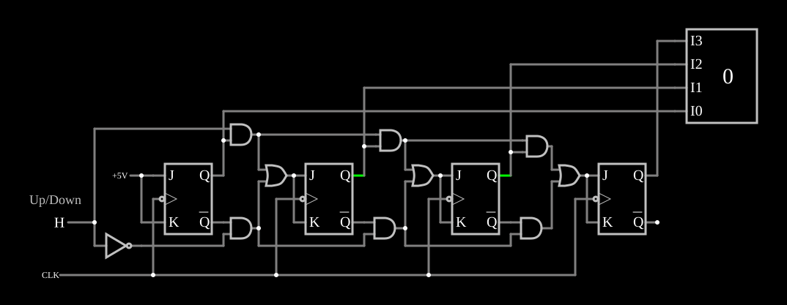

# Contador crescente/decrescente

<!-- navegacao:inicio -->
[Índice](README.md) · [Anterior: Synchronous Counter](synccounter.md) · [Próximo: Decimal Counter](deccounter.md)
<!-- navegacao:fim -->

## Objetivo

Mostrar um contador síncrono que conta **para cima ou para baixo** conforme uma entrada de controle.

## O circuito

<!-- esquema:inicio -->

<!-- esquema:fim -->

Quatro flip-flops JK com o mesmo relógio (onda quadrada de $200\ \text{Hz}$), como no [Synchronous Counter](synccounter.md). A entrada *Up/Down* (elemento 14) e o seu complemento (um inversor) escolhem, por meio de pares de portas AND e uma OR por estágio, se o sinal de inversão de cada bit vem das saídas $Q$ dos bits anteriores (contagem crescente) ou das saídas $\overline{Q}$ (decrescente). Um mostrador decimal (elemento 63) exibe a contagem. O exemplo abre com *Up/Down* $= 1$ e a contagem em $6$.

<!-- componentes:inicio -->
| N.º | Tipo | Elemento | Valores |
|----:|------|----------|---------|
| 0 | `JKFlipFlopElm` | JK flip-flop | High Logic Voltage = 5; Reset Pin = não; Positive Edge Triggered = não; Invert Reset = não |
| 4 | `RailElm` | voltage source | Voltage = 5; Waveform = D/C; DC Offset (V) = 0; Internal Resistance (ohms) = 0 |
| 5 | `RailElm` | square wave gen | Max Voltage = 2.5; Waveform = Square Wave; DC Offset (V) = 2.5; Internal Resistance (ohms) = 0; Show Voltage = não; Specify As = Frequency/Duty Cycle; Frequency (Hz) = 200; Phase Offset (degrees) = 0; Duty Cycle = 50; Rise/Fall Time (s) = 0 |
| 8 | `AndGateElm` | AND gate | # of Inputs = 2; High Logic Voltage = 5; Schmitt Inputs = não; Invert Inputs = não; Propagation Delay (s) = 0; DeMorgan's Symbol = não |
| 9 | `OrGateElm` | OR gate | # of Inputs = 2; High Logic Voltage = 5; Schmitt Inputs = não; Invert Inputs = não; Propagation Delay (s) = 0; DeMorgan's Symbol = não |
| 10 | `JKFlipFlopElm` | JK flip-flop | High Logic Voltage = 5; Reset Pin = não; Positive Edge Triggered = não; Invert Reset = não |
| 12 | `AndGateElm` | AND gate | # of Inputs = 2; High Logic Voltage = 5; Schmitt Inputs = não; Invert Inputs = não; Propagation Delay (s) = 0; DeMorgan's Symbol = não |
| 14 | `LogicInputElm` | logic input | Momentary Switch = não; High Logic Voltage = 5; Low Voltage = 0; Numeric = não; Ternary = não; Keyboard Shortcut =  |
| 18 | `InverterElm` | inverter | Slew Rate (V/ns) = 500m; High Logic Voltage = 5; DeMorgan's Symbol = não |
| 27 | `AndGateElm` | AND gate | # of Inputs = 2; High Logic Voltage = 5; Schmitt Inputs = não; Invert Inputs = não; Propagation Delay (s) = 0; DeMorgan's Symbol = não |
| 32 | `JKFlipFlopElm` | JK flip-flop | High Logic Voltage = 5; Reset Pin = não; Positive Edge Triggered = não; Invert Reset = não |
| 33 | `OrGateElm` | OR gate | # of Inputs = 2; High Logic Voltage = 5; Schmitt Inputs = não; Invert Inputs = não; Propagation Delay (s) = 0; DeMorgan's Symbol = não |
| 34 | `AndGateElm` | AND gate | # of Inputs = 2; High Logic Voltage = 5; Schmitt Inputs = não; Invert Inputs = não; Propagation Delay (s) = 0; DeMorgan's Symbol = não |
| 53 | `AndGateElm` | AND gate | # of Inputs = 2; High Logic Voltage = 5; Schmitt Inputs = não; Invert Inputs = não; Propagation Delay (s) = 0; DeMorgan's Symbol = não |
| 54 | `OrGateElm` | OR gate | # of Inputs = 2; High Logic Voltage = 5; Schmitt Inputs = não; Invert Inputs = não; Propagation Delay (s) = 0; DeMorgan's Symbol = não |
| 55 | `JKFlipFlopElm` | JK flip-flop | High Logic Voltage = 5; Reset Pin = não; Positive Edge Triggered = não; Invert Reset = não |
| 59 | `AndGateElm` | AND gate | # of Inputs = 2; High Logic Voltage = 5; Schmitt Inputs = não; Invert Inputs = não; Propagation Delay (s) = 0; DeMorgan's Symbol = não |
| 62 | `TextElm` | text | Text = Up/Down; Size = 18; Draw Bar On Top = não; Color = #c0c0c0 |
| 63 | `DecimalDisplayElm` | decimal display | High Logic Voltage = 5; Bit Order = MSB First; # of Bits = 4; Display Mode = Decimal |
<!-- componentes:fim -->

## Teoria

Contando para cima, o bit $k$ inverte quando todos os bits abaixo dele valem $1$; contando para baixo, quando todos valem $0$. Com $U$ a entrada de direção:

$$T_k = U \prod_{j<k} Q_j + \overline{U} \prod_{j<k} \overline{Q_j}.$$

As ANDs e ORs entre os estágios calculam exatamente essa expressão, encadeada de um bit para o seguinte.

## Resultados esperados

Com *Up/Down* em $1$, o simulador conta $6, 7, 8, \dots$, uma unidade a cada borda de descida ($5\ \text{ms}$), e mostra $12$ em $31{,}5\ \text{ms}$. Com *Up/Down* em $0$ desde o início, conta $6, 5, 4, \dots$: mostra $0$ em $31{,}5\ \text{ms}$ e $15$ em $36{,}5\ \text{ms}$, depois de passar por baixo do zero.

## O que observar

Mude *Up/Down* durante a contagem e veja a direção inverter na borda seguinte, sem perder o valor.

## Limites do modelo

- Mudar a direção perto de uma borda de relógio pode, num circuito real, produzir uma contagem errada; aqui as portas não têm atraso.

## Referências

Mano e Ciletti, *Digital Design*, capítulo sobre contadores; Texas Instruments, folha de dados do SN74191.

O circuito deste exemplo faz parte da coleção do simulador original de Paul Falstad e Iain Sharp (CircuitJS1); a explicação é deste projeto.
