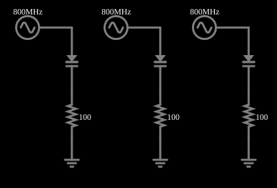

# Varactor: capacitância controlada por tensão

<!-- navegacao:inicio -->
[Índice](README.md) · [Próximo: VCO](varactorvco.md)
<!-- navegacao:fim -->

## Objetivo

Mostrar o **varactor**, um diodo cuja capacitância de junção diminui com a tensão reversa: a mesma rede RC passa mais ou menos sinal conforme a polarização.

## O circuito

<!-- esquema:inicio -->

<!-- esquema:fim -->

Três circuitos iguais, cada um com uma fonte senoidal de $1\ \text{V}$ de pico e $800\ \text{MHz}$ com uma componente contínua diferente ($-1{,}5\ \text{V}$, $-5\ \text{V}$ e $-10\ \text{V}$), um varactor com $C_0 = 4\ \text{pF}$ em série com um resistor de $100\ \Omega$ para a terra. O sinal que se observa é a tensão no resistor.

<!-- componentes:inicio -->
| N.º | Tipo | Elemento | Valores |
|----:|------|----------|---------|
| 0 | `RailElm` | A/C source | Max Voltage = 1; Waveform = A/C; DC Offset (V) = -1.5; Internal Resistance (ohms) = 0; Show Voltage = não; Frequency (Hz) = 800M; Phase Offset (degrees) = 0 |
| 1 | `VaractorElm` | varactor | Model = default; Capacitance @ 0V (F) = 4p |
| 2 | `ResistorElm` | resistor | Resistance (ohms) = 100 |
| 3 | `GroundElm` | ground | Symbol = Earth |
| 4 | `GroundElm` | ground | Symbol = Earth |
| 5 | `ResistorElm` | resistor | Resistance (ohms) = 100 |
| 6 | `VaractorElm` | varactor | Model = default; Capacitance @ 0V (F) = 4p |
| 7 | `RailElm` | A/C source | Max Voltage = 1; Waveform = A/C; DC Offset (V) = -5; Internal Resistance (ohms) = 0; Show Voltage = não; Frequency (Hz) = 800M; Phase Offset (degrees) = 0 |
| 8 | `RailElm` | A/C source | Max Voltage = 1; Waveform = A/C; DC Offset (V) = -10; Internal Resistance (ohms) = 0; Show Voltage = não; Frequency (Hz) = 800M; Phase Offset (degrees) = 0 |
| 9 | `VaractorElm` | varactor | Model = default; Capacitance @ 0V (F) = 4p |
| 10 | `ResistorElm` | resistor | Resistance (ohms) = 100 |
| 11 | `GroundElm` | ground | Symbol = Earth |
<!-- componentes:fim -->

## Teoria

A capacitância de junção reversa do modelo é

$$C(V) = \frac{C_0}{\sqrt{1 - V/\phi}},\qquad \phi = 0{,}806\ \text{V},$$

com $V < 0$ em polarização reversa. O circuito é um divisor capacitivo–resistivo (passa-altas); a razão das amplitudes sobre o resistor é

$$\frac{|V_R|}{|V_s|} = \frac{\omega RC}{\sqrt{1 + (\omega RC)^2}},\qquad \omega = 2\pi\cdot 800\ \text{MHz}.$$

| Polarização | $C$ | $\omega RC$ | Razão (teoria) |
|---:|---:|---:|---:|
| $-1{,}5\ \text{V}$ | $2{,}36\ \text{pF}$ | $1{,}19$ | $0{,}765$ |
| $-5\ \text{V}$ | $1{,}49\ \text{pF}$ | $0{,}75$ | $0{,}600$ |
| $-10\ \text{V}$ | $1{,}09\ \text{pF}$ | $0{,}55$ | $0{,}481$ |

## Resultados esperados

O simulador dá a amplitude no resistor de $100\ \Omega$ (para uma entrada de $1\ \text{V}$):

- **$-1{,}5\ \text{V}$:** $0{,}747\ \text{V}$ (teoria: $0{,}765$).
- **$-5\ \text{V}$:** $0{,}590\ \text{V}$ (teoria: $0{,}600$).
- **$-10\ \text{V}$:** $0{,}477\ \text{V}$ (teoria: $0{,}481$).

As tensões médias nos varactores são as de polarização ($-1{,}50$, $-5{,}00$ e $-10{,}00\ \text{V}$) e a frequência na saída é a da fonte, $800\ \text{MHz}$. A diferença para a teoria, de até $2\ \%$, vem de a capacitância variar durante o ciclo ($\pm 1\ \text{V}$ em torno da polarização), efeito que a conta de capacitância fixa não inclui.

## O que observar

Compare as três amplitudes: quanto maior a tensão reversa, menor a capacitância, menor o sinal que passa. Esse controle de capacitância por tensão é a base dos osciladores controlados por tensão (próximo exemplo) e dos sintonizadores de rádio.

## Limites do modelo

- O modelo de capacitância é $C_0/\sqrt{1 - V/\phi}$ (junção abrupta); varactores reais têm expoentes que vão de $0{,}33$ a mais de $1$ (junção hiperabrupta).
- Não há resistência série nem indutância de terminais, que importam a $800\ \text{MHz}$ num varactor real.

## Referências

Sze e Ng, *Physics of Semiconductor Devices*, capítulo sobre capacitores de junção e varactores; Horowitz e Hill, *The Art of Electronics*, seção sobre osciladores controlados por tensão.

O circuito deste exemplo faz parte da coleção do simulador original de Paul Falstad e Iain Sharp (CircuitJS1); a explicação é deste projeto.
