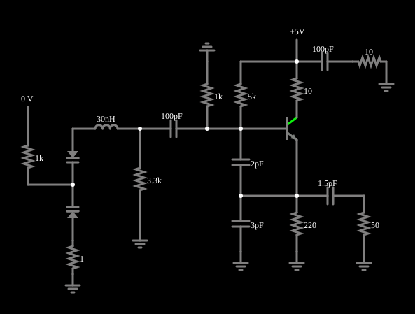

# Oscilador controlado por tensão com varactor

<!-- navegacao:inicio -->
[Índice](README.md) · [Anterior: Varactor](varactor.md)
<!-- navegacao:fim -->

## Objetivo

Mostrar um **oscilador controlado por tensão** (VCO): a frequência de um oscilador LC de $1$ a $2\ \text{GHz}$ varia com uma tensão de controle que polariza dois varactores.

## O circuito

<!-- esquema:inicio -->

<!-- esquema:fim -->

Um transistor NPN com um indutor de $30\ \text{nH}$ e capacitores de poucos picofarads forma um oscilador LC. Dois varactores ($C_0 = 4\ \text{pF}$), polarizados por uma tensão de controle ajustável de $0$ a $20\ \text{V}$ (*Control Voltage*, inicialmente em $0\ \text{V}$) por resistores, compõem a capacitância de sintonia: quanto maior a tensão reversa, menor a capacitância e maior a frequência.

<!-- componentes:inicio -->
| N.º | Tipo | Elemento | Valores |
|----:|------|----------|---------|
| 0 | `VarRailElm` | voltage source | Min Voltage = 0; Max Voltage = 20; Slider Text = Control Voltage |
| 1 | `ResistorElm` | resistor | Resistance (ohms) = 1k |
| 3 | `GroundElm` | ground | Symbol = Earth |
| 4 | `ResistorElm` | resistor | Resistance (ohms) = 1 |
| 5 | `InductorElm` | inductor | Inductance (H) = 30n; Trapezoidal Approximation = sim; Initial Current (on Reset) (A) = 0; Saturation Current (A) (0=none) = 0 |
| 6 | `CapacitorElm` | capacitor | Capacitance (F) = 100p; Trapezoidal Approximation = sim; Initial Voltage (on Reset) = 1m; Series Resistance = 0 |
| 7 | `ResistorElm` | resistor | Resistance (ohms) = 3.3k |
| 8 | `GroundElm` | ground | Symbol = Earth |
| 9 | `ResistorElm` | resistor | Resistance (ohms) = 1k |
| 10 | `GroundElm` | ground | Symbol = Earth |
| 11 | `ResistorElm` | resistor | Resistance (ohms) = 5k |
| 13 | `CapacitorElm` | capacitor | Capacitance (F) = 2p; Trapezoidal Approximation = sim; Initial Voltage (on Reset) = 1m; Series Resistance = 0 |
| 14 | `CapacitorElm` | capacitor | Capacitance (F) = 3p; Trapezoidal Approximation = sim; Initial Voltage (on Reset) = 1m; Series Resistance = 0 |
| 15 | `GroundElm` | ground | Symbol = Earth |
| 17 | `ResistorElm` | resistor | Resistance (ohms) = 220 |
| 18 | `GroundElm` | ground | Symbol = Earth |
| 19 | `CapacitorElm` | capacitor | Capacitance (F) = 1.5p; Trapezoidal Approximation = sim; Initial Voltage (on Reset) = 1m; Series Resistance = 0 |
| 20 | `ResistorElm` | resistor | Resistance (ohms) = 50 |
| 21 | `GroundElm` | ground | Symbol = Earth |
| 22 | `NTransistorElm` | transistor | Beta/hFE = 100; Swap E/C = não; Draw Circle = não; Model = default |
| 24 | `ResistorElm` | resistor | Resistance (ohms) = 10 |
| 26 | `CapacitorElm` | capacitor | Capacitance (F) = 100p; Trapezoidal Approximation = sim; Initial Voltage (on Reset) = 1m; Series Resistance = 0 |
| 27 | `ResistorElm` | resistor | Resistance (ohms) = 10 |
| 28 | `GroundElm` | ground | Symbol = Earth |
| 29 | `RailElm` | voltage source | Voltage = 5; Waveform = D/C; DC Offset (V) = 0; Internal Resistance (ohms) = 0 |
| 30 | `VaractorElm` | varactor | Model = default; Capacitance @ 0V (F) = 4p |
| 31 | `VaractorElm` | varactor | Model = default; Capacitance @ 0V (F) = 4p |
<!-- componentes:fim -->

## Teoria

A frequência de um oscilador LC é $f = 1/(2\pi\sqrt{LC_{tot}})$, e $C_{tot}$ inclui a capacitância dos varactores, que diminui com a tensão reversa $V$ como $C(V) = C_0/\sqrt{1 + V/\phi}$ ($\phi = 0{,}806\ \text{V}$). Logo, $f$ **cresce** com $V$; como $f\propto C_{tot}^{-1/2}$ e a faixa de capacitância é limitada pelas capacitâncias fixas do circuito, a faixa de frequências é de poucas dezenas de por cento.

## Resultados esperados

Variando a tensão de controle no simulador, medi a frequência da oscilação (na tensão do capacitor de $100\ \text{pF}$, o elemento 6):

| Controle | Frequência |
|---:|---:|
| $0\ \text{V}$ (exemplo) | $1{,}098\ \text{GHz}$ |
| $2\ \text{V}$ | $1{,}257\ \text{GHz}$ |
| $5\ \text{V}$ | $1{,}403\ \text{GHz}$ |
| $10\ \text{V}$ | $1{,}560\ \text{GHz}$ |
| $20\ \text{V}$ | $1{,}778\ \text{GHz}$ |

A frequência sobe de forma monotônica e cada vez mais devagar: $62\ \%$ de variação total ao longo de $20\ \text{V}$. A oscilação tem amplitude de poucos décimos de volt no capacitor.

## O que observar

Mova o cursor de controle e veja o osciloscópio comprimir as ondas: é a frequência subindo. Esse é o princípio dos sintetizadores de frequência de rádio e das malhas de captura de fase (veja a categoria *Phase-Locked Loops*).

## Limites do modelo

- A tabela vem de simulações com o cursor em cada posição; o documento verifica só o estado inicial ($0\ \text{V}$).
- O modelo do transistor é o padrão; a frequência real de um VCO de $1\ \text{GHz}$ depende de parasitas do encapsulamento e do circuito impresso.
- Não há cálculo da frequência a partir de uma capacitância equivalente; a curva é medida, não derivada.

## Referências

Sze e Ng, *Physics of Semiconductor Devices*, capítulo sobre capacitores de junção e varactores; Horowitz e Hill, *The Art of Electronics*, seção sobre osciladores controlados por tensão.

O circuito deste exemplo faz parte da coleção do simulador original de Paul Falstad e Iain Sharp (CircuitJS1); a explicação é deste projeto.
