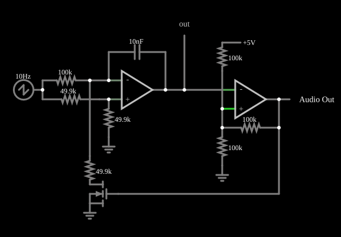

# Oscilador controlado por tensão (VCO)

<!-- navegacao:inicio -->
[Índice](README.md) · [Anterior: Sawtooth Wave Generator](sawtooth.md) · [Próximo: Triangle VCO](trianglevco.md)
<!-- navegacao:fim -->

## Objetivo

Mostrar um oscilador cuja frequência é proporcional a uma tensão de controle: um integrador gera uma onda triangular e um comparador com histerese inverte o sentido da rampa por meio de um transistor MOSFET, de forma que a inclinação da rampa e, portanto, a frequência, seguem a tensão de controle.

## O circuito

<!-- esquema:inicio -->

<!-- esquema:fim -->

A tensão de controle $V_c$ é uma fonte de dente de serra de $10\ \text{Hz}$ que varre de $1$ a $5\ \text{V}$ (a saída em $t = 15\ \text{ms}$ vale $1{,}6\ \text{V}$, em $55\ \text{ms}$, $3{,}2\ \text{V}$, e em $85\ \text{ms}$, $4{,}4\ \text{V}$). Um primeiro operacional, com capacitor de $10\ \text{nF}$ na realimentação, é um integrador: sua entrada não inversora recebe $V_c/2$ (divisor de dois resistores de $49{,}9\ \text{k}\Omega$) e sua entrada inversora recebe $V_c$ por um resistor de $100\ \text{k}\Omega$. Um segundo operacional é um comparador com histerese (saída de $0$ a $5\ \text{V}$) que lê a saída do integrador; a saída do comparador liga a porta de um MOSFET que, quando conduz, liga a entrada inversora do integrador à terra por um resistor de $49{,}9\ \text{k}\Omega$. Três osciloscópios e um elemento de saída de áudio mostram o circuito.

<!-- componentes:inicio -->
| N.º | Tipo | Elemento | Valores |
|----:|------|----------|---------|
| 0 | `OpAmpElm` | op-amp | Max Output (V) = 5; Min Output (V) = 0; Gain = 100k |
| 1 | `OpAmpElm` | op-amp | Max Output (V) = 5; Min Output (V) = 0; Gain = 100k |
| 6 | `ResistorElm` | resistor | Resistance (ohms) = 100k |
| 7 | `ResistorElm` | resistor | Resistance (ohms) = 100k |
| 8 | `GroundElm` | ground | Symbol = Earth |
| 9 | `ResistorElm` | resistor | Resistance (ohms) = 49.9k |
| 10 | `GroundElm` | ground | Symbol = Earth |
| 13 | `ResistorElm` | resistor | Resistance (ohms) = 100k |
| 16 | `ResistorElm` | resistor | Resistance (ohms) = 49.9k |
| 19 | `ResistorElm` | resistor | Resistance (ohms) = 49.9k |
| 20 | `GroundElm` | ground | Symbol = Earth |
| 21 | `NMosfetElm` | MOSFET | Model = default-nodiode; Swap D/S = não |
| 24 | `CapacitorElm` | capacitor | Capacitance (F) = 10n; Trapezoidal Approximation = sim; Initial Voltage (on Reset) = 1m; Series Resistance = 0 |
| 27 | `ResistorElm` | resistor | Resistance (ohms) = 100k |
| 28 | `RailElm` | voltage source | Voltage = 5; Waveform = D/C; DC Offset (V) = 0; Internal Resistance (ohms) = 0 |
| 29 | `RailElm` | sawtooth gen | Max Voltage = 2; Waveform = Sawtooth; DC Offset (V) = 3; Internal Resistance (ohms) = 0; Show Voltage = não; Frequency (Hz) = 10; Phase Offset (degrees) = 0 |
| 30 | `OutputElm` | output | Show Voltage = não |
| 31 | `AudioOutputElm` | audio output | Duration (s) = 1; Sampling Rate = 8000 |
<!-- componentes:fim -->

## Teoria

Pelo curto-circuito virtual, a entrada inversora do integrador fica em $V_c/2$. Com o MOSFET cortado, a corrente que chega ao capacitor é

$$i = \frac{V_c - V_c/2}{100\ \text{k}\Omega} = \frac{V_c}{200\ \text{k}\Omega}.$$

Com o MOSFET conduzindo, o resistor de $49{,}9\ \text{k}\Omega$ à terra drena $V_c/2$ dividido por $49{,}9\ \text{k}\Omega \approx V_c/100\ \text{k}\Omega$ e a corrente líquida no capacitor muda de sentido e tem o mesmo módulo: $i \approx -V_c/200\ \text{k}\Omega$. A rampa do integrador, de módulo

$$\left|\frac{dv}{dt}\right| = \frac{V_c}{200\ \text{k}\Omega\cdot C} = 500\ \frac{\text{V}}{\text{s}}\ \text{por volt de } V_c,$$

tem sentido que depende do estado do MOSFET. O comparador, com os resistores de $100\ \text{k}\Omega$ (realimentação, terra e alimentação de $5\ \text{V}$), tem limiares $(5 + 0)/3 = 1{,}667\ \text{V}$ e $(5 + 5)/3 = 3{,}333\ \text{V}$, de modo que a saída do integrador oscila entre eles ($\Delta V = 1{,}667\ \text{V}$). O período é $2\,\Delta V$ dividido pela inclinação:

$$f = \frac{500\,V_c}{2\,\Delta V} = 150\ \frac{\text{Hz}}{\text{V}}\;V_c.$$

## Resultados esperados

A frequência é proporcional a $V_c$, com constante de cerca de $150\ \text{Hz/V}$ (o simulador dá cerca de $145\ \text{Hz/V}$, porque a saída do integrador ultrapassa um pouco os limiares, $1{,}631$ a $3{,}370\ \text{V}$):

| Janela | $V_c$ médio | Frequência medida |
|--------|------------:|------------------:|
| $10$ a $20\ \text{ms}$ | $\approx 1{,}6\ \text{V}$ | $232{,}4\ \text{Hz}$ |
| $50$ a $60\ \text{ms}$ | $\approx 3{,}2\ \text{V}$ | $468{,}7\ \text{Hz}$ |
| $80$ a $90\ \text{ms}$ | $\approx 4{,}4\ \text{V}$ | $634{,}6\ \text{Hz}$ |

As verificações conferem essas três frequências (tolerância de 3%) e os extremos da saída do integrador.

## O que observar

- O tom do som cresce enquanto a rampa de controle sobe, e volta ao grave quando ela recomeça.
- A saída do integrador é uma onda triangular cuja amplitude fica fixa, entre $1{,}7$ e $3{,}4\ \text{V}$; só a inclinação muda.
- Observe o osciloscópio do comparador: o ciclo de trabalho fica em $50\%$, porque as duas rampas têm o mesmo módulo.

## Limites do modelo

O MOSFET e os operacionais são ideais (comutação instantânea). Em frequências altas o atraso do comparador faz a saída do integrador ultrapassar os limiares, e a linearidade $f \propto V_c$ piora. Um VCO real também tem deriva térmica e uma faixa limitada pelo *slew rate*.

## Referências

- A. S. Sedra e K. C. Smith, *Microeletrônica*, Pearson.
- P. Horowitz e W. Hill, *The Art of Electronics*, Cambridge University Press.
- S. Franco, *Design with Operational Amplifiers and Analog Integrated Circuits*, McGraw-Hill.

O circuito deste exemplo faz parte da coleção do simulador original de Paul Falstad e Iain Sharp (CircuitJS1); a explicação é deste projeto.
