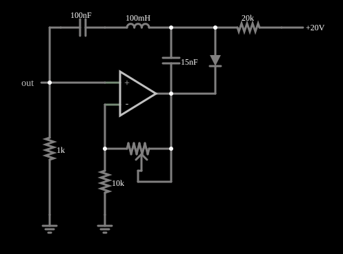

# Oscilador caótico de Vilnius

<!-- navegacao:inicio -->
[Índice](README.md) · [Anterior: Rossler](rossler.md) · [Próximo: Chua](chua.md)
<!-- navegacao:fim -->

## Objetivo

Mostrar um oscilador caótico construído com um único amplificador operacional, um circuito ressonante RLC e um diodo, no qual a variação de uma resistência (um potenciômetro) leva o circuito de um ciclo simples ao caos.

## O circuito

<!-- esquema:inicio -->

<!-- esquema:fim -->

O circuito tem um amplificador operacional, resistores de $1\ \text{k}\Omega$ e de $10\ \text{k}\Omega$, um potenciômetro de $10\ \text{k}\Omega$ chamado "Resistance" (em $66{,}8\%$ ao abrir), um ramo ressonante formado por um capacitor de $100\ \text{nF}$, um indutor de $100\ \text{mH}$ e um capacitor de $15\ \text{nF}$, e um diodo com um resistor de $20\ \text{k}\Omega$ ligado a uma fonte de $20\ \text{V}$. Dois osciloscópios XY mostram as tensões nos capacitores.

<!-- componentes:inicio -->
| N.º | Tipo | Elemento | Valores |
|----:|------|----------|---------|
| 0 | `OpAmpElm` | op-amp | Max Output (V) = 15; Min Output (V) = -15; Gain = 100k |
| 1 | `ResistorElm` | resistor | Resistance (ohms) = 10k |
| 5 | `ResistorElm` | resistor | Resistance (ohms) = 1k |
| 6 | `GroundElm` | ground | Symbol = Earth |
| 7 | `GroundElm` | ground | Symbol = Earth |
| 8 | `CapacitorElm` | capacitor | Capacitance (F) = 100n; Trapezoidal Approximation = sim; Initial Voltage (on Reset) = 1m; Series Resistance = 0 |
| 11 | `InductorElm` | inductor | Inductance (H) = 100m; Trapezoidal Approximation = sim; Initial Current (on Reset) (A) = 0; Saturation Current (A) (0=none) = 0 |
| 12 | `CapacitorElm` | capacitor | Capacitance (F) = 15n; Trapezoidal Approximation = sim; Initial Voltage (on Reset) = 1m; Series Resistance = 0 |
| 13 | `DiodeElm` | diode | Model = default |
| 16 | `ResistorElm` | resistor | Resistance (ohms) = 20k |
| 17 | `RailElm` | voltage source | Voltage = 20; Waveform = D/C; DC Offset (V) = 0; Internal Resistance (ohms) = 0 |
| 18 | `OutputElm` | output | Show Voltage = não |
| 19 | `PotElm` | potentiometer | Resistance (ohms) = 10k; Slider Text = Resistance; Show Values = não; Group Number (for linking) = 0 |
<!-- componentes:fim -->

## Teoria

Osciladores caóticos com um amplificador operacional costumam ser uma realimentação ativa em torno de um ressonador de segunda ordem. Ao se aumentar o parâmetro de controle (aqui, a resistência ajustável), o circuito passa em geral de um equilíbrio estável a um ciclo limite (bifurcação de Hopf), a ciclos de período duplo e, em seguida, ao caos (**cascata de dobramento de período**). O diodo, que só conduz acima de um limiar, é o elemento não linear.

A frequência natural do ressonador é da ordem de $1/(2\pi\sqrt{LC})$; com $L = 100\ \text{mH}$ e $C = 15\ \text{nF}$ resulta cerca de $4{,}1\ \text{kHz}$, de modo que as variações do sinal acontecem em milissegundos.

## Resultados esperados

A fonte da não linearidade (o diodo) e o parâmetro de controle (o potenciômetro "Resistance") estão visíveis no circuito, e o potenciômetro começa em $66{,}8\%$ da escala ($6{,}68\ \text{k}\Omega$). O comportamento esperado do exemplo, nessa posição, é o regime irregular descrito acima, mas o valor da resistência em que cada regime começa deve ser procurado no simulador.

Este documento não traz verificações numéricas (`sem-verificacao`): em regime caótico nenhum valor é reprodutível.

## O que observar

- Varie o *slider* "Resistance" lentamente e observe como o retrato de fase muda. Em circuitos desse tipo, é comum ir de uma curva fechada simples a curvas com duas e quatro voltas (dobramento de período) e, depois, a uma região preenchida (caos); a faixa de cada regime tem de ser encontrada no simulador.
- O diodo liga e desliga conforme a tensão no capacitor, o que dá o aspecto "dobrado" do retrato de fase.
- Procure janelas periódicas dentro da região caótica: elas aparecem quando o parâmetro muda um pouco.

## Limites do modelo

O comportamento caótico é extremamente sensível às condições iniciais, ao passo de tempo e à precisão numérica: uma trajetória simulada **não** é reprodutível ponto a ponto, nem em outro simulador nem em outra versão deste, e só as propriedades estatísticas e geométricas do atrator (a forma do retrato de fase, as faixas de tensão) têm significado. Os retratos de fase descritos neste documento são os esperados pela teoria destes sistemas e pela estrutura do circuito; não foram comparados, aqui, com uma captura do simulador. Os componentes (operacionais, diodos) são ideais, sem ruído, que num circuito real é parte do que alimenta o caos. A frequência de ressonância dada acima é a do ressonador isolado; o circuito completo, com o diodo e o ganho, oscila em frequências diferentes.

## Referências

- S. H. Strogatz, *Nonlinear Dynamics and Chaos*, Westview Press.
- J. C. Sprott, *Elegant Chaos: Algebraically Simple Chaotic Flows*, World Scientific.
- A. Tamaševičius et al., trabalhos sobre osciladores caóticos simples com amplificador operacional, Vilnius.

O circuito deste exemplo faz parte da coleção do simulador original de Paul Falstad e Iain Sharp (CircuitJS1); a explicação é deste projeto.
