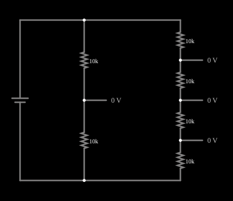

# Divisor de tensão

<!-- navegacao:inicio -->
[Índice](README.md) · [Anterior: LRC Circuit](lrc.md) · [Próximo: Potentiometer](pot.md)
<!-- navegacao:fim -->

## Objetivo

Mostrar que dois (ou mais) resistores em série dividem a tensão da fonte em partes proporcionais às resistências.

## O circuito

<!-- esquema:inicio -->

<!-- esquema:fim -->

Uma fonte de 10 V alimenta dois divisores em paralelo: um com dois resistores iguais de $10\ \text{k}\Omega$ e outro com quatro resistores iguais de $10\ \text{k}\Omega$. Marcadores de saída ("output") mostram a tensão de cada nó intermediário.

<!-- componentes:inicio -->
| N.º | Tipo | Elemento | Valores |
|----:|------|----------|---------|
| 0 | `VoltageElm` | voltage source | Voltage = 10; Waveform = D/C; DC Offset (V) = 0; Internal Resistance (ohms) = 0; Show Voltage = não; Circle Symbol = não |
| 2 | `ResistorElm` | resistor | Resistance (ohms) = 10k |
| 3 | `ResistorElm` | resistor | Resistance (ohms) = 10k |
| 5 | `OutputElm` | output | Show Voltage = sim; Scale = Auto |
| 8 | `ResistorElm` | resistor | Resistance (ohms) = 10k |
| 9 | `ResistorElm` | resistor | Resistance (ohms) = 10k |
| 10 | `ResistorElm` | resistor | Resistance (ohms) = 10k |
| 11 | `ResistorElm` | resistor | Resistance (ohms) = 10k |
| 12 | `OutputElm` | output | Show Voltage = sim; Scale = Auto |
| 13 | `OutputElm` | output | Show Voltage = sim; Scale = Auto |
| 14 | `OutputElm` | output | Show Voltage = sim; Scale = Auto |
<!-- componentes:fim -->

## Teoria

Resistores em série conduzem a mesma corrente $I = V/(R_1+R_2+\cdots)$, e a tensão sobre o resistor $k$ é

$$V_k = I\,R_k = V\,\frac{R_k}{R_1+R_2+\cdots+R_n}.$$

Para um divisor de dois resistores, a saída tomada sobre $R_2$ é $V_{out} = V\,\dfrac{R_2}{R_1+R_2}$. Isto vale com a saída em vazio; uma carga em paralelo com $R_2$ diminui $V_{out}$ (veja o divisor com potenciômetro).

## Resultados esperados

Divisor de dois resistores iguais: $V_{out} = 10\cdot\tfrac12 = 5\ \text{V}$. Divisor de quatro resistores iguais: $7{,}5\ \text{V}$, $5\ \text{V}$ e $2{,}5\ \text{V}$ nos três nós intermediários. A corrente do primeiro é $10/20\ \text{k}\Omega = 0{,}5\ \text{mA}$ e a do segundo $10/40\ \text{k}\Omega = 0{,}25\ \text{mA}$; a fonte fornece $0{,}75\ \text{mA}$. As verificações conferem três saídas e a corrente da fonte.

## O que observar

- Passe o ponteiro sobre os nós para ler as tensões.
- Observe que, com resistores iguais, a tensão cai de forma linear ao longo da cadeia.
- Altere um resistor e veja a tensão dos nós mudar na proporção da resistência.

## Limites do modelo

Fonte ideal, resistores ideais e saídas em vazio (os marcadores de saída não drenam corrente).

## Referências

- J. W. Nilsson e S. A. Riedel, *Circuitos Elétricos*, Pearson.
- C. K. Alexander e M. N. O. Sadiku, *Fundamentos de Circuitos Elétricos*, AMGH.

O circuito deste exemplo faz parte da coleção do simulador original de Paul Falstad e Iain Sharp (CircuitJS1); a explicação é deste projeto.
